<!-- WORKSPACE-STATUS-START -->
## 当前入口与目录约定

2026-11-24 更新。当前源码版本 v0.13.1：两台设备的额度合并展示，看起来像一台机器；全部额度互相同步并去重，Windows 修复同步上传为空的问题。

- 目录导览：[STRUCTURE.md](STRUCTURE.md)；AI 接手先读 [AGENTS.md](AGENTS.md)，共享知识入口在 [docs/agent-knowledge/README.md](docs/agent-knowledge/README.md)。
- Git：`main` 推送到 `github.com/Gary23333/agent-meter`；版本记录见 [CHANGELOG.md](CHANGELOG.md)。

```sh
python3 scripts/test-offline.py      # 全量离线回归
python3 -m agent_meter verify        # 本机账本独立重算对账
```
<!-- WORKSPACE-STATUS-END -->

<p align="center">
  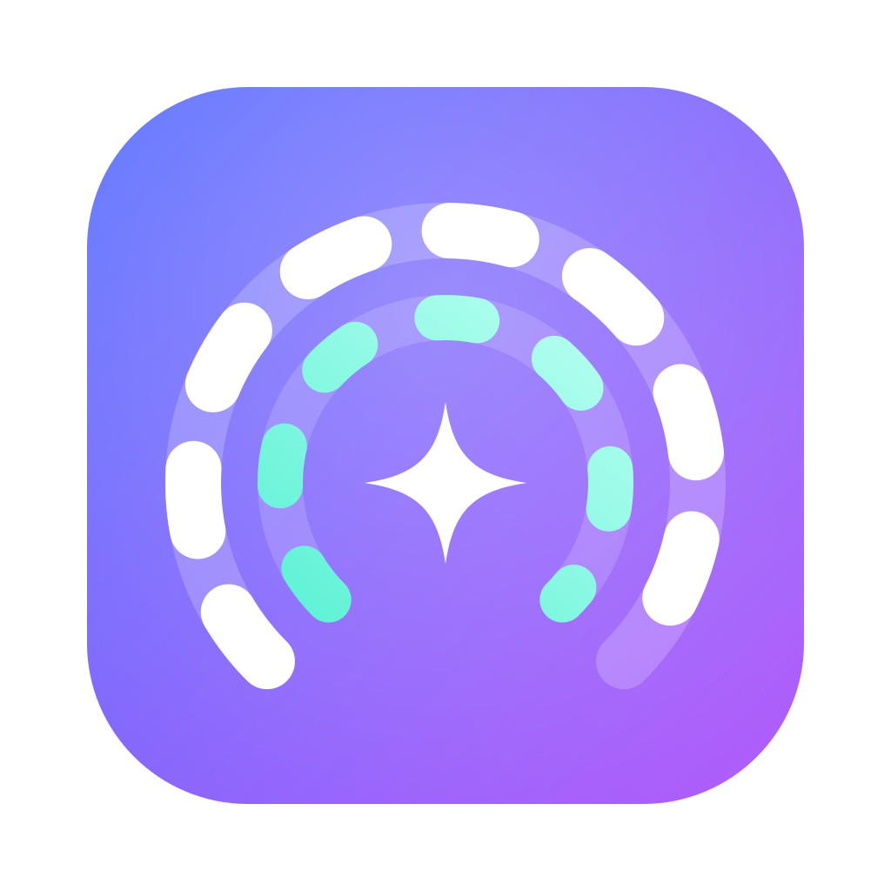
</p>

<h1 align="center">AgentMeter · Agent 用量</h1>

<p align="center">
  <strong>把所有 AI 编程工具的额度、重置时间和本机消耗，收进一个菜单栏。</strong><br />
  macOS 菜单栏应用 · Windows 托盘移植版 · 多台设备合并成一个视图
</p>

<p align="center">
  
  
  
  
  <a href="LICENSE"></a>
</p>

<p align="center">
  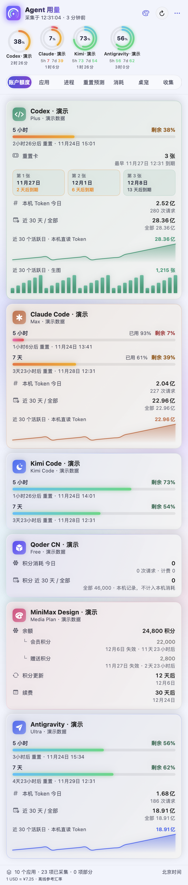
  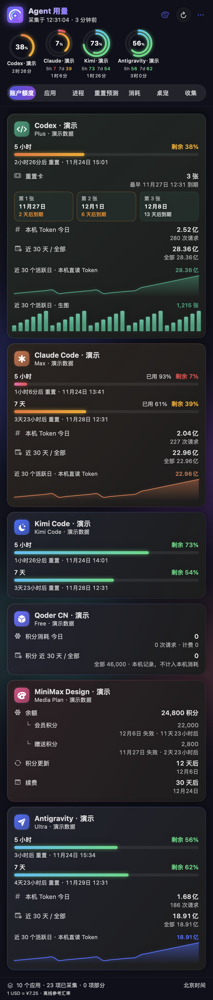
</p>

<p align="center"><sub>本页所有截图均由离线预览生成，账户、余额和用量都是<strong>虚构的演示数据</strong>。</sub></p>

---

## 它解决什么问题

同时用 Codex、Claude Code、Kimi、Qoder、TRAE、MiniMax 这类工具时，额度散在十几个网页和客户端里：哪个快用完了、什么时候重置、重置卡哪天过期、这个月本机到底烧了多少 Token，都要挨个去查。

AgentMeter 常驻在菜单栏（Windows 上在托盘），默认**只读**地把这些数字汇总到一处。换到另一台电脑，同步之后看到的仍是同一份账户全貌。

## 功能一览

| | 功能 | 说明 |
| :---: | --- | --- |
| 📊 | **账户额度** | 每个服务一张卡片：5 小时 / 每周等额度窗口、重置倒计时、套餐、余额、积分包、重置卡和续费日期。同一服务最多 5 个账号，各自独立成卡。 |
| 📈 | **菜单栏行情条** | 像股票行情一样滚动显示各账户余量和重置时间，余量变化带涨跌箭头；也可只显示最紧张的一项或今日 Token。 |
| 🔁 | **多机同步** | 6 位短码配对，端到端加密。两台设备的额度合并成一个视图：同一账户只有一张卡、取最新读数，只在另一台登录的账户也正常显示。详见[下文](#多台设备合并成一台)。 |
| 💰 | **本机消耗** | 直读本机十多个客户端的会话日志，按应用、模型统计 Token、缓存命中和 API 等价费用；支持预算提醒、周报月报和导出。 |
| 🔔 | **提醒** | 额度低于阈值、重置卡和积分包临期、自动续费扣款前，发系统通知；同一事件只提醒一次。 |
| 🔮 | **重置预测** | 汇总三家第三方追踪站公布的 ChatGPT / Codex 全员重置概率，用 Q 版 Tibo 重置器展示，概率从不弹通知。 |
| 🎴 | **收集册** | 额度窗口用量每越过一档就掉一张卡，另有 46 枚按本机历史重算的奖章；已获得的奖章是实时光照的 3D 金属币。 |
| 🖼️ | **报告与分享图** | 七种风格的竖版分享卡，一键复制或保存 PNG，可选简洁或完整复盘。 |
| 🐾 | **桌宠** | 可选的桌面伙伴，把额度、会话和提醒翻译成动作与表情；内置 7 个形象。 |
| 🧭 | **进程监控** | 只列出由 harness 启动的进程：进程树、CPU、内存和监听端口，命令行已脱敏。 |
| 🎨 | **七套界面风格** | 极简、原生、瓷白、极光、钛影、霓虹、棱镜，一键切换。 |

<p align="center">
  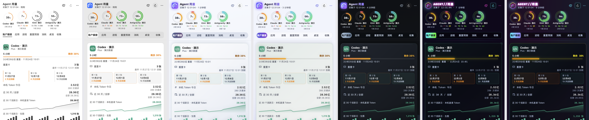
</p>
<p align="center"><sub>从左到右：极简 · 原生 · 瓷白 · 极光 · 钛影 · 霓虹 · 棱镜</sub></p>

<details>
<summary>更多截图：行情条、消耗、收集册、重置预测、分享卡、桌宠</summary>

<p align="center">
  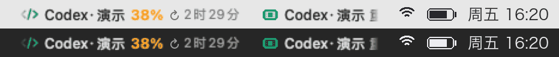
</p>

<p align="center">
  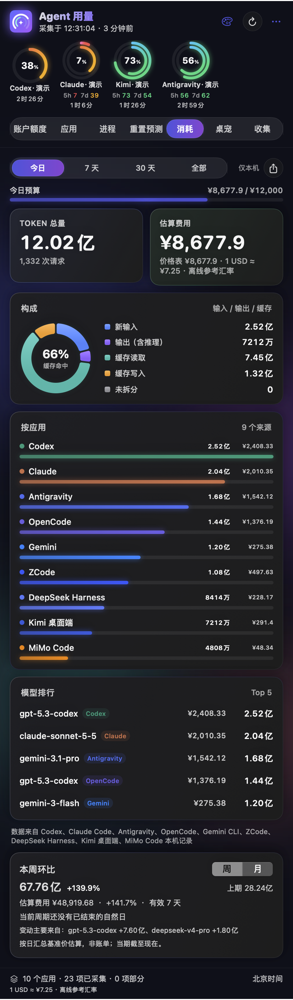
  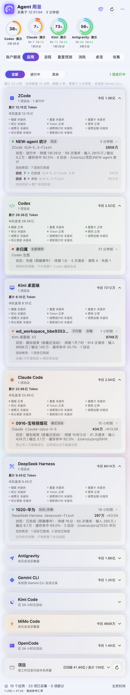
</p>

<p align="center">
  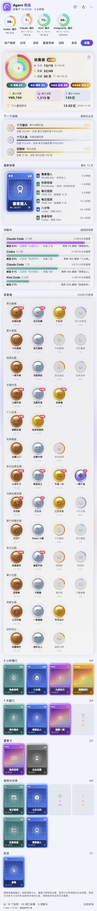
  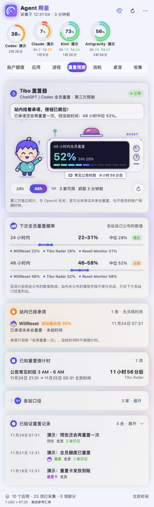
</p>

<p align="center">
  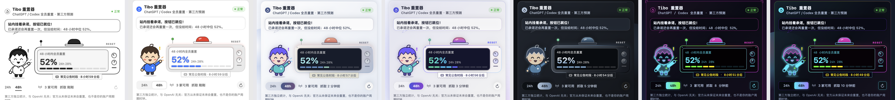
</p>

<p align="center">
  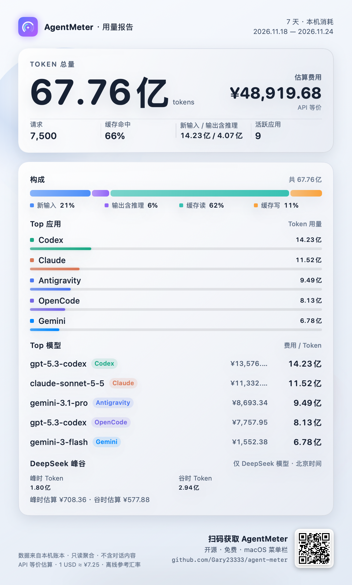
  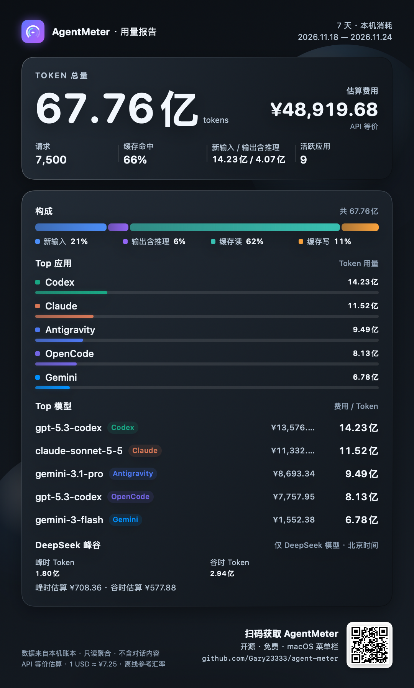
  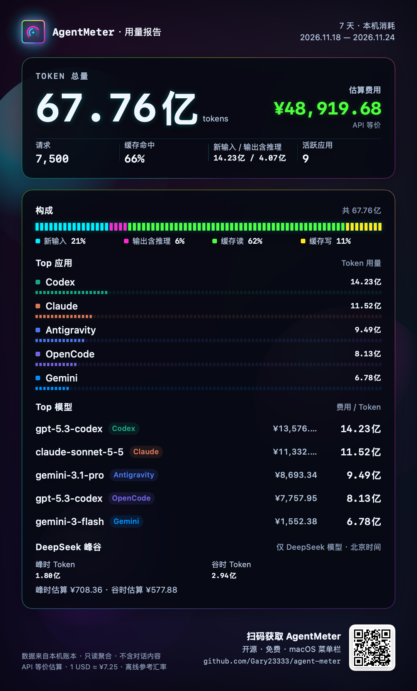
</p>

<p align="center">
  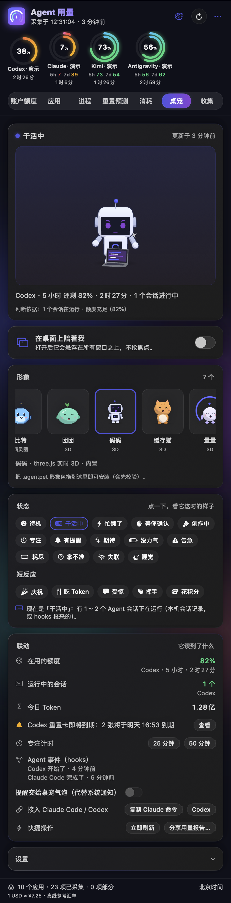
</p>

截图的生成方式见[截图说明](docs/images/README.md)。

</details>

## 安装

### macOS

1. 从 [GitHub Releases](https://github.com/Gary23333/agent-meter/releases) 下载 `AgentMeter-<版本>-macos-arm64.dmg`，或按[从源码构建](#从源码构建)自己打包。
2. 打开 DMG，把「Agent 用量.app」拖进「应用程序」，双击启动。

需要 macOS 14 或以上、Apple Silicon。App 内置独立的 Python 后端，不用另装 Python 或 Xcode。安装包使用 Developer ID 签名并通过 Apple 公证，可以直接打开。数据存放在 `~/Library/Application Support/AgentMeter/.runtime/`。详见[安装说明](docs/INSTALL.md)。

### Windows（预览版）

Windows 版是托盘应用，代码在 [`windows/`](windows/)，来自 [FoxBai/agent-meter-windows](https://github.com/FoxBai/agent-meter-windows) 的移植。可以从该仓库的 Releases 下载便携包，也可以按 [Windows 说明](windows/OVERVIEW.md#从源码构建)从源码构建。目前支持 Windows x64，预览版没有代码签名。

## 多台设备合并成一台

在「多机同步」里，第一台设备创建同步空间，另一台输入 6 位短码加入，两边核对安全码一致后即完成配对。之后可以手动点「立即同步」，也可以设成每 5 分钟、30 分钟、1 小时或 1 天自动同步（Windows 目前只支持手动）。

同步后，账户页看起来就像一台机器读到的：

- **同一账户只显示一张卡**，每个额度窗口取两台中较新的读数；本机读不到的套餐、余额、重置卡和续费日期，由另一台补上。
- **只在另一台登录的账户**也作为普通卡片显示，不再列在「未接入」里。另一台超过 1 小时没有同步时，卡片会注明「采样于」某个时间。
- **没有账号标识的服务**（如 Kimi、WorkBuddy、MiniMax Code、ZCode），按重置时间和用量走势判断两边是否同一账号：是就合并，不是就各自成卡。两个不同的账号标识永远不会合并。
- **消耗页**会把所有设备的 Token、请求数和费用加在一起统计。

同步的只是汇总后的数字，**不包含登录凭据**，所以另一台不能代你登录、刷新或签到。数据在本机加密后才上传，服务端只保存密文。macOS 版固定使用内置的同步服务；服务端代码在 [`sync_server/`](sync_server/README.md)。

## 安全与数据原则

> [!IMPORTANT]
> - **默认只读**：不会购买、兑换重置卡、更改套餐或替你发送 Prompt。唯一的写操作是可选的「每日积分领取」（TRAE 签到、WorkBuddy 任务奖励、Qoder 每日活动积分），默认关闭。
> - **凭据不离开本机**：网页登录和 API Key 只存在系统钥匙串（Windows 上是凭据管理器），经本机内存通道交给后端，不写入快照和日志，只发往对应服务的官方接口。对外的账号标识都是截断后的 SHA-256 哈希。
> - **未知不等于零**：接口没给的数字就标记为「未提供」，不会当成 0；不同服务的积分、Token 和货币从不相加。
> - **费用是估算**：所有金额都是按公开价格算出的 API 等价费用，不是你的实际账单。

## 支持的数据源

| 数据源 | 获取方式 | 主要指标 | 账号 |
| :--- | :--- | :--- | :---: |
| **Codex** | 本机配置与官方接口只读 + CLI 会话日志 | 额度余量、5 小时 / 每周重置、重置卡库存与到期、本机 Token、生图张数 | 独立账号 |
| **Claude Code** | 钥匙串 OAuth / 网页登录 / 桌面端登录态 + 本机转录 | 5 小时 / 7 天窗口与重置时刻、本机 Token | 独立账号 |
| **Kimi Code** | 本机 REST + 本机会话日志 | 5 小时 / 每周额度、本机 Token | 独立账号 |
| **Qoder CN** | 内嵌网页登录 / 桌面端登录态 | 总额度与共享额度、下次重置、每日活动积分 | 最多 5 个 |
| **WorkBuddy** | 内嵌网页登录 + 本机会话日志 | 资源包余量、冻结积分、周期截止、任务奖励、本机 Token | 最多 5 个 |
| **TRAE CN** | 内嵌网页登录 | 权益包额度、已用额度、有效积分、每日签到 | 最多 5 个 |
| **MiniMax Code** | API Key | 套餐余量、到期时间、本机 Token | 独立账号 |
| **MiniMax Design** | 本机安全网关 | 钱包余额、积分包失效期、月积分刷新、续费倒计时 | 个人 |
| **即梦 Dreamina** | 内嵌网页视图白名单捕获 / CLI | 会员等级、积分与到期、续费状态、积分消耗 | 最多 5 个 |
| **DeepSeek API** | API Key + 控制台登录（可选） | 余额（CNY / USD 分开）、网页用量、峰谷计价视图 | 独立账号 |
| **ZCode / 智谱 Coding Plan** | 网页登录 / API Key + 本机用量库 | 5 小时 / 每周额度、MCP 月度次数、本机 Token | 最多 5 个 |
| **火山方舟 Coding Plan** | 控制台登录 / AccessKey 签名 | 5 小时 / 每周 / 每月额度与重置时间 | 最多 5 个 |
| **小米 MiMo API** | 网页登录 | 现金与赠送余额、Token Plan 本月用量 | 最多 5 个 |
| **阶跃星辰 StepFun** | 网页登录 + API Key | 余额、窗口额度或月度积分池、套餐与到期 | 最多 5 个 |
| **豆包** | 网页登录 / 导入豆包 App 登录态 | 订阅额度点数与重置时间；豆包工作只统计会话活动，不是 Token | 最多 5 个 |
| **Antigravity** | 本机 SQLite + 本地语言服务 | 5 小时 / 每周分组额度、本机 Token、缓存命中、估算费用 | 独立账号 |
| **本机会话账本** | 只读直读本机日志 / SQLite / zstd 压缩日志 | Codex CLI、Claude Code、Gemini CLI、OpenCode、Kimi、ZCode、WorkBuddy、MiMo Code、DevECo、DeepSeek Harness 等的 Token、模型、缓存与费用 | 本机 |
| **Tibo 重置预测** | 三家第三方追踪站只读抓取 | 24 / 48 小时概率区间、加权中位、承诺与历史 | 公开数据 |

各来源仍需要对应的客户端已安装或已登录。Windows 版目前支持的来源少一些，以 [Windows 说明](windows/OVERVIEW.md) 为准。

## 工作方式

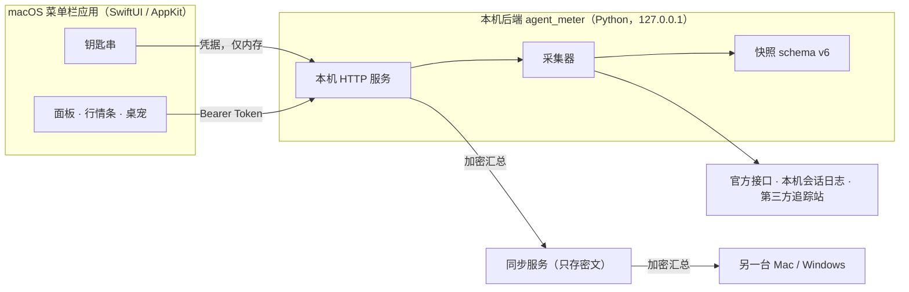

Swift 前端负责界面和凭据，Python 后端负责只读采集、聚合与估算，两者只通过本机回环地址通信。本机接口的完整说明见 [docs/backend-api.md](docs/backend-api.md)。

## 从源码构建

需要 macOS 14+、Xcode / Swift 5.10+、Python 3.9+。

```sh
git clone https://github.com/Gary23333/agent-meter.git AgentMeter
cd AgentMeter
python3 -m pip install -r requirements-build.txt
sh scripts/build-dmg.sh
```

App、DMG 和 `SHA256SUMS` 输出到 `release/`，版本号取自 `VERSION`。默认使用本机开发证书签名；设置 `SIGN_MODE=dist` 时改用 Developer ID 签名，同时提供 `APPLE_ID`、`APPLE_APP_SPECIFIC_PASSWORD` 和 `APPLE_TEAM_ID` 会自动公证。

后端也可以单独运行，核心采集只用 Python 标准库：

```sh
python3 -m agent_meter collect --output .runtime/snapshot.json      # 采集一次快照
python3 -m agent_meter collect --local-only --output .runtime/local.json   # 只读本机账本
python3 -m agent_meter serve                                        # 启动本机服务 127.0.0.1:8769
```

服务启动后，访问令牌写在 `.runtime/api.token`（权限 0600），请求时放进 `Authorization: Bearer <令牌>`。

| 目录 | 内容 |
| --- | --- |
| `agent_meter/` | Python 后端：采集、聚合、估算、同步、卡册与奖章 |
| `menubar/` | Swift 原生前端：菜单栏、面板、3D 渲染、桌宠、分享卡 |
| `windows/` | Windows 托盘移植版（.NET 8 WinForms + 打包后端） |
| `sync_server/` | 可自建的同步服务，只保存密文 |
| `pets/` | 桌宠运行时、内置形象与制作工具 |
| `scripts/` | 打包、发布校验与演示数据 |
| `tests/` | 自动化回归 |
| `docs/` | 接口说明、版本说明、设计与验收文档 |

## 测试

```sh
python3 scripts/test-offline.py                                   # 离线回归，断网运行
cd menubar && swift test                                          # Swift 单元测试
python3 -m agent_meter verify --output .runtime/verification.json # 用真实本机账本独立重算对账
```

CI 会跑 Python 3.9 / 3.12 / 3.14 离线回归、安装包版本校验、Swift 测试与 release 构建、桌宠运行时测试，以及 Windows 编译与测试。真实账户对账不进 CI。

参与开发请看 [CONTRIBUTING.md](CONTRIBUTING.md)，安全问题请按 [SECURITY.md](SECURITY.md) 报告。

## 最近更新

- **v0.13.1**（2026-11-24）：两台设备的额度合并展示，看起来像一台机器，卡片不再标注来源设备。
- **v0.13.0**（2026-11-24）：全部额度互相同步并去重；没有账号标识的服务按额度走势判断是否同一账号；修复 Windows 同步上传为空；奖章和 Tibo 重置器改为实时光照的 3D 渲染。
- **v0.12.x**（2026-11-19 ~ 20）：上线多机同步与短码配对，消耗页合并全部设备的用量。

完整记录见 [CHANGELOG.md](CHANGELOG.md)。

## 许可与致谢

本项目采用 [MIT 协议](LICENSE)，Copyright (c) 2026 Gary23333。MiniMax 额度解析改编自 CC Switch v4.0.5（MIT）；Windows 版由 [FoxBai](https://github.com/FoxBai/agent-meter-windows) 移植。发布包中的 CPython、PyInstaller 等第三方组件遵循各自协议，详见[第三方声明](THIRD_PARTY_NOTICES.md)。
