<!-- WORKSPACE-STATUS-START -->
## 当前入口与目录约定

2026-11-12 更新。当前源码版本 v0.11.0，新增桌宠分享与漫游、Claude 桌面额度、本机历史导出及联网汇率。

- 目录导览：[STRUCTURE.md](STRUCTURE.md)。
- AI 接手先读 [AGENTS.md](AGENTS.md)，再按任务阅读相应模块文档；共享知识入口在 [docs/agent-knowledge/README.md](docs/agent-knowledge/README.md)。
- Git：`main` 推送到 `github.com/Gary23333/agent-meter`，二进制发布在 GitHub Releases。
- 各版本的历史记录按原日期保留，不代表当前支持范围。

常用入口（依赖安装和环境配置见下文）：

```sh
python3.14 -m unittest discover -s tests -t .   # 全量回归
python3.14 -m agent_meter verify                 # 本机账本独立重算对账
```
<!-- WORKSPACE-STATUS-END -->

<p align="center">
  
</p>

# AgentMeter · Agent 用量

<p align="center">
  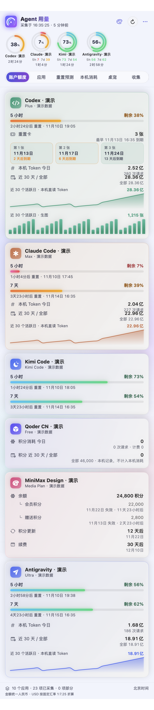
</p>

<p align="center">
  <strong>专为开发者与创作者打造的 macOS 菜单栏 AI Agent 用量与额度大盘</strong><br />
  实时聚合账户额度 · 重置倒计时 · 重置卡库存 · 每日积分 · 本机 Token 消耗流 · 集卡奖章 · Tibo 全员重置预测
</p>

<p align="center">
  
  
  
  
  
  
  <a href="LICENSE"></a>
</p>

> 下方截图由 App 离线预览生成，所有账户、余额、用量与收集进度均为**虚构演示数据**，不代表真实账户或全部来源的接入情况。

---

## 💡 为什么需要 AgentMeter？

用 AI 辅助编程和创作的人，几乎都会踩到同一组坑：

- 📉 **额度散在各处**：Codex、Claude Code、Kimi、Qoder、TRAE、MiniMax、即梦……每个平台的额度都要单独登录、单独刷新页面看；
- ⏳ **重置卡悄悄过期**：好不容易攒下的 5 小时卡、周重置卡，还没用上就到了有效期；
- 🚨 **额度突然见底**：正写到关键处，工具突然限流，心流断掉；
- 💸 **积分与续费无人盯着**：月付年付何时扣款、积分包何时失效、每日签到有没有漏领；
- 📊 **本机开销是一团糊**：不同客户端的 Token、缓存命中率、估算费用散在各自的日志里，没法聚合，也说不清钱花在哪。

**AgentMeter（Agent 用量）** 就是为此而生：一个常驻 macOS 菜单栏的**只读**大盘，把上面这些数字汇总到一处，顺带把每天的额度使用变成一套可以收集的卡牌。

---

## ✨ 核心亮点

```
┌────────────────────────────────────────────────────────────────────────┐
│  Menubar:   [Codex 剩余38% 2h31m]  [Claude 剩余7% 4d]  [Kimi 73% 1d]  │
└───────────────────────────────────┬────────────────────────────────────┘
                                    │ 点击弹出
┌───────────────────────────────────▼────────────────────────────────────┐
│ ✦ 七套界面风格：极简 / 原生 / 瓷白 / 极光 / 钛影 / 霓虹 / 棱镜          │
│ ├─ 账户额度：各供应商统一卡片——额度窗口、积分钱包、重置卡、续费提醒    │
│ ├─ 应用：本机各客户端用量、覆盖字段、近期会话与项目归因                │
│ ├─ 重置预测：Q 版 Tibo + 重置器，三家追踪站交叉的全员重置概率与倒计时  │
│ ├─ 本机消耗：各本机账本独立计量 + 一次性历史导入合并展示               │
│ ├─ 桌宠：常驻桌面的伙伴，把额度翻译成看得见的状态                     │
│ └─ 收集：卡册（越档即掉落）+ 46 枚奖章墙                             │
└────────────────────────────────────────────────────────────────────────┘
```

### 1. 📈 股票大盘式菜单栏行情条（Ticker）

- **Core Animation 硬件加速横向滚动**：默认平滑滚动显示「图标 + 名称 + 剩余量 + 剩余时间」，不占额外窗口、不抢焦点。
- **动态涨跌感**：额度百分比随余量自动变色，余量变动时带 ▲ / ▼ 提示（绿色代表恢复，红色代表被消耗）。
- **多种呈现模式**：滚动轮播（宽度 160/220/300 自选）、逐条翻动、最紧张额度优先、今日 Token 汇总、极简图标。

<p align="center">
  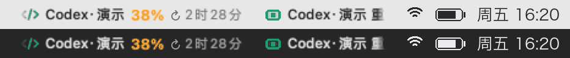
</p>

### 2. 🔔 阶梯式预警与系统通知（Notifier）

- **额度告急**：剩余低于阈值（默认 20%，可选 10%/30%）、跌破 5%、耗尽时自动发原生系统通知；
- **重置卡与积分临期**：3 天内与 24 小时内即将过期的重置卡、临时积分包重点提醒；
- **订阅周期**：3 天内自动续费扣款、7 天内会员到期（未开启自动续费）；
- **防打扰**：同一事件只提醒一次（键里带事件时刻，补发也不会重复弹），点通知直接打开面板。

### 3. 🎨 七套界面风格，一键切换（SwiftUI + AppKit）

- **从克制到炫技**：标题栏的调色板按钮或设置菜单「界面风格」随时切换，立即生效并记住选择：
  - **极简 / 原生**：黑白排版或 macOS 系统卡片，适合长时间专注；
  - **瓷白**：柔和陶瓷质感与克制的浅浮雕；
  - **极光**（默认）：流光底色、毛玻璃卡片与品牌色微光；
  - **钛影**：深色拉丝金属、机械式立体层次；
  - **霓虹 / 棱镜**：赛博光效或全息晶体。
- **统一的视觉基线**：七套风格共享三级文字颜色、稳定卡片底色、清晰选中态与固定排行数字列；霓虹与棱镜收敛强光，钛影与瓷白的小字对比更清楚。
- **统一的供应商卡片**：各来源按同一顺序展示「额度窗口 → 积分钱包 → 积分更新 → 重置卡 → 续费 → Token」，窗口从短到长排列，倒计时按紧急程度而非品牌色着色。
- **Swift Charts 消耗分布图**：输入、输出、缓存命中等构成以环形图直观呈现，深浅色自适应。

<p align="center">
  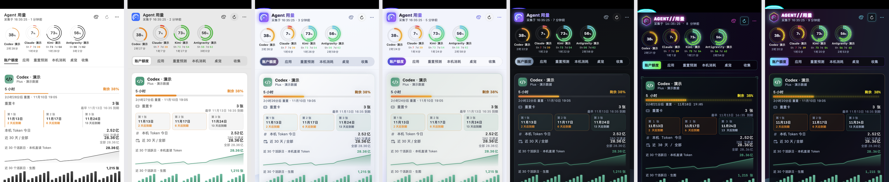
  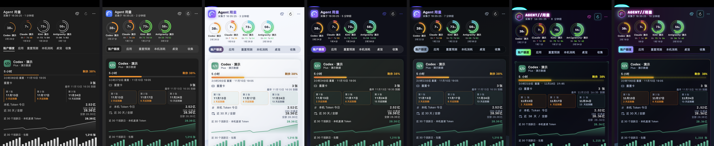
</p>
<p align="center"><sub>从左到右：极简 · 原生 · 瓷白 · 极光 · 钛影 · 霓虹 · 棱镜（钛影、霓虹、棱镜固定深色）</sub></p>

<p align="center">
  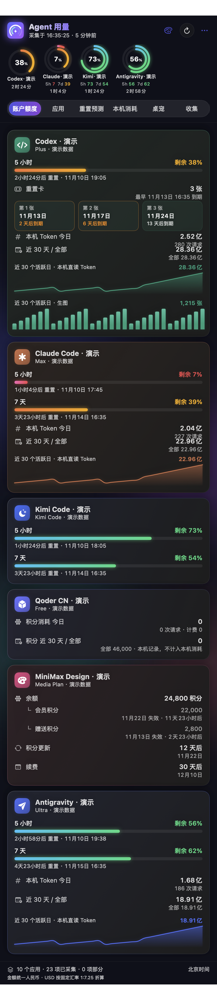
  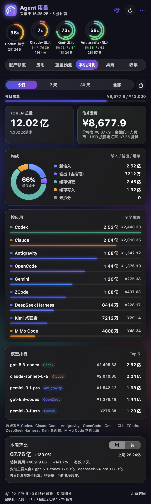
</p>

<details>
<summary>查看更多截图：应用页、收集册、重置预测与菜单栏行情</summary>

<p align="center">
  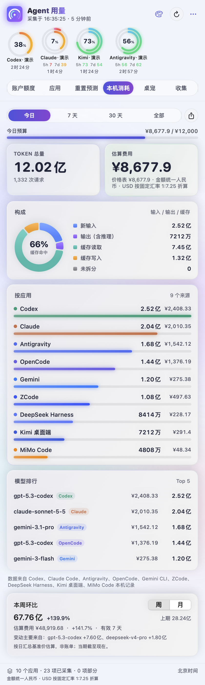
  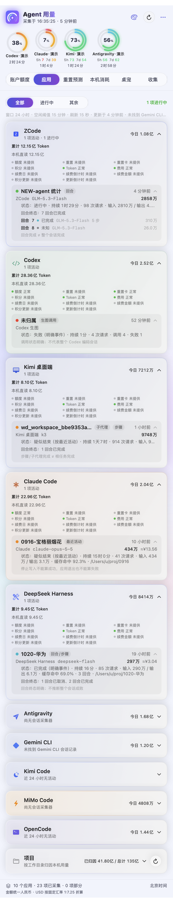
</p>

<p align="center">
  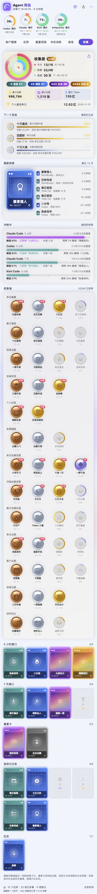
  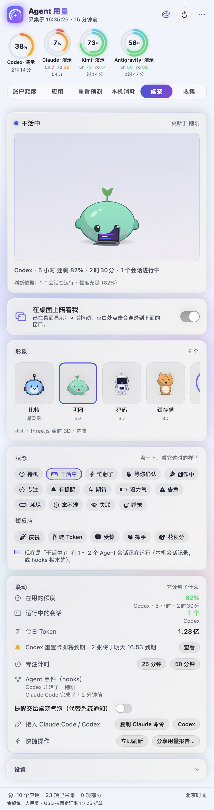
</p>

<p align="center">
  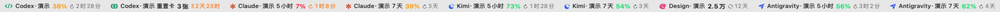
</p>

截图生成方式见 [截图说明](docs/images/README.md)。

</details>

### 4. 🎴 收集册：卡册与奖章

- **越档即掉落的卡册**：5 小时 / 7 天额度窗口的用量每越过一档（50% / 80% / 90% / 用满）就**立刻**掉一张卡，不用等窗口重置；同一窗口同一档只掉一张，峰值继续上涨就再补下一档。掉卡时刻就是你真正越过那一档的时刻。
- **46 枚奖章墙**：单日 / 累计 Token 里程碑、连续活跃天数、单日多端并用、刷新个人最佳、单日与月度估算金额、Codex 生图张数、创作积分消耗、免费额度用量——全部按本机历史实时重算，第一次打开就能解锁已达成的奖章。
- **其它卡种**：重置卡在过期前用掉得「物尽其用」，过期未用得灰色「白白过期」；每日签到、连续 7 / 30 / 100 天、任务奖励与官方徽章也各有卡片。
- **动效与分享**：奖章有金属厚度与缎带，卡片有系列底纹、编号与分层视差，跟随鼠标 3D 倾斜、高光与火花，史诗 / 传说卡带镭射光泽；解锁新卡或新奖章时播放 3D 能量环、环绕粒子、彩带与翻转入场动画。点任一卡或奖章进入同款详情页，一键复制或保存分享图（可附项目二维码）。
- **冲刺中**：实时显示每个进行中窗口的峰值、本窗已掉落的卡，以及「再用多少 % 解锁哪张卡」。

<p align="center">
  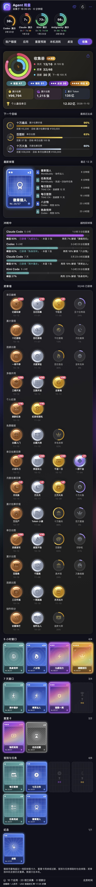
</p>

### 5. 🎁 每日积分自动领取（默认关闭）

- **三个平台**：TRAE CN 每日签到、WorkBuddy 已完成任务的奖励、Qoder 每日活动积分（每日北京时间 10:00 发布，每份 100 通用 Credits，有效期 30 天）。
- **默认关闭，需手动开启**：开启后可设置每天的领取时刻（北京时间）。它**不会**兑换连续天数档位、不会使用补签卡、不会接受新任务、不会抽奖。
- **幂等且可审计**：同一活动重复领取只回放既有发放；每次成功或多次失败都会发系统通知；领取记录写进本机 `rewards.json`（0600，不含任何凭据）。
- **凭据处理**：网页登录凭据只存在 macOS 钥匙串，经 loopback 内存通道传给后端，不落盘、不进日志。

### 6. 👥 多账号隔离支持（Multi-Account）

- 每个网页登录来源支持最多 **5 个独立账号**（如「主号」「小号」「工作号」）；
- 每个账号**独立成卡、独立进行情条、独立计算提醒阈值**，严禁把不同账号的额度粗暴相加；
- 后端规范命名通道（首个账号保持原源名，后续分配 `provider#2` 并关联备注）。

### 7. 🔀 多账本独立计量本机消耗（Independent Local Ledgers）

- **本机账本直读**：Codex CLI、Claude Code + Claude 桌面端 local-agent、Gemini CLI、Antigravity、OpenCode、MiniMax Code、Kimi Code / 桌面端 / 旧 CLI、ZCode、WorkBuddy、MiMo Code、DevECo、DeepSeek Harness 的会话日志、SQLite 或压缩 rollout，只读不写；Codex 支持 `.jsonl.zst`，`sessions` 与 `archived_sessions` 都读取。
- **历史导入**：项目自有 `<runtime>/imported-history.json`（一次性迁移写入，0600，`schema=1`），逐请求记录保留请求时刻、可拆峰谷；不再读取任何第三方路由数据库。
- **独立计量**：每个账本只汇总自己的记录，不做跨账本日期剔除；`imported_history` 只在本地账本没有数据的日期补入，或在本地数据不足时按模型补差，**绝不叠加**。
- **DeepSeek 峰谷计价视图**：挂在「账户额度」页的 DeepSeek 卡内，只汇总各本机账本中的 DeepSeek 系模型，按请求时间戳拆成峰时 / 谷时，展示峰时 ×2 的价差影响。

### 8. 🧠 模型目录自动同步与体验模型计费绑定

- **自动更新模型名称与刊例价**：从公开 `models.dev` 目录同步主流供应商的模型 ID、名称、发布日期及输入 / 输出 / 缓存读写的每百万 Token 单价；启动后自动同步，每 6 小时检查，目录本身按 24 小时节流，也可在「模型与计费」窗口手动同步。
- **本地修改不被覆盖**：内置价、同步目录价与用户价格分层合并，用户自定义优先；同步失败保留上次成功目录，未返回有效价格的体验模型不会被当成免费。
- **超前体验期也能估算**：可把无法计价的模型或内部代号绑定到现有模型，沿用其四项 Token 单价，绑定关系写进估算结果，正式价格发布后随时替换。
- **峰谷双价**：DeepSeek 系模型默认峰时倍率 2×（北京时间工作日 09:00–12:00、14:00–18:00 峰时），可逐行修改；价格表保持谷时基准，估算按请求时刻自动选价。
- **口径透明**：所有金额均为 **API 等价估算**而非订阅账单；未知不等于零，不同账户与币种不混算。

### 9. 🎨 创作类工具专属指标支持（Creative Metering）

- **MiniMax Design**：读取当前个人 Media Plan 钱包余额，追踪积分包失效时间与次月积分刷新倒计时；
- **即梦 (Dreamina)**：内置隐藏 Web 监控视图，拦截自身发出的安全查询响应，展现会员等级、积分明细与续费倒计时，并统计创作积分的实际消耗。

### 10. 🔮 Tibo 全员重置预测 + Q 版重置器（Reset Forecast）

- **独立的「重置预测」标签页**：只读抓取三家第三方追踪站（Will Codex Reset、Tibo Radar、Codex Reset Monitor）公布的 ChatGPT / Codex 全员重置概率，给出 24 / 48 小时**区间 + 加权中位**，并标出各站「接近 / 分歧」；
- **更易用的重置器**：可切换 24 / 48 小时观察窗、立即刷新；机身、屏幕与旋钮具有立体层次，各站口径默认折叠，历史记录默认 3 条并可展开；
- **七套主题各有造型**：从黑白线稿、系统色到陶瓷、钛金属与全息发光；
- **口径克制**：只汇总各站自己公布的数值，不写入账户重置时间、不进菜单栏行情条；通知只在**已公告**的时段开始 / 结束或追踪站记录到落地时触发，**概率永远不弹通知**；可在设置一键关闭联网抓取。

<p align="center">
  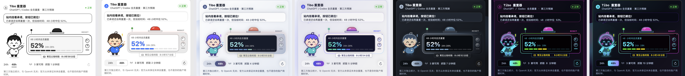
</p>
<p align="center"><sub>从左到右：极简 · 原生 · 瓷白 · 极光 · 钛影 · 霓虹 · 棱镜（演示数据，非真实预测）</sub></p>

<details>
<summary>查看完整的重置预测页</summary>

<p align="center">
  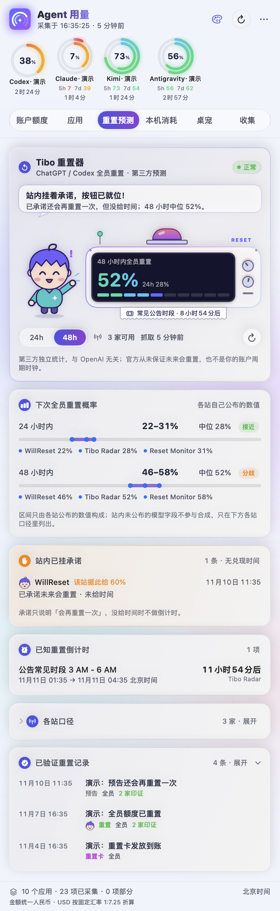
  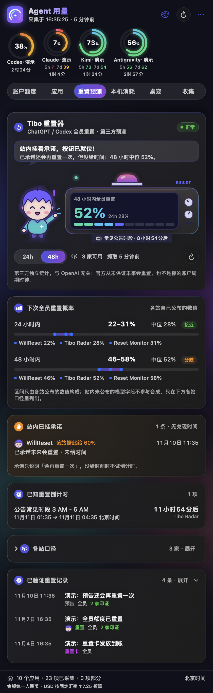
</p>

</details>

### 11. 🖼️ 用量报告与一键分享图（Usage Report）

- **本机消耗页一键打开报告窗口**：时间段筛选与本机消耗页共用，今日 / 7 天 / 30 天 / 全部即时联动；总览、Token 构成、应用 / 模型排行口径逐位一致，只含本机消耗、不含账户余额。
- **七套风格竖版分享卡**：极简、原生、瓷白、极光、钛影、霓虹、棱镜，宽度固定、高度随内容自适应；一键复制 2x PNG 到剪贴板或直接保存，适合分享到微信 / 飞书 / 小红书。
- **两种内容模式**：简洁晒用量 / 完整复盘，可切换并记住选择；费用、缓存与构成、应用、模型、DeepSeek 峰谷、Codex 生图均可单独开关。
- **口径标注**：页脚标明「数据来自本机账本 · 只读聚合 · 不含对话内容」「费用为 API 等价估算」，不含凭据与对话正文。

<p align="center">
  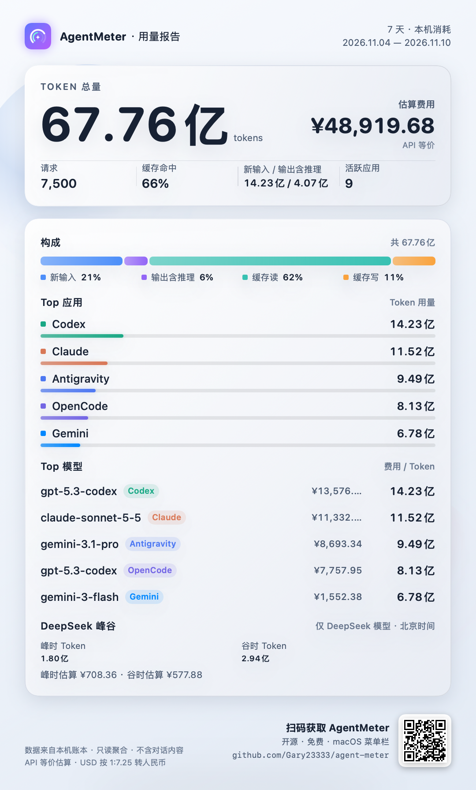
  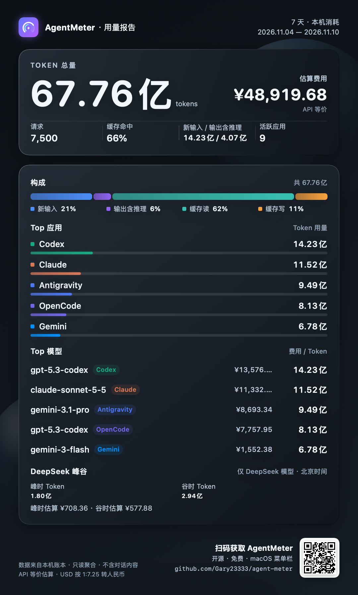
  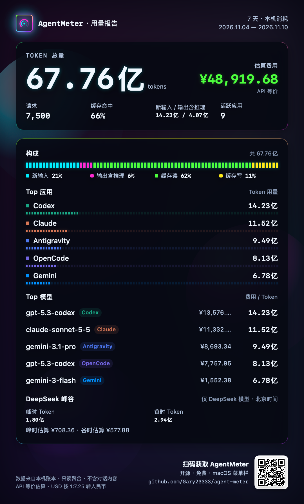
</p>
<p align="center"><sub>瓷白 · 钛影 · 棱镜（演示数据，非真实消耗）</sub></p>

### 12. 🐾 桌面宠物（默认关闭）

- **桌面 + 面板里的「桌宠」标签页**：除了悬浮在桌面上的伙伴，面板里有独立的一页：同一个实时形象（可戳、双击刷新）、形象库、状态与短反应试玩、「它读到了什么」（额度、会话、今日 Token、待提醒、hooks 事件）、专注计时与设置。
- **常驻桌面的伙伴**：透明置顶、不抢焦点、透明区域点击穿透；把额度、会话、重置、提醒、本机消耗、创作积分与 Tibo 预测翻译成动画和表情——未知额度是「拿不准」，不是「耗尽」。
- **六个内置形象**：量量（额度圆环）、团团（果冻）、码码（机器人）、缓存猫、Tibo、比特（像素）；七套风格各有配色。
- **功能性联动**：额度胶囊、会话看板、Claude Code / Codex 钩子（完成、等你确认）、专注计时、久坐提醒、提醒接管、右键快捷操作。
- **两套形象制作 skill**：前端 three.js 程序化 3D 与生图模型精灵图。详见 [桌宠说明](pets/README.md)。

<p align="center">
  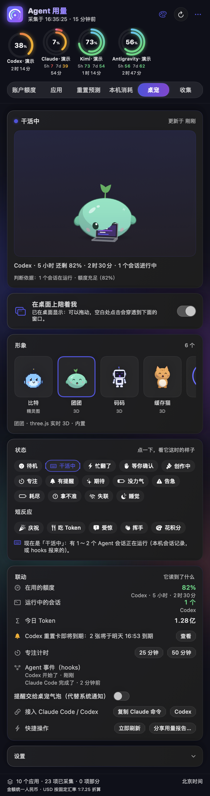
</p>

---

## 🛡️ 安全与设计原则（Security First）

开发者对**隐私与凭据安全**的要求极高，AgentMeter 的铁律是：

> [!IMPORTANT]
> 1. **默认只读（Read-Only by Default）**：核心逻辑绝不包含任何买入、兑换重置卡、更改套餐、发送模型 Prompt 的操作。唯一的写操作是**可选**的「自动领取每日积分」（TRAE 签到、WorkBuddy 已完成任务的奖励、Qoder 每日活动积分），默认关闭，需在设置里手动开启并指定每天的领取时刻。
> 2. **凭据零泄露（Zero Credential Leakage）**：
>    - 网页 Session 与 API Key 仅保存在 macOS 钥匙串（Keychain）；
>    - 传给本机后端时只走 loopback 内存通道（`PUT /v1/web-sessions`），不写入快照文件或日志；查询时只发给对应服务的官方端点；
>    - 快照与对外接口中，账号标识一律经 SHA-256 散列并截断（`account_key`），绝不泄漏原始用户 ID。
> 3. **数据诚实性（Honest Metrics）**：
>    - **未提供 ≠ 0**：接口没返回的字段明确标为 `not_provided`，绝不脑补为 0；
>    - **不同质不相加**：不同服务商的积分、Token、重置卡绝不机械求和；不同账户的额度也不合并；
>    - **时间精度保真**：天级精度的续费日期不伪造秒级时刻，过期日期真实呈现 overdue 状态。

---

## 📋 数据源支持矩阵

| 数据源 | 覆盖应用 / 场景 | 获取方式 | 支持指标 | 账号隔离 |
| :--- | :--- | :--- | :--- | :---: |
| **Codex** | ChatGPT / Codex CLI | 本机配置与官方端点只读解析 + CLI 会话日志直读 | 额度余量、5 小时 / 周重置、重置卡库存及到期、账户与本机 Token、Codex 生图 | 独立账户 |
| **Claude Code** | Claude Code CLI、Claude 桌面端 | 钥匙串 OAuth / 网页登录只读 + `.claude/projects` 转录直读 | 5 小时 / 7 天窗口额度与重置时刻、本机 Token | 独立账户 |
| **Kimi Code** | Kimi 编程助手 | 本机 REST + 本机 `wire.jsonl` | 周 / 5 小时额度、turn 级 Token 消耗流 | 独立账户 |
| **Kimi 桌面端 / 旧 CLI** | Kimi 桌面端、Kimi 旧版 CLI | 本机会话日志直读 | 本机 Token（按模型分组） | 本机历史 |
| **Qoder CN** | Qoder 中国区 | 内嵌安全网页登录 / 桌面客户端登录态 | 总体与共享额度、已用 / 剩余、下次重置、每日活动积分 | 最多 5 账号 |
| **WorkBuddy** | WorkBuddy 腾讯协作 | 内嵌安全网页登录 + 本机会话日志直读 | 资源包总量与剩余、冻结积分、周期截止、任务奖励、本机 Token / 费用 | 最多 5 账号 |
| **TRAE CN** | 字节 TRAE IDE / SOLO | 内嵌安全网页登录 / Cloud-IDE-JWT | 权益包额度汇总、已用额度、有效积分、每日签到 | 最多 5 账号 |
| **MiniMax Code** | MiniMax Coding Plan | 应用内 API Key / 环境变量 / `<runtime>/secrets/`（0600） | 周套餐余量、到期时间、本机 Token | 独立账户 |
| **MiniMax Design** | MiniMax 创作工作台 | 本机安全网关 `127.0.0.1:8001` | 个人钱包、积分包失效期、月积分刷新日、年费续费倒计时 | 个人 Media Plan |
| **即梦 (Dreamina)** | 剪映即梦创作平台 | 内嵌隐藏 Web 视图白名单捕获 / CLI | 会员等级、积分总额、多积分包到期、续费状态、创作积分消耗 | 最多 5 账号 |
| **DeepSeek API** | DeepSeek 开放平台 | 环境变量 / 钥匙串 API Key + 控制台登录（可选） | 货币余额（CNY / USD 独立保留）；网页用量 3 / 7 / 30 天（仅展示，不计入本机消耗） | 独立账户 |
| **ZCode / 智谱 Coding Plan** | ZCode、GLM Coding Plan（中国区） | 内嵌网页登录捕获控制台凭据 / 钥匙串 API Key + 本机用量库 | 5 小时 / 每周额度（已用 / 总量）、周重置时间、MCP 月度次数、本机 Token | 最多 5 账号 |
| **火山方舟 Coding Plan** | 火山引擎方舟 | 内嵌控制台登录（回放页面自身的只读 `GetCodingPlanUsage`）/ AccessKey 签名 | 5 小时 / 每周 / 每月额度与各自重置时间 | 最多 5 账号 |
| **小米 MiMo API** | MiMo 开放平台控制台 | 内嵌安全网页登录 / Cookie | 账户余额（现金 / 赠送）、Token Plan 本月用量 | 最多 5 账号 |
| **阶跃星辰 (StepFun)** | 阶跃星辰开放平台 | 内嵌安全网页登录 / Cookie + 开放平台 API Key | 账户余额（充值 / 赠送）、5 小时 / 每周窗口或月度积分池、套餐名与到期日 | 最多 5 账号 |
| **Antigravity** | Google Antigravity 桌面端 / agy CLI | 本机会话 SQLite 只读 + 运行中 `language_server` 本地 RPC | 5 小时 / 周额度（Gemini / Claude+GPT / Argon 分组）、重置时间、本机 Token 今日/30 天/全部、模型分组、缓存命中率、估算费用 | 独立账户 |
| **历史导入** | 早期由本机路由数据库记录、现由项目自有文件保存的历史消耗 | `<runtime>/imported-history.json`（一次性迁移写入，0600） | 今日 / 7 天 / 30 天 / 全部 Token、缓存命中率、估算费用（逐请求行可拆峰谷） | 本机历史 |
| **本机 Agent 会话账本** | Codex CLI、Claude Code + Claude 桌面端 local-agent、Gemini CLI、Antigravity、OpenCode、MiniMax Code、Kimi Code / 桌面端 / 旧 CLI、ZCode、WorkBuddy、MiMo Code、DevECo、**DeepSeek Harness (dsh)** | 本机会话日志 / SQLite / zstd 压缩会话日志只读直读（无需第三方路由数据库） | 今日 / 7 天 / 30 天 / 全部 Token、按模型分组、缓存命中率、API 等价费用 | 本机历史 |
| **Tibo 全员重置预测** | ChatGPT / Codex 全员重置 | 三家第三方追踪站只读抓取 | 24 / 48 小时概率区间与加权中位、站内承诺、倒计时、历史记录 | 第三方公开数据 |

---

## 🏗️ 架构概览

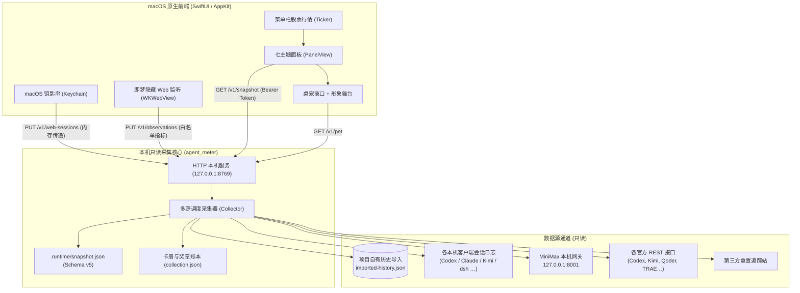

---

## 🚀 快速上手

### 方式一：下载即用（推荐）

1. 打开本机打包生成的 `AgentMeter-0.11.0-macos-arm64.dmg`，或从 [GitHub Releases](https://github.com/Gary23333/agent-meter/releases) 下载已公开的版本。
2. 打开 DMG，把「Agent 用量.app」拖进「应用程序」文件夹；
3. 双击启动。菜单栏会立即出现行情条。
   - *App 自带独立 Python 后端，**无需安装 Python、Xcode 或项目源码**。各来源仍需对应的客户端或登录态。*

本版 App 与 DMG 均使用 Developer ID Application 签名，已通过 Apple 公证并装订票据，正常双击即可打开，无需在「隐私与安全性」里手动放行。详见[安装说明](docs/INSTALL.md)。安装版数据位于 `~/Library/Application Support/AgentMeter/.runtime/`。

### 方式二：从源码构建原生应用

环境要求：macOS 14.0+、Xcode / Swift 5.10+、Python 3.9+ 和固定版本的 PyInstaller。

```sh
# 1. 克隆代码仓库
git clone git@github.com:Gary23333/agent-meter.git "AgentMeter"
cd "AgentMeter"

# 2. 安装打包依赖，构建 App 和 DMG
python3 -m pip install -r requirements-build.txt
sh scripts/build-dmg.sh
```

构建产物输出到 `release/`：App、DMG 和 `SHA256SUMS`。`VERSION` 指定本次构建的版本；默认使用本机开发证书，`SIGN_MODE=dist` 使用 Developer ID，并在提供 `APPLE_ID` / `APPLE_APP_SPECIFIC_PASSWORD` / `APPLE_TEAM_ID` 时自动公证。开发时可用 `AGENT_METER_HOME` 指定源码后端。

| 目录 | 内容 |
| --- | --- |
| `agent_meter/` | Python 后端（采集、聚合、卡册与奖章） |
| `menubar/` | Swift 原生前端（菜单栏、面板、桌宠、分享卡） |
| `pets/` | 桌宠运行时、内置形象包与制作 skill |
| `scripts/` | 后端 / DMG 打包、发布验证与演示数据 |
| `tests/` | 自动化回归 |
| `docs/` | 共享知识、接口说明、研究与验收文档 |
| `examples/` | 无凭据配置示例 |
| `release/` | 本机发布产物；二进制上传到 GitHub Releases |
| `.runtime/` | 本机日志、缓存与构建中间产物，不上传 |

### 方式三：独立运行 Python 只读统计后端

后端使用 **Python 3.9+ 纯标准库** 实现，**无需安装任何 pip 第三方依赖**。

```sh
# 1. 采集单次快照并输出至本地
python3 -m agent_meter collect --output .runtime/snapshot.json

# 2. 仅采集本机账本与历史导入（跳过账户网络查询）
python3 -m agent_meter collect --local-only --output .runtime/local.json

# 3. 启动本地守护服务（默认监听 127.0.0.1:8769）
python3 -m agent_meter serve --start-kimi-server
```

> 服务启动后，认证 Token 写入 `.runtime/api.token`（权限 0600，仅当前用户可读写）。所有 API 调用需在 Header 携带 `Authorization: Bearer <本地 Token>`。

---

## 🔌 本机 API 接口速查

服务仅响应本机（127.0.0.1）请求，严禁跨域 Origin 访问。

| 接口 | 方法 | 说明 |
| :--- | :---: | :--- |
| `/v1/health` | `GET` | 检查服务运行状态与 Schema 版本（当前为 5） |
| `/v1/snapshot` | `GET` | 完整快照：全部来源、应用覆盖矩阵、卡册与奖章（默认缓存 120 秒） |
| `/v1/sources` | `GET` | 各数据源的细分指标、提取范围与错误代码 |
| `/v1/coverage` | `GET` | 各应用在关键指标上的覆盖状况矩阵 |
| `/v1/status` | `GET` | 采集状态、失败来源、被跳过的账本与缓存节流信息 |
| `/v1/activity` | `GET` | 最近 24 小时的会话活动（轻量端点，不触发全量采集） |
| `/v1/projects` | `GET` | 项目归因：各项目用到的应用、Token 与未归因部分 |
| `/v1/periods/week` · `/v1/periods/month` | `GET` | 本机消耗的周报 / 月报环比 |
| `/v1/budget` | `GET` / `PUT` | 日 / 周预算与异常阈值 |
| `/v1/prices` | `GET` / `PUT` | 自定义价格与体验模型绑定；响应含同步目录状态 |
| `/v1/prices/sync` | `POST` | 立即同步公开模型名称与刊例价，保留用户价格与旧目录回退 |
| `/v1/pet` | `GET` | 桌宠状态大脑：额度、会话、预测仲裁出的状态 |
| `/v1/pet/preferences` · `/v1/pet/events` | `GET` / `PUT` | 桌宠偏好与事件流 |
| `/v1/rewards/claim/<slot>` | `POST` | 对该账户立即读状态并领取每日积分 |
| `/v1/preferences` | `PUT` | 来源开关、自动领取开关与领取时刻 |
| `/v1/web-sessions` | `PUT` | 前端把钥匙串中的凭据 / Cookie 传入后端内存使用 |
| `/v1/observations` | `PUT` | 前端把网页抓取到的白名单结构化指标同步至后端内存 |
| `/v1/refresh` | `POST` | 强制穿透缓存立即采集并返回快照 |

**Python 调用示例：**

```python
import json
from pathlib import Path
from urllib.request import Request, urlopen

token = Path(".runtime/api.token").read_text().strip()
req = Request(
    "http://127.0.0.1:8769/v1/snapshot",
    headers={"Authorization": f"Bearer {token}"}
)

with urlopen(req, timeout=30) as resp:
    data = json.load(resp)
    print("采集时间:", data["collected_at"])
    print("覆盖概览:", data["coverage_summary"])
    print("已得奖章:", data["collection"]["stats"]["medals_earned"])
```

---

## 🧪 自动化测试与对账验证

```sh
# 1. 运行隔离的离线回归（Python 3.9–3.13 需安装 zstd CLI；3.14 可用标准库）
python3 scripts/test-offline.py

# 2. 运行真实环境对账校验（各本机账本与历史导入独立重算）
python3 -m agent_meter verify --output .runtime/verification.json
```

CI 运行 Python 3.9、3.12、3.14 离线回归、源码包 / wheel 版本校验，以及 macOS Swift 测试与 release 构建。真实账户对账不进入 CI。

贡献步骤见 [CONTRIBUTING.md](CONTRIBUTING.md)，本地数据与漏洞报告边界见 [SECURITY.md](SECURITY.md)。Python 包与 macOS 打包脚本统一从 `VERSION` 读取版本。

---

## 📝 更新日志

完整说明见 [docs/](docs/) 下的 `release-v*.md`。

### v0.11.0 · 2026-11-12

- 桌宠新增麻薯、漫游、昨日用量气泡、拖入安装和分享图合成。
- 支持复用 Claude 桌面登录态读取额度，报告可导出 JSON / CSV，消费估算采用联网 USD/CNY 行情。详见[版本说明](docs/release-v0.11.0.md)。

### v0.10.4 · 2026-11-10
- **额度卡改为实时发卡 + 补发**：5 小时 / 7 天窗口用量每越过一档（50% / 80% / 90% / 用满）就立刻掉一张卡，峰值继续上涨再补下一档；掉卡时刻即真正越过该档的时刻。窗口结算退化为兜底，只补发漏掉的档。详见[发布说明](docs/release-v0.10.4.md)。
- **卡片张数独立记账**：每张卡的张数存进账本台账，掉落日志裁剪到 3000 条不再让老卡的「×N」缩水；旧账本自动回填。
- **README 重写与截图重生成**：按当前代码重排结构、更新数据源矩阵与接口表，补上 v0.10.x 更新日志，全部演示截图重新生成。

### v0.10.3 · 2026-11-10
- **Qoder 每日活动积分**：桌面客户端登录态接入，每日北京时间 10:00 发布当日活动、每份 100 通用 Credits、领取后 30 天有效；自动领取默认关闭。详见[发布说明](docs/release-v0.10.3.md)。

### v0.10.2 · 2026-11-10
- **积分签到与集卡**：TRAE 签到、WorkBuddy 任务奖励的每日领取（可选写操作，默认关闭）；卡册与 46 枚奖章墙上线。项目从此不再是 100% 只读。详见[发布说明](docs/release-v0.10.2.md)。

### v0.10.1 · 2026-11-10
- **桌宠系统**：常驻桌面的透明置顶宠物窗口、状态大脑与六个内置形象；「项目」页并入「应用」页。详见[发布说明](docs/release-v0.10.1.md)。
- **接入批次**：MiMo Code、DevECo、Kimi 旧 CLI 三个本机账本，以及 ZCode 桌面端登录与重置卡、即梦回退路由。

### v0.9.9 · 2026-11-04
- 按应用整合本机账本、迁移历史、覆盖字段与最近会话；纯本地采集可独立运行。详见[本机统计升级记录](docs/local-accounting-0.9.9.md)。

<details>
<summary>更早的版本</summary>

### v0.9.8 · 2026-11-01
- **会话活动页签**：跨 harness 的最近会话 / 回合状态，状态严格分级（进行中 / 疑似结束 / 已完成 / 失败 / 取消 / 未知——未知绝不等于失败）。
- **轻量活动端点**：`GET /v1/activity` 只扫最近 24 小时窗口，绝不触发全量账户采集。

### v0.9.5 · 2026-10-29
- **Codex 内置生图统计**：账户卡新增今日 / 近 30 天张数与按日趋势；本机消耗页新增独立生图卡，不计入 Token 费用。

### v0.9.4 · 2026-10-29
- **DeepSeek 峰谷定价迁入账户卡**：只统计各本机账本中的 DeepSeek 系模型，并在卡片内提供今日 / 7 天 / 30 天 / 全部切换。

### v0.9.3 · 2026-10-28
- **修复 Codex 间歇性「读取失败」**：账户额度接口实测需 15–25 秒，改用独立 45 秒超时，并缓存最后一次成功结果，瞬时失败显示「旧数据」而不是「读取失败」。

### v0.9.2 · 2026-10-28
- **DeepSeek 网页消耗与峰谷定价**：账户卡新增近 3 / 7 天金额与 7 日柱图；本机消耗新增峰谷定价卡片，按请求时间戳拆分峰 / 谷。
- **首次使用 Developer ID 签名 + Apple 公证发布 DMG。**

### v0.9.1 · 2026-10-24
- **七套主题完整视觉升级**：统一三级文字、卡片、间距、圆角、选中态和排行数字列。
- **重置器与数据页优化**、**分享卡与报告同步升级**。

### v0.9.0 · 2026-10-24
- **模型目录自动同步与体验模型绑定**；新增瓷白、钛影、棱镜三套 3D 主题；重置器体验升级。

### v0.8.x · 2026-10-21
- 新增「用量报告与分享」（v0.8.0）；修复分享卡风格点不动（v0.8.3）；修复点击分享崩溃、分享卡改为仅竖版（v0.8.2）；修复 MiniMax Code 模型识别与计费（v0.8.1）。

### v0.7.0 · 2026-10-19
- **新增本机来源：DeepSeek Harness（dsh）Token 账本**，直读 zstd 压缩会话日志；内置后端升级至 Python 3.14，dsh 来源开箱可用。

### v0.6.0 · 2026-10-15
- **新增「重置预测」标签页（Tibo 全员重置）** 与 Q 版 Tibo 重置器；schema 升至 4。

### v0.5.0 · 2026-10-15
- **新增来源：阶跃星辰 (StepFun) 开放平台**；Qoder CN 本机积分账本；MiniMax Design 本机 Token；本机消耗口径完善。

### v0.4.x · 2026-10-09
- 本机 token 历史扩展到 10 个来源（v0.4.0）；品牌更新与新 Logo（v0.4.1）。

### v0.3.x · 2026-10-09
- 顶部仪表合并、火山方舟支持控制台登录（v0.3.1）；新增 ZCode、MiMo API、火山方舟三个来源（v0.3.0）。

### v0.1.0 / v0.2.0 · 2026-10-09
- 首个版本：Swift 原生菜单栏应用 + 内嵌独立 Python 后端；本机 token 历史扩展、API 等价费用估算、DeepSeek 网页用量。

</details>

---

## 📄 开源许可与第三方致谢

- 本项目采用 [MIT 开源协议](LICENSE)，Copyright (c) 2026 Gary23333。
- MiniMax 配额解析改编自上游 CC Switch v4.0.5（MIT），保留其版权声明；发布包中的 CPython 和 PyInstaller 使用各自协议。详见 [第三方声明](THIRD_PARTY_NOTICES.md)。

---

<p align="center">
  <sub>Made with ❤️ for AI Agent Power Users & Developers</sub>
</p>
