<div align="center">

# Agent Meter for Windows

**AI 编程用量，点开托盘就能看。**

账户额度、重置时间、本机消耗，收在 Windows 右下角。

[](https://github.com/FoxBai/agent-meter-windows/releases)
[](https://github.com/FoxBai/agent-meter-windows/actions/workflows/windows-port.yml)
[](LICENSE)

[下载](https://github.com/FoxBai/agent-meter-windows/releases/tag/windows-v0.1.0-alpha.43) · [快速使用](windows/QUICK_START.md) · [更新记录](windows/CHANGELOG.md) · [移植进度](windows/PORT_PLAN.md) · [English](README.en.md)

</div>

基于 [Gary23333/agent-meter](https://github.com/Gary23333/agent-meter) 的独立 Windows 移植版。当前为 **Alpha 43**：已有可运行的便携包，功能、材质和动效仍在向 macOS 原版靠拢。

<p align="center">
  
  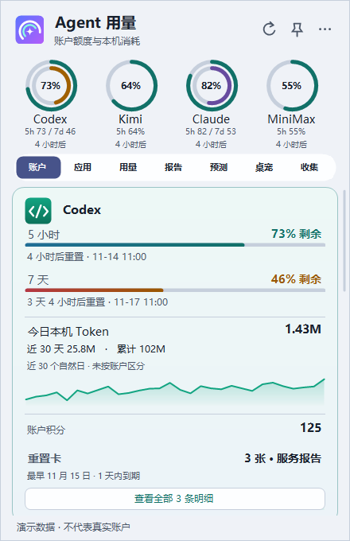
</p>

截图由真实 Windows 界面在隔离构建机中使用**虚构数据**生成；系统圆角、阴影和任务栏效果不包含在截图中。

## 三步开始

1. 从 [Alpha 43 发布页](https://github.com/FoxBai/agent-meter-windows/releases/tag/windows-v0.1.0-alpha.43) 下载 `AgentMeter-Windows-x64.zip`。更新时请先从旧版托盘菜单选择「退出」。
2. 解压并保留完整文件夹，运行 `AgentMeter.Windows.exe`。便携包已包含运行环境；3D 桌宠以及 WorkBuddy、小米 MiMo、Qoder 和 TRAE 登录另需 [WebView2 Runtime](https://developer.microsoft.com/microsoft-edge/webview2/)。
3. 点击通知区域的图标查看用量；找不到时展开隐藏图标。右键或顶部三个圆点可切换账户、托盘余量和界面风格。

当前支持 Windows x64，开发验证环境为 Windows build 26300；其他系统版本与 ARM64 尚待验证。预览版未签名，发布页附 SHA-256 校验文件。账户数据依赖对应 Agent 的本地安装与登录状态，首次扫描大量历史记录可能较慢。

## 随用随收，信息一眼可见

- **真正的托盘弹层**：默认约 440 × 680，无系统标题栏，不占任务栏窗口按钮。点击外部或按 Esc 收起，图钉可临时固定；普通窗口模式也保留。
- **托盘直接看余量**：图标显示剩余百分比，可选固定来源或自动最低余量。悬停查看来源与周期；过期、关闭和未知数据不冒充零。切换显示来源不会开启账户查询。
- **账户信息集中展示**：双周期额度环、倒计时、套餐、钱包、积分和 Codex 重置卡明细放在对应账户卡片里；Qoder 本机积分单独标注为消耗，不当作账户余额。重置卡按到期时间排序，支持展开；服务报告的总数不会由程序擅自扣减。
- **可选登录启动**：在托盘菜单登记当前用户的登录启动项，启动时面板保持收起；默认关闭。系统的启动应用开关仍可能阻止程序启动。
- **七种界面风格**：极简、原生、瓷白、极光、钛影、霓虹、棱镜。导航、卡片、菜单与分享图使用一致配色。

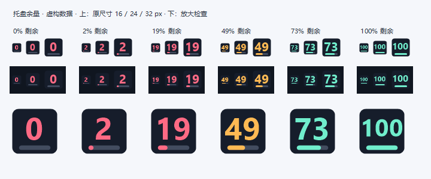

托盘自动模式比较百分比，不能据此比较不同服务的绝对额度；余额和积分绝对值不参加比较。图标为整数近似值，悬停保留一位小数。

## 七个页面，各有分工

| 页面 | 可以查看什么 |
| --- | --- |
| 账户 | 各服务剩余额度、周期重置时间、可用的套餐与余额，以及独立标注的本机统计 |
| 应用 | 工具覆盖情况、近期有更新的活动记录；支持筛选和展开数据来源 |
| 用量 | 今日、近 7 天、近 30 天和累计 Token、API 等价估算、输入／输出／缓存构成、按应用来源对比及可选预算进度，并提供 7 日模型排行和自然日趋势；支持导出 JSON / CSV 汇总 |
| 报告 | 本周、上周、本月和上月汇总；比较已结束的相同自然日，导出 Markdown 或 PNG 分享图 |
| 预测 | 主动开启后查看第三方 24 / 48 小时预测、上游加权中位数、明确时间窗口与历史事件 |
| 桌宠 | 查看状态，预览并切换七个内置形象，控制桌面显示；显示时同步动态画面 |
| 收集 | 本机用量、图片文件和 API 等价估算花费徽章、5 小时和 7 天额度窗口的掉落卡片；更多类别仍在移植 |

还提供默认关闭的低额度通知、独立的 Codex 重置卡到期提醒，以及上游「麻薯」「比特」精灵图和五套 3D 桌宠。在桌宠页或托盘菜单选择形象并显示桌宠，单击可打开面板，拖动可调整位置。账户和本机账本默认每 15 分钟刷新，可在托盘菜单选择 5、15 或 30 分钟，也可手动刷新；应用页可见时每分钟单独检查本机活动。桌宠完整互动、通知效果和高 DPI 仍需实机验收。

在托盘菜单的「预算与异常提醒」中可选设人民币日／周预算，预算和通知默认关闭。进度按北京时间及本机 API 等价估算计算，美元使用固定汇率 1:7.25；它不是实际账单。周统计使用每天最后一次记录，缺失日期会标记为部分；异常速度在数据不足时不判断。启用后仅在本机保存设置和每日汇总，关闭功能不会自动删除已有历史。系统通知是否显示取决于 Windows 设置。

<p align="center">
  
  
  
  
  
</p>

五套 3D 形象使用原版离线渲染资源，上图由隔离构建机生成；额度未知时圆环保持未知。3D 形象对单击、拖起、放下和右键刷新提供动作反馈，也可主动开启视线跟随光标。桌宠和视线跟随均默认关闭，更多互动仍在移植。


<details>
<summary>查看形象选择与视线跟随设置</summary>

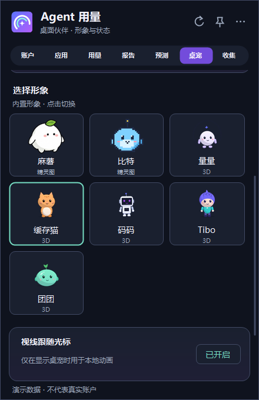
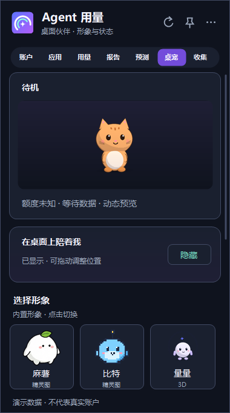

</details>

<details>
<summary>展开查看账户明细、应用与用量截图</summary>

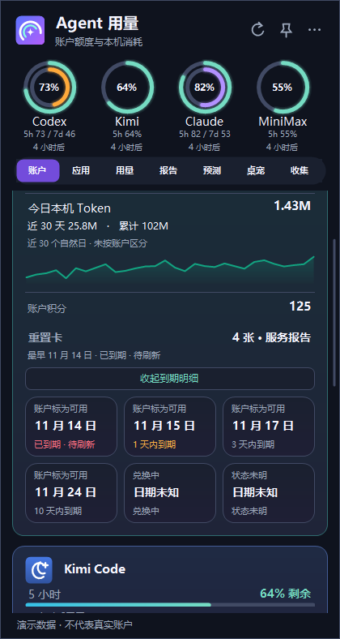


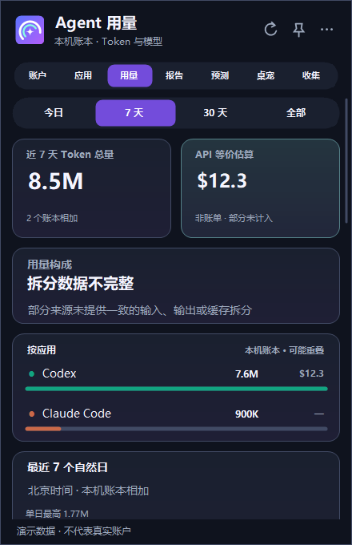

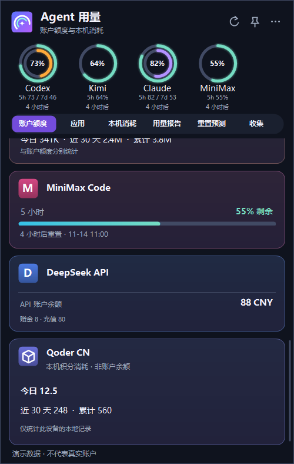
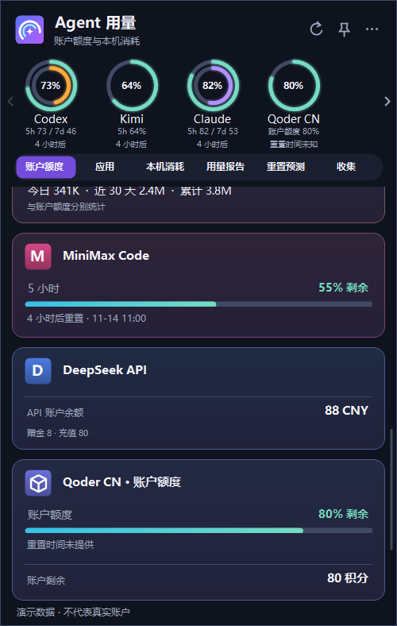
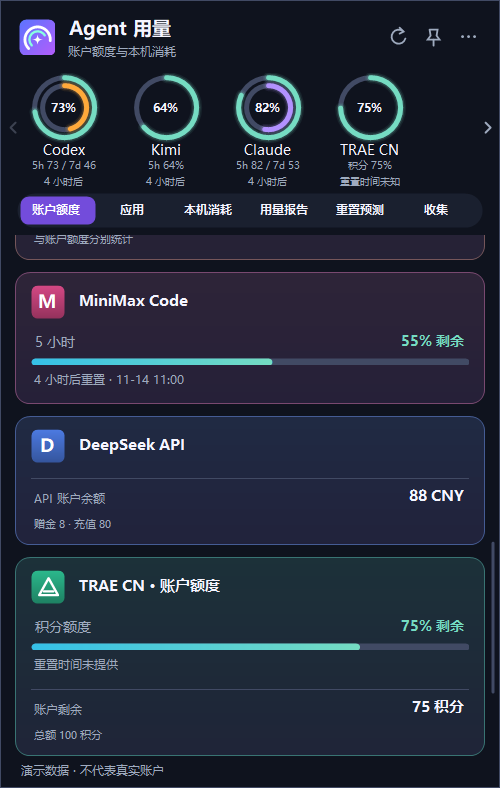

</details>

<details>
<summary>展开查看报告、预测、收集与余额截图</summary>

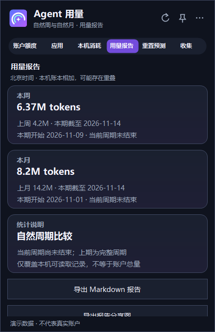


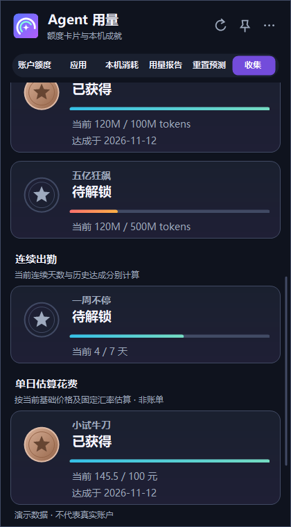
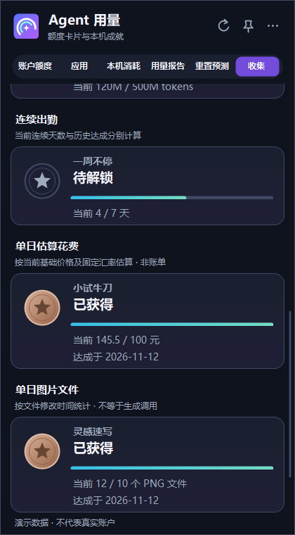
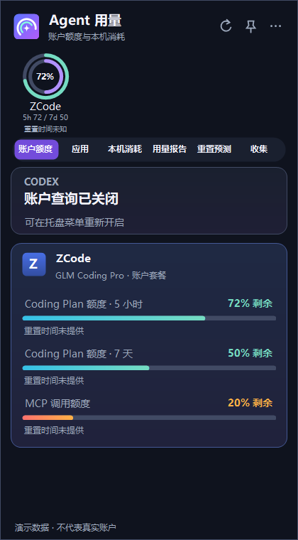
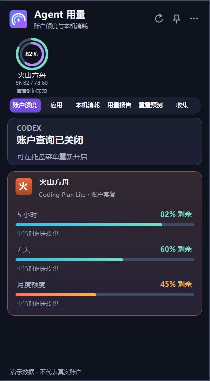
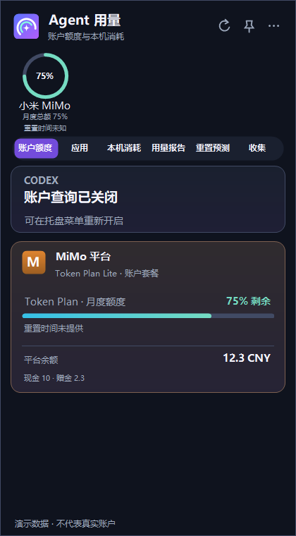

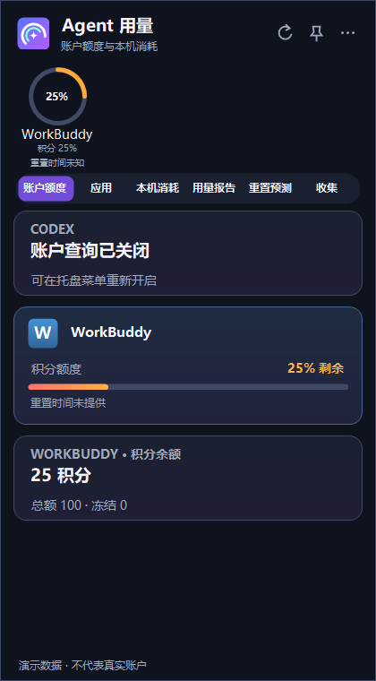

</details>

## 支持的数据来源

| 来源 | 账户额度 | 本机 Token 历史 |
| --- | --- | --- |
| Codex | 额度和重置时间；可用时显示积分、重置卡 | 本机会话及归档；生图目录 PNG 文件数量 |
| Claude Code | 读取已有本地订阅凭据（模拟验证） | 本地项目会话 |
| Gemini CLI | 暂不支持 | 本地聊天会话 |
| WorkBuddy | 实验性网页登录与积分查询，默认关闭（模拟验证） | 本地项目会话 |
| ZCode / 智谱 Coding Plan | 用户主动添加密钥后查询，默认关闭（模拟验证） | 本地 CLI 用量数据库 |
| 火山方舟 Coding Plan | 用户主动添加 AccessKey 对后查询，默认关闭（模拟验证） | 暂不支持 |
| DeepSeek Harness | 暂不支持 | 本机会话日志，包含受支持的压缩日志 |
| DeepSeek API | API 余额，主动添加密钥并启用（模拟验证） | 不直接提供本机历史；DeepSeek Harness 另列 |
| Kimi Code / 旧版 Kimi CLI | Kimi Code 已运行本地服务（模拟验证） | 本机会话日志 |
| OpenCode | 暂不支持 | 本地 v1 / v2 助手消息，迁移记录按编号去重；部分压缩记录暂未计入 |
| MiniMax Code | 最多 5 个独立账户或环境变量密钥，主动开启（模拟验证） | 本机用量数据库 |
| 小米 MiMo 平台 | 实验性独立网页登录与余额／Token Plan，默认关闭（模拟验证） | 不直接提供本机历史 |
| MiMo Code、DevECo | 暂不支持 | 本机用量数据库 |
| Qoder CN | 实验性独立网页登录与账户额度，默认关闭（模拟验证） | 本机积分消耗，不是 Token 或账户余额 |
| TRAE CN | 实验性独立网页登录与账户额度，默认关闭（模拟验证） | 暂不支持 |

Codex 账户和部分本机账本已有真实数据核对；其他新增账户接入目前以模拟测试为主。OpenCode 压缩记录和无法识别的数据会标记为不完整；Windows 版尚未完成所有上游数据源、账户隔离、桌宠互动和动效。逐项证据与待验收内容见[移植计划](windows/PORT_PLAN.md)。

## 数字怎么理解

**账户额度与本机历史分别计量。** 本机历史只覆盖当前电脑能读取的记录，未按登录账户归属，不等于账户总用量；不同账本可能重叠。今日、自然日和周月报告使用北京时间（Asia/Shanghai），近 7 天等滚动窗口另行标注。未知不等于零，不同服务的积分不相加。

用量构成只汇总已读取的账本，并仅在各账本拆分与总数一致时显示。缓存命中率按缓存读取 ÷（新输入 + 缓存读取 + 缓存写入）计算；存在未拆分 Token 时不显示命中率，部分来源失败会提示。

本机汇总可导出 JSON 或 CSV，只包含可用来源、周期、状态和 Token 汇总，不含路径、会话或账户凭据。未知值保留为空或 null；本机积分和金额估算不包含在内。

API 等价估算使用上游内置价格快照或本机自定义美元价格，单位为每百万 Token；部分人民币价格使用 1 美元 = 7.25 元的固定回退汇率。它不是实际账单或订阅扣费，缺少必要字段时会标注不完整。实时价格、汇率和更完整的峰谷设置仍在移植。

预测来自第三方站点。范围带表示站点数值的最小值与最大值，不能当作置信区间；超过 48 小时的来源不参与合并。预测时间到点只显示待确认，不代表 OpenAI 承诺或个人账户已重置。

## 隐私与数据

- 本机历史只在本机处理，界面使用汇总指标，不上传会话记录，也不要求注册 Agent Meter 账户。
- Codex、Kimi、Claude 查询默认开启；MiniMax、DeepSeek、WorkBuddy、智谱 Coding Plan、火山方舟 Coding Plan、小米 MiMo、Qoder、TRAE、第三方预测、通知和桌宠默认关闭。账户开关不影响本机账本读取。
- 启用账户查询时会联系对应服务。Codex 使用已有登录，Claude 使用已有本地订阅凭据；MiniMax、DeepSeek、智谱 Coding Plan 密钥及火山方舟 AccessKey 对保存在 Windows 凭据管理器。WorkBuddy、小米 MiMo、Qoder 和 TRAE 分别使用独立的 WebView2 登录目录。TRAE 启用后会在应用内后台打开官网页面以尝试更新短期凭据。
- 3D 桌宠视线跟随默认关闭；开启后只在桌宠显示时读取当前鼠标位置用于本地动画，不保存或上传位置。
- Windows 界面尚未开放自动领取或兑换积分。托盘来源设置只保存模式，切换或更新图标不额外联网。

凭据传递方式、网络域名、本地缓存、删除与退出登录的区别，见[隐私与本地数据说明](windows/PRIVACY.md)。安全问题请按 [SECURITY.md](SECURITY.md) 反馈。

## 从源码构建

需要 Python 3.10 与 .NET 8 SDK。在项目根目录打开 PowerShell：

```powershell
py -3.10 -m venv .venv-win
.\.venv-win\Scripts\python.exe -m pip install -r windows\requirements.txt
powershell -NoProfile -ExecutionPolicy Bypass -File windows\build.ps1
.\windows\dist\AgentMeter\AgentMeter.Windows.exe
```

`--demo` 使用虚构数据，不读取真实账户或历史；`--window` 以普通窗口查看真实数据。退出请在菜单中选择「退出」，收起面板会继续后台运行。

```powershell
powershell -NoProfile -ExecutionPolicy Bypass -File windows\test.ps1
dotnet build windows\AgentMeter.Windows -c Release
```

针对性测试覆盖 Windows 适配重点路径；CI 另外检查打包程序、后台唤起、托盘切换、弹层生命周期、WebView2 隔离与演示渲染，并核对托盘弹层导航及筛选切换后的实际画面。通过构建和隔离检查不等于完成所有实体设备验收。

## 常见问题

| 现象 | 处理方法 |
| --- | --- |
| 托盘没有数字 | 检查「托盘余量」来源及对应账户开关；数据未知、超过 30 分钟或窗口已到重置时间时恢复为应用图标 |
| 没有 Codex 额度 | 确认已登录的 `codex.exe` 在 PATH 或 Codex Desktop 安装目录中，再刷新 |
| 没有本机历史 | 确认当前 Windows 用户已使用过对应工具且记录仍在；可用 `CODEX_HOME`、`CLAUDE_CONFIG_DIR`、`DSH_HOME`、`KIMI_CODE_HOME`、`XDG_DATA_HOME` 或 `OPENCODE_DB` 指定路径 |
| 首次刷新慢 | 首次需要扫描历史，后续复用有限的内存缓存；退出、文件变化或缓存淘汰后需要重新读取 |
| 数字与官方页面不同 | 核对账户额度和本机历史的范围、周期、更新时间与不完整来源提示 |

更多交互见[快速使用](windows/QUICK_START.md)，布局和失焦规则见[弹层设计](windows/DESIGN.md)。

## 参与贡献

欢迎通过 [Issues](https://github.com/FoxBai/agent-meter-windows/issues) 反馈，或提交改进。请提供 Windows 版本、应用版本、数据源、预期结果和脱敏后的复现步骤；请勿附上凭据、私密账户信息或对话内容。

Windows 新代码、注释与文档以中文为主。修改前阅读 [贡献说明](CONTRIBUTING.md)；提交时附上针对性测试结果，界面改动请提供虚构数据截图，并说明尚未验证的平台。当前优先项：更多原版数据源、多屏与高 DPI、账户归属、材质与动效。

## 致谢与许可

感谢 [Gary23333/agent-meter](https://github.com/Gary23333/agent-meter) 提供原版设计、采集器和素材。移植基准为 [`ac547d0`](https://github.com/Gary23333/agent-meter/commit/ac547d0dd56031cad70c3f0adf6266ce96a69bf9)，Windows 原生界面与适配层位于 [`windows/`](windows/)。本项目是独立移植版，并非上游或任何 Agent 服务商的官方发行版。

[MIT](LICENSE)，保留原作者 Gary23333 的版权声明；第三方组件和素材遵循各自许可，见 [THIRD_PARTY_NOTICES.md](THIRD_PARTY_NOTICES.md)。
