<p align="center">
  
</p>

# AgentMeter · Agent 用量

<p align="center">
  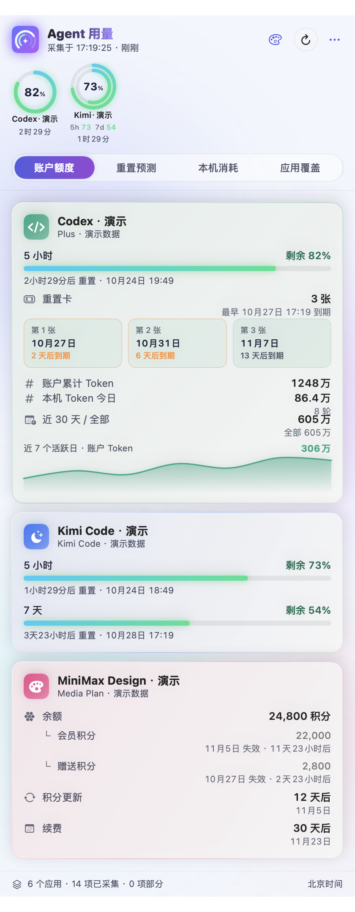
</p>

<p align="center">
  <strong>专为开发者与创作者打造的 macOS 菜单栏 AI Agent 用量与额度大盘</strong><br />
  实时聚合账户额度 · 重置倒计时 · 重置卡库存 · 创作积分 · 本机 Token 消耗流 · Tibo 全员重置预测
</p>

<p align="center">
  
  
  
  
  
  
  
  <a href="LICENSE"></a>
</p>

> 下方截图由 App 离线预览生成，所有账户、余额和用量均为虚构演示数据，不代表真实账户或全部来源的接入情况。

---

## 💡 为什么需要 AgentMeter？

在使用各类 AI 辅助编程与创作工具（Codex、Claude Code、Kimi Code、Qoder、TRAE、MiniMax、即梦等）时，你是否常遇到以下痛点：

- 📉 **用量焦虑与分散查询**：额度分散在各种网页后台、控制台或本地配置里，每次查询都要反复登录或点开多个面板；
- ⏳ **重置卡悄然过期**：好不容易领到的 5 小时卡、周重置卡还没来得及用，就已经过了有效期；
- 🚨 **额度突发告急**：编码正处于关键思路阶段，工具突然触发限流，打断专注心流；
- 💰 **会员续费与扣费遗忘**：多平台的月付、年付会员何时扣款、何时刷新积分缺乏统一跟踪；
- 📊 **缺少统一视角的本地开销账本**：不同 Agent 客户端的 Token 消耗、缓存命中率与估算费用散落各处，难以聚合。

**AgentMeter（Agent 用量）** 正是为此而生：以极低资源开销常驻 macOS 菜单栏，像**股票大盘**一样滚动轮播你的所有 Agent 核心额度，支持多级阈值告警，并在本地建立精准去重的 Token 与费用透析大盘。

---

## ✨ 核心亮点

```
┌────────────────────────────────────────────────────────────────────────┐
│  Menubar:   [Codex 82% 2h31m]  [Claude 65% 4d]  [Kimi 91% 1d]  ...   │
└───────────────────────────────────┬────────────────────────────────────┘
                                    │ 点击弹出
┌───────────────────────────────────▼────────────────────────────────────┐
│ ✦ 七套界面风格：极简 / 原生 / 瓷白 / 极光 / 钛影 / 霓虹 / 棱镜          │
│ ├─ 顶部驾驶舱：每个账户一个同心圆仪表（5 小时 / 7 天合一），一键直达应用 │
│ ├─ 账户额度：各供应商统一卡片——额度窗口、积分钱包、重置卡、续费提醒    │
│ ├─ 重置预测：Q 版 Tibo + 重置器，三家追踪站交叉的全员重置概率与倒计时  │
│ ├─ 本机消耗：CC Switch 历史 + Kimi Code 真实会话 Token 双流去重合并     │
│ └─ 应用覆盖：已检测 24+ Agent 应用的原生状态矩阵                       │
└────────────────────────────────────────────────────────────────────────┘
```

### 1. 📈 股票大盘式菜单栏行情条（Ticker）
- **Core Animation 硬件加速横向滚动**：默认平滑滚动显示「图标 + 名称 + 剩余量 + 剩余时间」，CPU 占用仅约 **0.4%**。
- **动态涨跌感**：额度百分比根据余量自动变色，当余量变动时带 ▲ / ▼ 提示（绿色代表余量充裕/恢复，红色代表被消耗）。
- **多种呈现模式自由切换**：支持滚动轮播（宽度 160/220/300 自选）、逐条翻动、最紧张额度优先、今日 Token 汇总或极简图标模式。

<p align="center">
  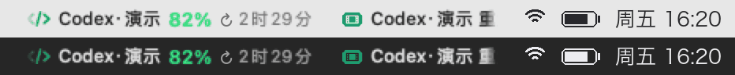
</p>

### 2. 🔔 阶梯式预警与系统通知（Notifier）
- **额度告急提醒**：剩余低于阈值（默认 20%，可选 10%/30%）、跌破 5%、耗尽时自动发送原生系统通知；
- **重置卡/积分临期提醒**：3 天内与 24 小时内即将过期的重置卡或临时积分包重点提醒；
- **订阅周期提醒**：3 天内自动续费扣款提醒、7 天内会员到期（未开启自动续费）提醒；
- **防打扰机制**：同一事件仅提醒一次，点击通知即可直接定位打开面板。

### 3. 🎨 七套界面风格，一键切换（SwiftUI + AppKit）
- **从克制到炫技**：面板标题栏的调色板按钮或设置菜单「界面风格」随时切换，立即生效并记住选择：
  - **极简 / 原生**：黑白排版或 macOS 系统卡片，适合长时间专注使用；
  - **瓷白**：柔和陶瓷质感与克制的浅浮雕；
  - **极光**（默认）：流光底色、毛玻璃卡片与品牌色微光；
  - **钛影**：深色拉丝金属、机械式立体层次；
  - **霓虹 / 棱镜**：赛博光效或全息晶体，提供更强的空间感与视觉表现；
- **统一的视觉与排版基线**：七套风格共享三级文字颜色、稳定卡片底色、清晰的选中态、14px 内容内边距和固定排行数字列；霓虹与棱镜收敛强光干扰，钛影与瓷白的小字对比更清楚；
- **统一的供应商卡片**：各来源按同一顺序展示「额度窗口 → 积分钱包 → 积分更新 → 重置卡 → 续费 → Token」，额度窗口从短到长排列，倒计时按紧急程度而非品牌色着色；
- **Swift Charts 消耗分布图**：将输入、输出、缓存命中等构成以环形图直观呈现，深色/浅色模式自适应。

<p align="center">
  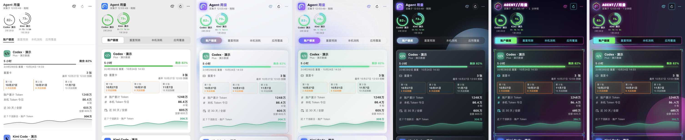
  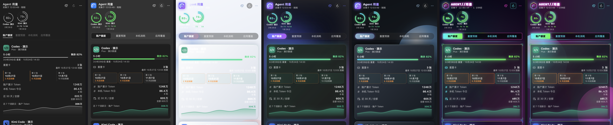
</p>
<p align="center"><sub>从左到右：极简 · 原生 · 瓷白 · 极光 · 钛影 · 霓虹 · 棱镜（钛影、霓虹、棱镜固定深色）</sub></p>

<p align="center">
  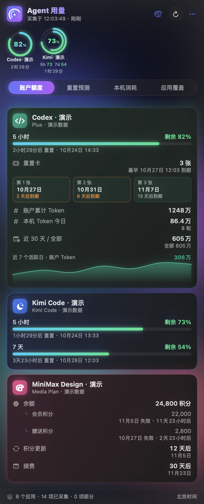
  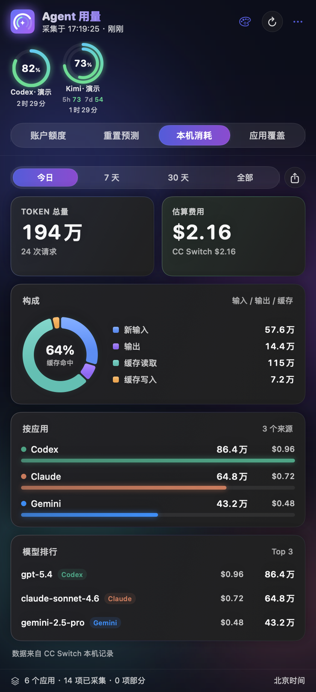
</p>

<details>
<summary>查看更多截图：本机消耗、应用覆盖与菜单栏行情</summary>

<p align="center">
  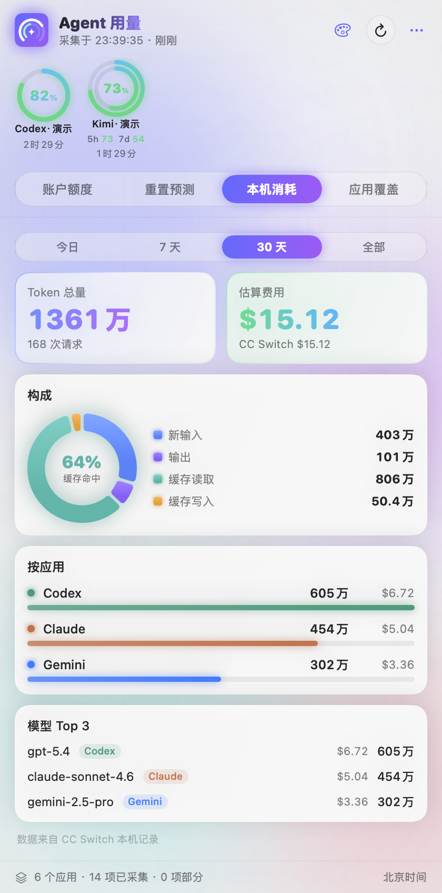
  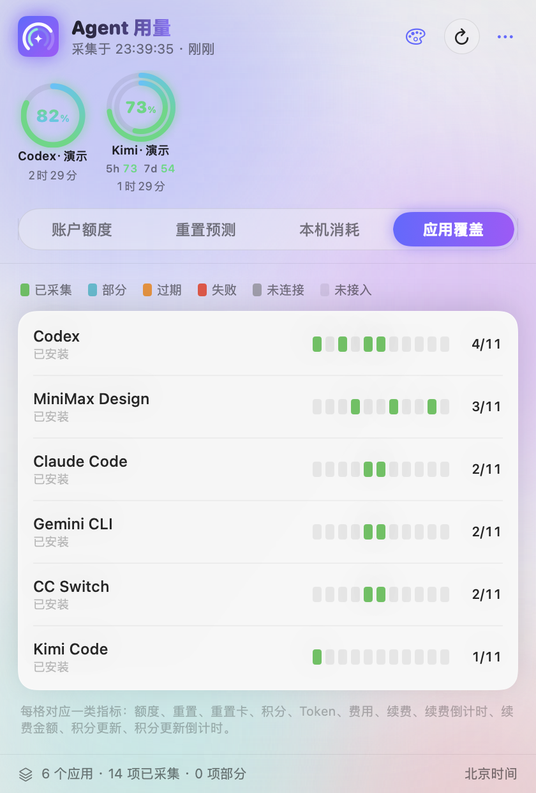
</p>

<p align="center">
  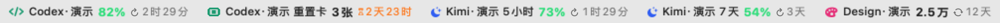
</p>

截图生成方式见 [截图说明](docs/images/README.md)。

</details>

### 4. 👥 多账号隔离支持（Multi-Account）
- 每个网页登录来源支持最多 **5 个独立账号**（如「主号」、「小号」、「工作号」）；
- 每个账号**独立成卡、独立进大盘行情条、独立计算提醒阈值**，严禁将不同账号的额度粗暴相加；
- 后端规范命名通道（首个账号保持原源名，后续账号分配 `provider#2` 并关联备注）。

### 5. 🔀 智能双流合并本机消耗（Dual-Stream Accounting）
- **历史主库**：通过只读事务与一致性连接读取 **CC Switch (Schema 20)** 历史数据库；
- **增量会话**：毫秒级解析 **Kimi Code** 本机 `~/.kimi-code/sessions/**/wire.jsonl`，提取唯一 `turn` 作用域真实 Token；
- **严密去重**：明确区分 CC Switch 路由的 `kimi-for-coding` 与独立的 Kimi Code 桌面端，相加绝不重叠；对缺少定价的记录或下界统计明确标注，绝不捏造虚假账单。
- **峰谷计价视图**：按请求时间戳把本机消耗拆成峰时 / 谷时，展示 DeepSeek 峰时 ×2 的价差影响；没有请求时刻的账本（CC Switch 日汇总）按谷价计入价格表估算，并在视图里点名说明。

### 6. 🧠 模型目录自动同步与体验模型计费绑定
- **自动更新模型名称与刊例价**：从公开 `models.dev` 目录同步主流供应商的模型 ID、名称、发布日期及输入、输出、缓存读写的每百万 Token 单价；启动后自动同步，每 6 小时检查，目录本身按 24 小时节流，也可在「模型与计费」窗口手动同步。
- **本地修改不被覆盖**：内置价、同步目录价与用户价格分层合并，用户自定义优先；同步失败保留上次成功目录，未返回有效价格的体验模型不会被自动当成免费。
- **超前体验期也能估算**：可将无法计价的模型或内部代号绑定到现有模型，沿用其四项 Token 单价；绑定关系会写入估算结果，正式价格发布后可随时替换。
- **峰谷双价**：DeepSeek 系模型默认峰时倍率 2×（北京时间工作日 09:00–12:00、14:00–18:00 峰时，周末谷时），可在「模型与计费」逐行修改；价格表单价保持谷时基准，估算自动按请求时刻选价。
- **口径透明**：所有金额均为 API 等价估算而非订阅账单；未知不等于零，不同账户与币种不混算。

### 7. 🎨 创作类工具专属指标支持（Creative Metering）
- **MiniMax Design**：读取当前个人 Media Plan 钱包余额，精准追踪积分包失效时间与次月积分刷新倒计时；
- **即梦 (Dreamina)**：内置隐藏 Web 监控视图，定期在后台拦截自身发出的安全查询响应，直观展现会员等级、积分明细与续费倒计时。

### 8. 🔮 Tibo 全员重置预测 + Q 版重置器（Reset Forecast）
- **独立的「重置预测」标签页**：只读抓取三家第三方追踪站（Will Codex Reset、Tibo Radar、Codex Reset Monitor）公布的 ChatGPT / Codex 全员重置概率，给出 24 / 48 小时**区间 + 加权中位**，并标出各站「接近 / 分歧」；
- **更易用的重置器**：可切换 24 / 48 小时观察窗、立即刷新；机身、屏幕和旋钮具有立体层次，各站口径默认折叠，历史记录默认 3 条并可展开；
- **七套主题各有造型**：从黑白线稿、系统色到陶瓷、钛金属与全息发光效果，整页颜色与组件跟随主题；
- **口径克制**：只汇总各站自己公布的数值，不写入账户重置时间、不进菜单栏行情条；通知只在**已公告**的时段开始 / 结束或追踪站记录到落地时触发，概率永远不弹通知；可在设置菜单一键关闭联网抓取。

<p align="center">
  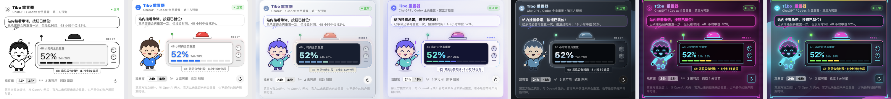
</p>
<p align="center"><sub>从左到右：极简 · 原生 · 瓷白 · 极光 · 钛影 · 霓虹 · 棱镜（演示数据，非真实预测）</sub></p>

<details>
<summary>查看完整的重置预测页</summary>

<p align="center">
  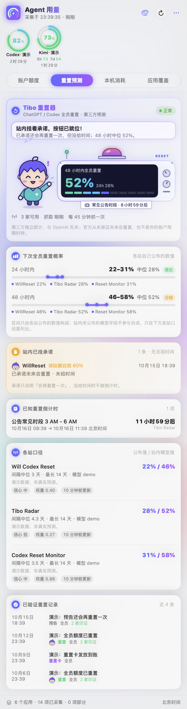
  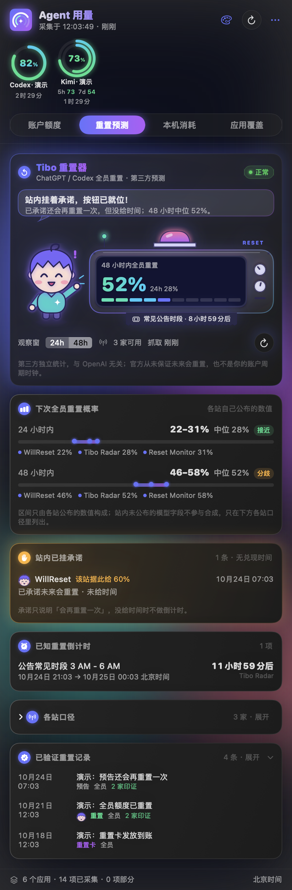
</p>

</details>

### 9. 🖼️ 用量报告与一键分享图（Usage Report）
- **本机消耗页一键打开报告窗口**：时间段筛选与本机消耗页共用，今日 / 7 天 / 30 天 / 全部即时联动；总览、Token 构成、按应用 / 模型 Top 排行口径逐位一致，只含本机消耗、不含账户余额。
- **七套风格竖版分享卡**：极简、原生、瓷白、极光、钛影、霓虹、棱镜，宽度固定、高度随内容自适应；一键复制 2x PNG 到剪贴板，或直接保存为图片，适合分享到微信 / 飞书 / 小红书。
- **口径标注**：页脚标明「数据来自本机账本 · 只读聚合 · 不含对话内容」「费用为 API 等价估算」，不含凭据与对话正文。

<p align="center">
  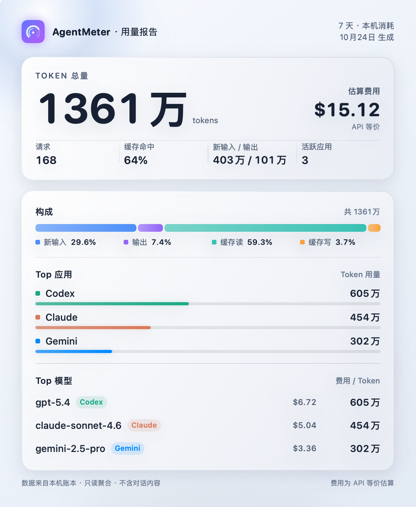
  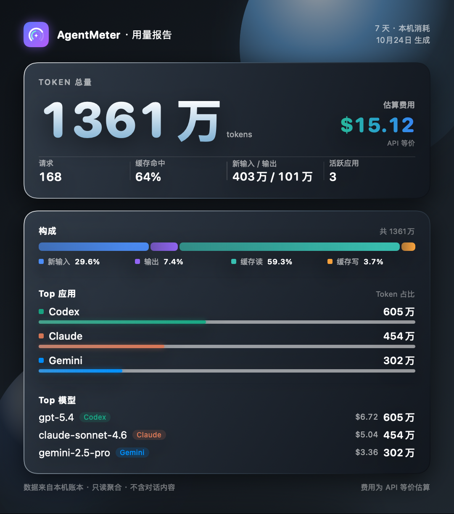
  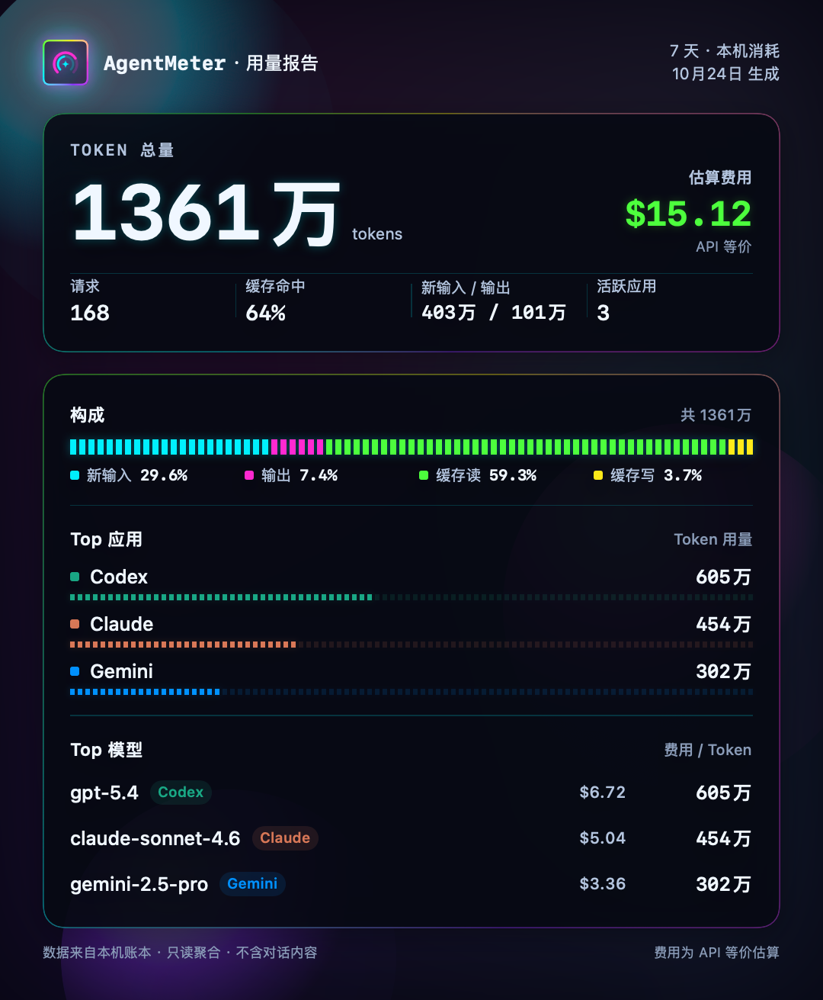
</p>
<p align="center"><sub>瓷白 · 钛影 · 棱镜（演示数据，非真实消耗）</sub></p>

---

## 🛡️ 安全与设计原则（Security First）

我们深知开发者对**隐私与凭据安全**的极高要求。AgentMeter 遵循以下铁律设计：

> [!IMPORTANT]
> 1. **100% 只读保障 (Strictly Read-Only)**：核心逻辑绝不包含任何买入、兑换重置卡、更改套餐、发送模型 Prompt 的操作。
> 2. **凭据零泄露 (Zero Credential Leakage)**：
>    - 网页 Session 与 API Key 仅保存在 macOS 系统的钥匙串（Keychain）中；
>    - 传输给本机后端时仅通过 loopback 内存通道（`PUT /v1/web-sessions`），不写入快照文件或日志；查询时仅发送给对应服务的官方端点；
>    - 快照与对外接口中，账号标识一律经过 SHA-256 散列并截断（`account_key`），绝不泄漏原始用户 ID。
> 3. **数据诚实性 (Honest Metrics)**：
>    - **未提供 ≠ 0**：接口未返回的字段明确标为 `not_provided`，严禁脑补为 0；
>    - **不同质不相加**：不同服务商的积分、Token、重置卡绝不机械求和；
>    - **时间精度保真**：天级精度的续费日期不伪造秒级时刻，过期日期真实呈现 overdue 状态。

---

## 📋 数据源支持矩阵

| 数据源 | 覆盖应用 / 场景 | 获取方式 | 支持指标 | 账号隔离 |
| :--- | :--- | :--- | :--- | :---: |
| **Codex** | ChatGPT / Codex CLI | 本机配置与官方端点只读解析 | 额度余量、周重置时间、重置卡库存及到期、Token 汇总 | 独立账户 |
| **Claude Code** | Claude Code CLI | 钥匙串 OAuth 令牌只读获取 | 5 小时 / 7 天窗口额度与重置时刻 | 独立账户 |
| **Kimi Code** | Kimi 编程助手 | 本机 REST + 本机 `wire.jsonl` | 周/5小时额度、Token 消耗流（turn 级精准解析） | 独立账户 |
| **Qoder CN** | Qoder 中国区 | 内嵌安全网页登录 / Cookie | 总体额度、共享额度、已用/剩余、下次重置时间 | 最多 5 账号 |
| **WorkBuddy** | WorkBuddy 腾讯协作 | 内嵌安全网页登录 / Cookie + 本机会话日志直读 | 资源包总量、剩余量、冻结积分、周期截止时间、本机 Token/费用估算 | 最多 5 账号 |
| **TRAE CN** | 字节 TRAE IDE / SOLO | 内嵌安全网页登录 / Cloud-IDE-JWT | 权益包额度汇总、已用额度、有效积分 | 最多 5 账号 |
| **MiniMax Code** | MiniMax Coding Plan | 环境变量 / 钥匙串 API Key | 周套餐余量百分比、到期时间 | 独立账户 |
| **MiniMax Design** | MiniMax 创作工作台 | 本机安全网关 `127.0.0.1:8001` | 个人钱包、积分包失效期、月积分刷新日、年费续费倒计时 | 个人 Media Plan |
| **即梦 (Dreamina)** | 剪映即梦创作平台 | 内嵌隐藏 Web 视图白名单捕获 / CLI | 会员等级、积分总额、多积分包到期、续费状态 | 最多 5 账号 |
| **DeepSeek API** | DeepSeek 开放平台 | 环境变量 / 钥匙串 API Key + 控制台登录（可选） | 货币余额（CNY/USD 独立保留）；网页用量今日 / 3 天 / 7 天 / 30 天（仅展示，不计入本机消耗） | 独立账户 |
| **ZCode / 智谱 Coding Plan** | ZCode、GLM Coding Plan（中国区） | 内嵌网页登录捕获控制台凭据 / 钥匙串 API Key | 5 小时 / 每周额度（已用/总量）、周重置时间、MCP 月度次数 | 最多 5 账号 |
| **火山方舟 Coding Plan** | 火山引擎方舟 | 内嵌控制台登录（回放页面自身的只读 `GetCodingPlanUsage`）/ 钥匙串 AccessKey 签名 | 5 小时 / 每周 / 每月额度与各自重置时间 | 最多 5 账号 |
| **小米 MiMo API** | MiMo 开放平台控制台 | 内嵌安全网页登录 / Cookie | 账户余额（现金 / 赠送）、Token Plan 本月用量 | 最多 5 账号 |
| **阶跃星辰 (StepFun)** | 阶跃星辰开放平台 | 内嵌安全网页登录 / Cookie + 开放平台 API Key | 账户余额（充值 / 赠送）、STEP plan 5 小时 / 每周窗口或月度积分池、套餐名与到期日 | 最多 5 账号 |
| **CC Switch** | 本机多模型路由历史 | 本机 SQLite 数据库只读事务 | 今日/7天/30天/全部 Token、缓存命中率、估算费用 | 本机聚合 |
| **本机 Agent 会话账本** | Codex CLI、Claude Code、Gemini CLI、Antigravity、OpenCode、MiniMax Code、Kimi Code、Kimi 桌面端、ZCode、WorkBuddy、**DeepSeek Harness (dsh)** | 本机会话日志 / SQLite / zstd 会话日志只读直读（未装 CC Switch 也可读） | 今日/7天/30天/全部 Token、按模型分组、缓存命中率、估算费用 | 本机历史 |

---

## 🏗️ 架构概览

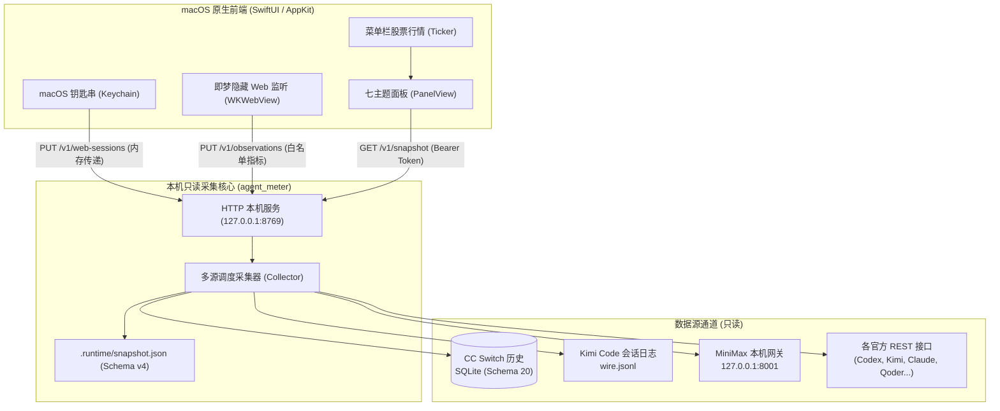

---

## 🚀 快速上手

### 方式一：下载即用（推荐）

1. 从 [Releases · v0.9.3](https://github.com/Gary23333/agent-meter/releases/tag/v0.9.3) 页面下载最新的安装镜像：
   - 📦 `AgentMeter-0.9.3-macos-arm64.dmg`
2. 打开 DMG，将 `Agent 用量.app` 拖入 `Applications`（应用程序）文件夹；
3. 双击启动应用。菜单栏将立即出现小组件图标与默认行情条。
   - *App 包含独立 Python 后端，无需安装 Python、Xcode 或项目源码。各来源仍需对应客户端/登录态。*

当前发布使用 Developer ID Application 签名，App 与 DMG 均已完成 Apple 公证与装订；正常双击即可打开。详见 [安装说明](docs/INSTALL.md) 和 [v0.9.3 发布说明](docs/release-v0.9.3.md)。安装版数据位于 `~/Library/Application Support/AgentMeter/.runtime/`。

### 方式二：从源码构建原生应用

环境要求：macOS 14.0+，Xcode / Swift 5.10+、Python 3.9+ 和固定版本的 PyInstaller。

```sh
# 1. 克隆代码仓库
git clone git@github.com:Gary23333/agent-meter.git "AgentMeter"
cd "AgentMeter"

# 2. 安装打包依赖，构建 App 和 DMG
python3 -m pip install -r requirements-build.txt
sh scripts/build-dmg.sh
```

构建产物输出至 `release/`：App、DMG 和 `SHA256SUMS`。`VERSION` 指定内部版本 0.9.3，发布标签为 v0.9.3；默认 ad-hoc 签名，`SIGN_MODE=dist` 使用 Developer ID 并在提供 `APPLE_ID` / `APPLE_APP_SPECIFIC_PASSWORD` / `APPLE_TEAM_ID` 时自动公证。开发时可用 `AGENT_METER_HOME` 指定源码后端。

| 目录 | 内容 |
| --- | --- |
| `agent_meter/` | Python 后端 |
| `menubar/` | Swift 原生前端 |
| `scripts/` | 后端、DMG 打包和发布验证 |
| `tests/` | 自动化回归 |
| `docs/` | 共享知识、接口、研究及验收文档 |
| `examples/` | 无凭据配置示例 |
| `release/` | 本机发布产物；二进制上传到 GitHub Releases |
| `.runtime/` | 本机日志、缓存及构建中间产物，不上传 |

### 方式三：独立运行 Python 只读统计后端

后端使用 **Python 3.9+ 纯标准库** 实现，**无需安装任何 `pip` 第三方依赖**。

```sh
# 1. 采集单次快照并输出至本地
python3 -m agent_meter collect --output .runtime/snapshot.json

# 2. 仅采集本机 CC Switch 历史（跳过账户网络查询）
python3 -m agent_meter collect --local-only --output .runtime/local.json

# 3. 启动本地守护服务（默认监听 127.0.0.1:8769）
python3 -m agent_meter serve --start-kimi-server
```

> 服务启动后，认证 Token 将写入 `.runtime/api.token`（文件权限 0600，仅当前用户可读写）。所有 API 调用需在 Header 中携带 `Authorization: Bearer <本地 Token>`。

---

## 🔌 本机 API 接口速查

服务仅响应本机（127.0.0.1）请求，严禁跨域 Origin 访问。

| 接口 | 方法 | 说明 |
| :--- | :---: | :--- |
| `/v1/health` | `GET` | 检查服务运行状态与 Schema 版本（当前为 4） |
| `/v1/snapshot` | `GET` | 获取包含全部来源与应用覆盖矩阵的完整快照（默认缓存 120 秒） |
| `/v1/sources` | `GET` | 查询各个数据源的细分指标、提取范围及错误代码 |
| `/v1/coverage` | `GET` | 查询 24+ 应用在十一类关键指标上的覆盖状况矩阵 |
| `/v1/refresh` | `POST` | 强制穿透缓存立即采集最新数据并返回快照 |
| `/v1/prices` | `GET` / `PUT` | 读取或保存自定义价格与体验模型绑定；响应包含同步目录状态 |
| `/v1/prices/sync` | `POST` | 立即同步公开模型名称和刊例价，保留用户价格与旧目录回退 |
| `/v1/web-sessions` | `PUT` | 前端将钥匙串中的凭据/Cookie 传入后端内存使用 |
| `/v1/observations` | `PUT` | 前端将网页抓取到的白名单结构化指标同步至后端内存 |

**Python 调用示例：**

```python
import json
from pathlib import Path
from urllib.request import Request, urlopen

token = Path(".runtime/api.token").read_text().strip()
req = Request(
    "http://127.0.0.1:8769/v1/snapshot",
    headers={"Authorization": f"Bearer {token}"}
)

with urlopen(req, timeout=30) as resp:
    data = json.load(resp)
    print("采集时间:", data["collected_at"])
    print("覆盖概览:", data["coverage_summary"])
```

---

## 🧪 自动化测试与对账验证

本项目拥有严格的质量保障体系，包含完整的单元测试、契约测试与真实对账校验器：

```sh
# 1. 运行全量单元测试（包含 306 项严格测试，零失败；dsh 建议 Python 3.14）
python3 -m unittest discover -v

# 2. 运行真实环境对账校验（核对 CC Switch 逐条计算与后端 SQL 一致性）
python3 -m agent_meter verify --output .runtime/verification.json
```

---

## 📝 更新日志

各版本的完整说明见 [发布说明](docs/)（`release-v*.md`）。

### v0.9.3 · 2026-10-28
- **修复 Codex 间歇性“读取失败”**：`account/rateLimits/read` 实测需 15–25 秒，原 20 秒通用超时导致 `rpc_timeout`；Codex 改用独立 45 秒超时，并缓存最后一次成功的账户指标，瞬时失败显示“旧数据”而不是“读取失败”。详见[发布说明](docs/release-v0.9.3.md)。
- **减少无效等待**：Codex 账户累计 Token 接口上游超时（`token usage profile fetch timed out`），成功结果缓存 6 小时、错误缓存 1 小时，不再每轮白等 10 秒。
- **错误文案**：`rpc_timeout` / `rpc_disconnected` / `rpc_request_failed` 改为中文说明。

### v0.9.2 · 2026-10-28
- **DeepSeek 网页消耗与峰谷定价**：账户卡新增今日 / 近 3 天 / 近 7 天金额、Token 与请求数，附近 7 日金额柱图；本机消耗新增峰谷定价卡片，按请求时间戳拆分峰/谷，DeepSeek 系峰时 ×2，拆不开的账本按谷价估算。详见[发布说明](docs/release-v0.9.2.md)。
- **全量官方定价复核**：更新 GLM-5.3、Gemini 3 Flash、MiniMax M3、MiMo v2.6 Flash 四项刊例，新增 8 个有官方按量价的模型；价格表支持峰时倍率，官方人民币价优先于美元折算。
- **新增 Kimi 桌面端 Agent Token 账本** 与 MiniMax MCP 正式接入；首次使用 Developer ID 签名 + Apple 公证发布 DMG。

### v0.9.1 · 2026-10-24
- **七套主题完整视觉升级**：统一三级文字、卡片、间距、圆角、选中态和排行数字列，提升浅色与深色外观的可读性，同时保留每套主题的个性。详见[发布说明](docs/release-v0.9.1.md)。
- **重置器与数据页优化**：24 / 48 小时观察窗、概率区间、来源与历史日期对齐；账户、应用覆盖和模型排行更易扫描。
- **分享卡与报告同步升级**：七套竖版分享卡及报告窗口采用一致的排版与图表规范，README 演示截图同步更新。

### v0.9.0 · 2026-10-24
- **模型目录自动同步与体验模型绑定**：软件内更新主流模型名称与四项 Token 刊例价，自定义价格优先；未定价模型可绑定现有模型进行 API 等价估算。详见[发布说明](docs/release-v0.9.md)。
- **新增瓷白、钛影、棱镜三套 3D 主题**：总计七套风格，覆盖主面板、重置器与竖版分享卡。
- **重置器体验升级**：24 / 48 小时观察窗、立即刷新、立体机身与屏幕、折叠来源口径及可展开历史记录。

### v0.8.3 · 2026-10-21
- **修复分享卡风格点不动**：报告窗口改回 `NSHostingController` 挂载，系统桥接控件的点击恢复；风格切换换成纯 SwiftUI 的 `PillTabs`。详见[发布说明](docs/release-v0.8.3.md)。
- **打开即可切换风格**：窗口打开时立即抢焦点，并在后续两轮补激活，不再需要等约 2 秒；实测点击到预览刷新约 186–189ms。

### v0.8.2 · 2026-10-21
- **修复点击分享崩溃**：报告窗口此前在 `body` 里创建 `NSHostingView` 量高度，触发 SwiftUI/AttributeGraph 布局期断言；改为纯 SwiftUI 测量与 `ImageRenderer` 自适应高度。详见[发布说明](docs/release-v0.8.2.md)。
- **分享卡改为仅竖版**：宽度固定 540（2x 输出 1080），高度随内容自适应；移除横版布局。
- **性能**：报告窗口一次 body 只聚合一次数据；MiniMax Code 模型解析改走 SQLite JSON1 并按库版本缓存，该路径耗时约减 2/3，也不再一次性搬运整条消息 JSON。

### v0.8.1 · 2026-10-21
- **修复 MiniMax Code 模型识别与计费**：MiniMax Code 用量表的 `model` 为空、CC Switch 又记为 `unknown`，现按会话消息的逐轮 telemetry 还原每次请求的模型，并通过 `mcode:<session>:<row id>` 精确回填，直读与本通道两处口径一致。详见[发布说明](docs/release-v0.8.1.md)。
- **新增 MiniMax M3.1 Flash 定价**：USD 0.15 / 0.015 / 0.60，CNY 1 / 0.1 / 4（每百万 token），`-Preview` 同档；CC Switch 已给出的非零费用保持不变。

### v0.8.0 · 2026-10-21
- **新增「用量报告与分享」**：本机消耗页时间段筛选旁新增分享按钮，打开独立报告窗口；周期与本机消耗页联动，明细口径逐位一致，只含本机消耗、不含账户余额；四套风格横版分享卡高度自适应，一键复制 2x PNG 到剪贴板或保存为图片。详见[发布说明](docs/release-v0.8.md)。

### v0.7.0 · 2026-10-19
- **新增本机来源：DeepSeek Harness（dsh）Token 账本** —— 直读 `~/.dsh/sessions` 下的 zstd 压缩会话日志（CLI 与桌面端共用），兼容新旧两代格式并按 `(turn, step)` 去重；`reasoningTokens` 归入 `outputTokens` 拆分不双算，缓存写入按 0。**全部模型计入**（跨 deepseek-official、小米 MiMo、火山方舟等供应方），作为独立来源只进「本机消耗」页、不挂单一账户卡片；CC Switch 不导入 dsh，两不相加。详见[发布说明](docs/release-v0.7.md)。
- **内置后端升级至 Python 3.14**：发布包自带标准库 zstd 解码，dsh 来源在任何机器开箱可用，无需用户安装解压工具；接口契约不变。
- **新增研究文档**《本机候选来源复勘》：对 TRAE CN、CodeBuddy、Cursor、Cherry Studio、豆包、Kimi 家族、Qoder 家族等十多项本机数据做只读勘察并分级。

### v0.6.0 · 2026-10-15
- **新增「重置预测」标签页（Tibo 全员重置）**：只读抓取三家第三方追踪站，汇总 ChatGPT / Codex 全员重置的 24 / 48 小时概率区间与加权中位，列出站内承诺、已知时段倒计时、各站口径与已验证的重置记录；通知只按已公告事件触发。schema 升至 4。详见[发布说明](docs/release-v0.6.md)。
- **Q 版 Tibo 与重置器**：预测页顶部的吉祥物会随数据换表情，旁边的「重置器」显示 48 小时中位、LED 进度条和下一时段倒计时小票；四套主题各有造型，整页颜色改为跟随主题。

### v0.5.0 · 2026-10-15
- **新增来源：阶跃星辰 (StepFun) 开放平台** —— 内嵌窗口登录控制台读取账户余额（充值 / 赠送）与 STEP plan 用量（5 小时 / 每周窗口，或 Token Plan 的月度积分池），并显示套餐名与到期日；也可改用开放平台 API Key（按官方文档 `GET /v1/accounts`，只能读余额）。最多 5 个账号。详见[发布说明](docs/release-v0.5.md)。
- **Qoder CN 本机积分账本**：CLI 会话日志每请求带 `credits`（本机 token 字段恒为 0，不臆造），按 `request_id` 去重后折叠进 Qoder 账户卡片的「积分消耗 今日 / 近 30 天 / 全部」，**不写 tokens 指标**，绝不混入本机消耗。
- **MiniMax Design 本机 Token**：读取 Design.app 内嵌 opencode 运行时的账本，按 session ID 剔除与独立 OpenCode 库重复的拷贝会话后附着到 Design 账户卡，附模型 / agent 双分项。
- **本机消耗口径完善**：WorkBuddy 补上按模型分组、Kimi 补齐输入 / 输出 / 缓存拆项，两者首次进入「按应用 / 模型 Top」并获得价格表估算；价格表匹配先归一化（取最后一段 id、小写、`.`≡`-`），新增混元 hy4/hy3、阶跃 step-5 等 8 个刊例，仅 CNY 刊例的国产模型在 USD 表按 1/7.25 折算并标注。
- **修复**：Swift「估算费用」卡此前恒为「—」（CC Switch 估价没进合并视图）；账户额度页 token 行改读与本机消耗页同一个合并函数，不再显示 0。

### v0.4.1 · 2026-10-09
- 品牌更新：新 Logo（两圈 270° 仪表环绕 Agent 星芒）、应用包新增 `AppIcon.icns`、面板顶部标志按主题配色。

### v0.4.0 · 2026-10-09
- 本机 token 历史扩展到 10 个来源：新增 ZCode 用量库、OpenCode、WorkBuddy、Antigravity CLI，以及 Codex CLI / Claude Code / Gemini CLI / MiniMax Code 会话日志直读——**未安装 CC Switch 也能完整读取**；与 CC Switch 重叠的日期动态剔除、绝不叠加。
- API 等价费用估算（18 个模型家族默认价，USD/CNY 双币种）与菜单「API 价格表」配置页。
- DeepSeek 网页用量（近 30 天，仅展示、不计入本机消耗）。
- 加固：来源开关覆盖第二账号与本地历史、采集线程池与任务数同宽、配置 PUT 不再被长采集阻塞。

### v0.3.1 · 2026-10-09
- 顶部仪表合并：同一账户的多个窗口合成同心圆仪表。
- 火山方舟 Coding Plan 支持控制台登录（回放页面自身的只读查询，无需密钥）。
- 修复火山重置时间异常导致整卡失败、即梦多账号串卡等问题。

### v0.3.0 · 2026-10-09
- 新增 ZCode / 智谱 GLM Coding Plan、小米 MiMo API、火山方舟 Coding Plan 三个来源。

### v0.2.0 · 2026-10-09
- 本机 token 历史从 2 个来源扩展到 10 个；API 等价费用估算；DeepSeek 网页用量。

### v0.1.0 · 2026-10-09
- 首个版本：Swift 原生菜单栏应用 + 内嵌独立 Python 后端。

---

## 📄 开源许可与第三方致谢

- 本项目采用 [MIT 开源协议](LICENSE)，Copyright (c) 2026 Gary23333。
- CC Switch 衍生适配保留上游 MIT 版权声明；发布包中的 CPython 和 PyInstaller 使用各自协议。详见 [第三方声明](THIRD_PARTY_NOTICES.md)。

---

<p align="center">
  <sub>Made with ❤️ for AI Agent Power Users & Developers</sub>
</p>
