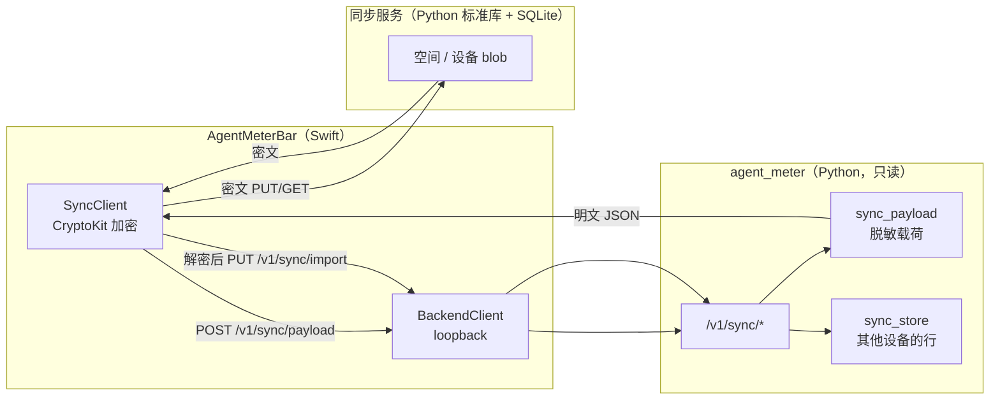

# 云端同步与会员（Pro）规划 · AgentMeter Cloud Sync（2026-11-10）

目标：给 AgentMeter 加**云端同步**（跨设备留存用量与额度历史）与**会员**（付费 Pro 能力）。
本文是规划与契约；M0 的实施结果见文末「实施状态」。

云同步是本项目**第一个把用户数据送出本机**的功能，会员是**第一个引入付费与身份**的功能。
因此本规划的重点不是「把功能做出来」，而是**在保持诚实、可审计的前提下开这两个口子**。

## 1. 目标与边界

做：

1. 一份**脱敏最小载荷**：按天×应用×模型用量行、每来源每天最后一次额度观测、卡册张数、设备无关设置。
2. 一条**端到端加密**的同步链路：客户端加密，服务端只存密文。
3. 一个**独立投影**的跨设备历史（不进快照、不进覆盖矩阵、不进本机合计）。
4. 一套**会员**机制（兑换码 → 本地签名 license），把 Pro 能力门控在服务端。

不做（M0 明确排除）：

- 不做账号密码体系（license 与同步密钥都免账号）。
- 不做自建支付回调（收款走人工发放兑换码）。
- 不做团队/共享看板（需要账号与权限模型，放路线图）。
- 不把同步数据混进 `application_usage` / `coverage` / 快照 schema。
- 不做「加密的 chat 记录同步」——本项目不读对话正文。

## 2. 设计原则

| 原则 | 落地 |
|---|---|
| 默认关闭 | 同步开关默认关；第一次开启要显式二次确认，并展示「将上传什么」的逐条清单 |
| 服务端看不懂 | 客户端用同步密钥派生的密钥做 ChaChaPoly 加密；服务端只见密文、体积、时间戳 |
| 只上传聚合 | 载荷逐字段装配，不整包复制快照；逐条 token 明细、绝对路径、项目路径、凭据、`account_label` 永不进入 |
| 设备相关状态不同步 | 来源开关、省资源模式、跳过账本、项目别名是「这台机器的事」，只同步设备无关设置 |
| 本机数据仍然权威 | 别的设备的行按 `device` 分桶存放；本机行永远从实时快照读，不用云端副本 |
| 卡册不回灌 | 卡册张数只作展示用上限；掉落账本留在本机，否则别的设备的张数会让本机误判「这档今天已掉过」 |
| 不放松现有守卫 | 本机 HTTP API 的 Host 白名单、拒绝 Origin、Bearer 校验原样保留；同步走独立 https 客户端 |

## 3. 总体架构



**关键取舍**

1. **加密放在 Swift 侧**（CryptoKit `ChaChaPoly`）：macOS 14 部署目标原生可用，**不引入任何新依赖**，Python 端一行加密代码都不用写。
2. **服务端不做合并**：`PUT /v1/sync/{space_id}/{device_id}` 每台设备只写自己那份密文；下载时拉取空间内全部 blob，**在客户端合并**。服务端永远接触不到明文行。
3. **Python 后端不联网**：云端访问只发生在 Swift 侧；后端新增接口全是 loopback 本地接口，与 `PUT /v1/web-sessions` 同一安全姿态。

## 4. 契约

### 4.1 同步载荷（schema 1）

```json
{
  "schema": 1,
  "device": "<32 位小写 hex>",
  "generated_at": 1794272349.0,
  "usage": [
    {"date": "2026-11-09", "app": "codex", "model": "gpt-5.3-codex", "device": "<device>",
     "requests": 42, "fresh_input": 1, "output": 2, "reasoning": 3,
     "cache_read": 4, "cache_write": 0, "total_tokens": 10}
  ],
  "quota": [
    {"account": "3f9c…", "bucket": "primary", "window": "primary",
     "day": "2026-11-09", "observed_at": 1794272349.0,
     "used_percent": 62.0, "remaining_percent": 38.0,
     "window_minutes": 300, "resets_at": 1794300000.0}
  ],
  "cards": {"cd_5h": 3},
  "settings": {"theme": "aurora", "low_quota_threshold": 20.0,
               "source_order": ["codex"], "claim_time": "08:00", "alerts_enabled": true}
}
```

- `usage` 行复用现有 `daily_models` 行结构（`agent_meter/daily.py`），合并口径因此可以完全复用 `agent_meter/report_periods.py` 的 `_window()`。
- 行的 `device` 由载荷头声明，**不接受行内自称**。
- `quota` 用 `account`（快照里的 `account_key`，本身已是截断散列）而不是来源 id：来源 id 带 `#N` 账号槽位，会泄漏「这个平台有几个账号」。没有 `account_key` 时退回去掉槽位的平台名。
- `settings` 只含设备无关项；`disabled_sources` / `low_resource_mode` / `skip_ledgers_low_resource` / 项目别名一律不同步。
- 载荷行数上限 `MAX_ROWS = 20000`；超限时保留**最近**的日子，保证载荷不会超过服务端 8 MB 的 blob 上限。

### 4.2 本机接口

| 方法 | 路径 | 说明 |
|---|---|---|
| POST | `/v1/sync/payload` | body `{"device": ..., "settings": {...}}` → 脱敏载荷；同时记住本机 device |
| PUT | `/v1/sync/import` | body `{"local_device": ..., "payload": {...}}` → 按 `payload.device` 分桶落盘；等于 `local_device` 的载荷丢弃（响应带 `stored:false`） |
| GET | `/v1/sync/history` | 本机行 + 各远端设备行的合并视图，另含额度与卡册 |
| POST | `/v1/sync/reset` | 清空远端设备桶（用户停用同步）；**保留**本机 device |

导入是**严格**的：载荷由程序生成，行不合法即整体拒绝（400）。否则一次损坏的载荷会用空记录覆盖掉某台设备的历史。
被拒绝的导入**不写任何东西**，包括不改动 `local_device`。

### 4.3 同步服务接口

| 方法 | 路径 | 说明 |
|---|---|---|
| GET | `/v1/health` | 存活检查 |
| POST | `/v1/sync/spaces` | body `{"space_id": ..., "auth_hash": ...}` + Bearer → 建空间（id 由**客户端**生成） |
| GET | `/v1/sync/{space_id}` | 空间清单：各设备的 `device_id / size / version / updated_at`（不含内容） |
| GET | `/v1/sync/{space_id}/{device_id}` | 取回某设备的密文（原始字节） |
| PUT | `/v1/sync/{space_id}/{device_id}` | 上传本设备的密文（原始字节，≤ 8 MB） |
| DELETE | `/v1/sync/{space_id}/{device_id}` | 删除本设备的密文 |

所有接口都要 `Authorization: Bearer <token>`；服务只保存 token 的 sha256 摘要。
建空间也要 token：匿名调用者不能把服务塞满空间。请求必须带 `Content-Type: application/json`，
并拒绝带 `Origin` 的浏览器请求与不在 Host 白名单内的请求。单 blob ≤ 8 MB，单空间 ≤ 10 台设备 / 64 MB。
标识符只接受 32 位小写 ASCII 十六进制。

### 4.4 密钥派生（Swift）

```
master_key  = 32 字节随机（用户保管，丢失 = 数据永久丢失，服务端无法找回）
space_id    = 客户端生成，32 位小写 ASCII hex
salt        = SHA256("agentmeter-sync-salt-v1" || space_id)
enc_key     = HKDF-SHA256(master_key, salt, info="agentmeter-sync-enc-v1", 32)
auth_token  = base64(HMAC-SHA256(master_key, "agentmeter-auth-v1:" || space_id))
auth_hash   = SHA256(auth_token)          # 建空间时交给服务，之后不再出现
```

`space_id` 由客户端生成，因此客户端能先派生出 token 再建空间；token **按空间限定**，
一个空间泄漏的 token 打不开另一个空间。

设备配对：6 位短码（类似微信输入法多设备配对），不带 `space_id` / `master_key` / 服务地址。
发起端建一个一次性槽位并提交临时公钥 `pub_a`；加入端输码取得 `pub_a`，提交自己的
临时公钥 `pub_b`；发起端用 X25519 共享秘密派生包装密钥，把 `{space_id, master_key}`
用 ChaChaPoly 封装后上传；加入端取回解密。两端再用同一个共享秘密派生 6 位安全码
（SAS）由人核对，防中间人。服务端只中转公钥、密文和槽位状态，**零知识**。短码 5 分钟
过期，单槽 5 次尝试，每 IP 每分钟 10 次 lookup。两台设备必须事先配置同一个服务地址。

### 4.5 会员（M1 设计，尚未实现）

- `license = base64url(JSON(payload) || Ed25519_sig(payload))`，
  `payload = {"v":1,"tier":"pro","device":..., "issued":..., "expires":..., "features":[...]}`。
- 公钥内置在 App 二进制 → **本地离线校验通过即 Pro**；服务端用同一把公钥校验，自由度一致。
- 兑换 `POST /v1/license/redeem {code, device_id}`；续期 `POST /v1/license/renew` 签发带离线宽限期的 license。
- 兑换码一次性核销、限速、防重放。Pro 能力**必须过服务端这一关**，客户端篡改无用。
- 免费版**不阉割**现有本机能力，Pro 只做增量：云同步与跨设备历史、完整历史深度与导出、高级分享图模板。

## 5. 已知边界与待办

- **空间是互信组**：同一空间里的设备共享 master key，因此任何一台都能写别的设备的 blob。P0 保留这个模型；要收紧就得给每台设备独立密钥，配对方式要重做（后续里程碑）。
- 用量行按设备累加：同一台机器的账本被两台设备读到就会算两遍。这是用户自己的部署方式，存储层无法识别。
- 卸载重装会产生新的 `device` id，旧设备的桶仍留在库里，会与新设备的行重复计入同一台机器。设备 id 目前存在 UserDefaults，重装后不保留；后续可在配对时声明「替换旧设备」。
- 服务端目前是自建轻量服务（Python 标准库 + SQLite）。协议刻意做得很瘦，日后换 Cloudflare Workers 只是换实现。
- 短码 lookup 已按 IP 限速（每分钟 10 次）；其余写接口仍无通用限速与配额，公网部署前需在 Cloudflare 层补规则。
- 会员的收款与售后流程未定义（M1）。

## 6. 里程碑

| 阶段 | 内容 | 状态 |
|---|---|---|
| **M0** | 骨架与契约：载荷 / 存储 / 本机接口 / 加密客户端 / 同步服务 | **已完成（2026-11-10）** |
| M1 | 会员闭环：签发工具、license 校验、权益门控、兑换 UI | 未开始 |
| M2 | 云同步闭环：空间创建、短码配对、手动同步、状态展示 | **已完成（2026-11-19，服务端 + 客户端 + UI）** |
| M3 | UI：跨设备「历史」页、Pro 分享图模板 | **部分完成（2026-11-19：账户页已展示其他设备额度；完整历史页未做）** |
| M4 | 文档与发布：README/SECURITY 隐私章节、CI job、发版 | 未开始 |

发布建议：**v0.11.0 = M0+M1**，**v0.12.0 = M2+M3**。分两次发，避免半成品上云。

## 实施状态（2026-11-10）

分支 `claude/cloud-sync-m0`，M0 已完成：

- `agent_meter/sync_payload.py` —— 脱敏载荷装配与校验；`agent_meter/sync_store.py` —— 按设备分桶的本地存储（`.runtime/synced-history.json`，0600）。
- `agent_meter/server.py` —— 新增 `/v1/sync/payload`、`/v1/sync/import`、`/v1/sync/history`、`/v1/sync/reset`。
- `menubar/Sources/AgentMeterBar/SyncClient.swift` —— CryptoKit 加密、HKDF 派生、服务端传输、一次同步回合。
- `sync_server/` —— 开发用同步服务（只存密文）；`sync_server/README.md` 有接口说明。
- 回归：Python 694 项、Swift 87 项、同步服务 20 项全过；真机 `verify` 0 失败（同步数据未污染本机合计与覆盖矩阵）。
- 顺带修掉 `agent_meter/server.py` 里一个潜在缺陷：`do_PUT` 内的局部 `from .model import SourceError`
  让 `SourceError` 变成整个函数的局部名，任何在价格分支之外引用它的代码都会 `UnboundLocalError`。

## 实施状态（2026-11-19）

分支 `feat/cloud-sync-pairing`，M2 已完成：

- `sync_server/app.py` —— 新增 `pair_slots` 表与 `/v1/pair/*`：建槽、lookup、上传 `pub_b`、发起端封密钥、加入端取密文、消费；6 位码只存 sha256，join token 只存 sha256，5 分钟 TTL、5 次尝试、每 IP 每分钟 10 次 lookup、每空间 3 个未消费槽。
- `menubar/Sources/AgentMeterBar/SyncPairing.swift` —— X25519 临时密钥、HKDF 派生包装密钥与 SAS、ChaChaPoly 封装主密钥、`PairingTransport` / `PairingService` / `PairingInitiator` / `PairingJoiner`。
- `menubar/Sources/AgentMeterBar/SyncConfigurationStore.swift` —— master key 与 space/device id 存登录 Keychain（`local.agent-meter.sync`），服务地址与 device id 存 UserDefaults。
- `menubar/Sources/AgentMeterBar/SyncPairingView.swift` —— 设置菜单「多机同步（合并用量）…」：创建配对码、输码加入、安全码核对、立即同步、解除配对。
- 测试：服务端 45 项、`tests.test_sync_payload` 39 项、Swift 118 项全过；其中 Swift 集成测试会启动真实 Python 服务并在两端跑完整短码交接。

## 实施状态（2026-11-19，自动同步 + 额度合并）

分支 `feat/sync-auto-quota`：

- `menubar/Sources/AgentMeterBar/SyncInterval.swift` —— 自动同步间隔：关闭 / 5 分钟 / 30 分钟 / 1 小时 / 1 天，写入 UserDefaults。
- `menubar/Sources/AgentMeterBar/UsageStore.swift` —— 手动同步与自动同步共用 `syncNow(automatic:)`；自动循环按间隔重启，退出时取消；同步成功后重读 `/v1/sync/history`。
- `menubar/Sources/AgentMeterBar/SyncPairingView.swift` —— 已配对状态新增自动同步间隔选择、上次同步时间和同步结果。
- `menubar/Sources/AgentMeterBar/SyncClient.swift` —— `SyncReport` 增加本机/远端额度行计数，同步结果会显示“合并了多少条额度”。
- `agent_meter/sync_store.py` —— 额度合并结果给远端行标注 `device`，同账号仍按 `observed_at` 取最新一条，不重复累加。
- `menubar/Sources/AgentMeterBar/AccountViews.swift` —— 账户页新增“其他设备同步的额度”区块；同一账号显示最新观测，不同账号分行展示。
- 回归：Swift 122 项、`tests.test_sync_payload` 39 项通过。
