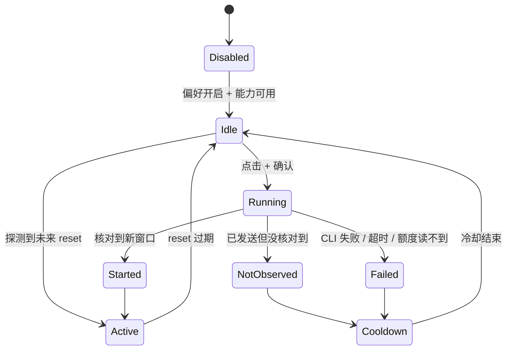

# 5 小时窗口一键开窗 · 设计草案（2026-11-13）

> 状态：**设计稿，未实现，不作为自动执行指令**。
> 来源：用户提出「对于有 5 小时限制的 harness，支持一键给对应 harness 发一个随机数字，来触发 5 小时计时」，并选择**先出设计文档、暂不写码**。
> 结论：对有本地 headless CLI 的 harness（Claude Code、Kimi Code，条件满足时的 Codex / Antigravity）技术可行；对纯网页/桌面端（ZCode、StepFun、Qoder、MiniMax、Kimi 桌面端等）没有一键入口。真正的阻塞不是代码，而是产品边界——AgentMeter 现在承诺「核心逻辑绝不发送模型 Prompt」，这个按钮会新增一类**真实、会消耗额度的写操作**。

## 0. 读前结论

1. **能做**，但只对「本机 CLI 能无交互发一条 prompt」的 harness 成立；纯网页/桌面端最多做到「打开 App + 复制提示词」。
2. **它只能开新窗，不能重置当前窗**。5 小时窗口由窗口内第一条真实请求开始计时；窗口还在走时，再发随机数不会让计时重来。按钮只能在窗口空闲时生效。
3. **不是零成本、零痕迹**。即使最小请求也会消耗少量额度；Kimi 这类 CLI 还会留下会话记录。必须默认关闭、每次确认、只对 CLI 主账户、失败不自动重试。
4. **需要一次产品边界决策**。实现前要改 README / SECURITY 的「只读」口径，并明确这是「用户点击才发生」的写操作，不是自动行为。本文件第 4 节给出约束，第 12 节给出不破边界的替代方案。

---

## 1. 需求与术语

### 1.1 用户要什么

在账户卡上给有 5 小时限制的 harness 加一个按钮：点一下，向对应的 harness（Claude Code / Kimi Code / …）发送一个随机数字，让 5 小时窗口从现在开始计时。

### 1.2 术语

| 术语 | 含义 |
|---|---|
| **5 小时窗口** | 按账户计算的 5 小时用量窗口；上游返回 `used_percent` / `remaining_percent` / `resets_at`。本项目已有 `five_hour`、`limit5h`、`window_minutes=300` 等表示。 |
| **开窗** | 用一条真实模型请求作为窗口内第一条消息，把窗口起点钉在现在。 |
| **重置** | 让当前窗口的计时重新开始。**普通请求做不到**；只有等窗口结束，或使用产品提供的重置卡（本项目目前只读重置卡，不兑换）。 |
| **空闲** | 该账户当前没有 `resets_at > now` 的 5 小时窗口。 |
| **主账户** | CLI 自己登录的账户；`claude#2` / `qoder#2` 这类网页登录的额外账户不在范围内（同一个 CLI 无法定向到它们）。 |
| **harness** | README 里的 Agent 产品：Claude Code、Codex、Kimi Code、ZCode、StepFun、Antigravity 等。 |

### 1.3 明确不在范围内

- 让**当前** 5 小时窗口提前重置。
- 自动/定时触发；后台轮询到空闲就发。
- 浏览器或桌面 UI 自动化（AppleScript、Accessibility、点击坐标）。
- 用 OAuth token 直接调供应商的模型 API（绕过官方 CLI）。
- 伪造用量、伪造窗口、把「未知」写成「已开窗」。
- 兑换重置卡、买额度、改套餐。

---

## 2. 本机事实核对（2026-11-12 / 11-13）

### 2.1 窗口语义

Claude Code 的 5 小时窗口从窗口内第一条真实消息开始；窗口结束后，下一条消息开新窗。窗口进行中再发消息只会增加用量，**不会移动 `resets_at`**。这一点由本机历史窗口状态和 Claude Code 的公开行为一致印证；Kimi / Codex / Antigravity 的窗口语义需要逐家实测确认（见 §11）。

因此按钮的合理形态是：

```
当前窗口空闲  → 可点「开始 5 小时窗口」
当前窗口进行中 → 禁用，显示「还有 2h13m 重置；此时发送不会重新计时」
```

### 2.2 当前账户与 CLI

2026-11-12 14:18 的快照与本机文件：

| 来源 | 5 小时窗口现状 | 本机 CLI | 一键开窗 |
|---|---|---|---|
| **Claude Code** | 源被用户关闭（`disabled_by_user`）；`collection.json` 里 11-12 13:41 首次观测到 `five_hour` 峰值 14%，`resets_at` 17:10 | `~/.local/bin/claude` 2.1.278 | **MVP 目标** |
| **Kimi Code** | 快照 `kimi_server_not_running`，没有额度行；CLI 本身可用 | `~/.kimi-code/bin/kimi` 0.39.1 | **P1** |
| **Codex** | 快照只有 `primary` 10080 分钟（45%，11-14 07:49 重置），**没有 5 小时桶** | `/Applications/ChatGPT.app/Contents/Resources/codex-cli/bin/codex` 0.167.0-alpha.4.1 | P2（只在套餐出现 5h 桶时） |
| **Antigravity** | 快照 `antigravity_language_server_not_running`；额度按 Gemini / Claude+GPT / Argon 分桶 | `~/.local/bin/agy` 1.4.12 | P2（先定模型组） |
| **ZCode** | 5 小时行 `used=0%`、`resets_at=null`；周窗口 11-19 重置 | 无 headless CLI | 不支持 |
| **StepFun** | `limit5h` 契约已接入，本机无账号 | 无 | 不支持 |
| **Qoder** | 每日积分，不是 5 小时窗口 | 无 prompt CLI | 不适用 |
| **MiniMax Code** | 快照未连接；有 `mavis` CLI 但未验证 headless prompt | 未验证 | 不纳入 MVP |
| **Kimi 桌面端** | 只有本地账本，无 CLI 入口 | 无 | 不支持 |
| **火山方舟** | 5 小时/周/月契约已接入，本机无账号 | 无 | 不支持 |

### 2.3 成本与痕迹的实测

在核对 Kimi CLI 参数时，误把 `--help` 当成 prompt 跑了：

```
kimi -p --help
```

结果：**至少 3 次模型调用、约 378 输出 token**，并在 `~/.kimi-code/sessions/wd_new-agent_d735fb09dc7a/session_4639e5c9-.../` 留下一条会话。它同时加载了当前项目的 `AGENTS.md` / skill 上下文，所以输出很长。

这次请求是否已经开了 Kimi 的 5 小时窗口，本机当前**无法核对**（`kimi_server_not_running`）；如果开了，说明测试本身已经动过该账户的 5 小时窗口（开了新窗，或增加了当前窗口的用量）。这条记录同时说明：按钮的实现必须能在发送前判断空闲、发送后核对窗口，否则无法回答「到底开没开」。

这不是推荐的验证方式（是我的操作失误），但它证明了两件事：

1. `kimi -p` 确实能无交互发请求，链路可用；
2. 「发一个随机数字」不是免费的，也不是无痕的——需要严格限制提示词、模型和上下文，并在 UI 里如实告知。

Claude Code 的最小参数组合尚未实测；设计上通过 `--tools ""`、短 system prompt、`--no-session-persistence`、便宜模型把请求压小，验收时记录真实 token。

### 2.4 项目现有边界

- `README.md`：「默认只读（Read-Only by Default）：核心逻辑绝不包含任何买入、兑换重置卡、更改套餐、**发送模型 Prompt** 的操作。唯一的写操作是**可选**的『自动领取每日积分』。」
- `SECURITY.md`：「唯一的写操作是可选的『自动领取每日积分』。」
- `docs/pet-system-plan-2026-11-09.md`：「不新增任何会写账户、买卡、换套餐、**发模型请求**的能力（沿用『100% 只读』）。」

这个功能必须被当作一次**有意的边界修订**，而不是普通的小功能。若实现，README / SECURITY 要改成「默认只读；可选的用户点击开窗是第二条写操作，默认关闭」。

---

## 3. 可行性矩阵

| 来源 | 5h 桶 | headless 命令 | 会话痕迹 | 额度核对 | 结论 |
|---|---|---|---|---|---|
| Claude Code | `five_hour` | `claude -p` | `--no-session-persistence` 可关 | `/api/oauth/usage` | **MVP** |
| Kimi Code | `limit5h` | `kimi -p` | 会建 session | 本地 `kimi web` 的 `/api/v1/oauth/usage` | P1 |
| Codex | `primary`/`secondary` 且 `windowDurationMins=300` | `codex exec` | `--ephemeral` 可关 | ChatGPT 后端 | P2 |
| Antigravity | `window=5h`，按模型组 | `agy -p` | 会建 conversation | 本地 language_server RPC | P2 |
| ZCode | `window_minutes=300` | 无 | — | 有额度行 | 不支持 |
| StepFun | `limit5h` | 无 | — | — | 不支持 |
| 火山方舟 | `5-hour` | 无 | — | — | 不支持 |
| Qoder | 无 5h | 无 | — | — | 不适用 |
| MiniMax Code | 无 5h | `mavis` 未验证 | — | — | 不纳入 |
| Kimi 桌面端 | 5h 可能存在 | 无 | — | — | 不支持 |

「不支持」的产品不做浏览器/桌面自动化：要 Accessibility 权限、容易点错、没有可靠的窗口核对通道，而且会把「只读」破坏得更彻底。表中「无」指**本机没有可直接发 prompt 的 headless 入口**，不代表产品永远没有；新增入口要单独复勘。

---

## 4. 产品边界与安全设计

### 4.1 新增的是什么

一条**用户主动触发**的、对本机已登录 harness CLI 的真实模型请求。它不是读额度，不是读日志，也不是自动领取；它会：

- 消耗少量订阅额度（或 API 费用，取决于 CLI 的登录方式）；
- 在部分 harness 中留下会话/对话记录；
- 可能触发用户配置的 hooks、skills、MCP（即使我们尽量关闭）；
- 改变该账户 5 小时窗口的起点（仅当窗口空闲）。

### 4.2 必须遵守的约束

| 约束 | 落地 |
|---|---|
| 默认关闭 | 新增偏好 `window_start_enabled=false`；关闭时账户卡不显示按钮，POST 返回 403。 |
| 用户点击才发生 | 不做定时、不做后台轮询、不做「空闲就自动开」；不做自动重试。 |
| 首次/每次确认 | 默认每次点击弹确认；用户可勾选「不再询问」后变真正一键。 |
| 只在空闲时 | 服务端先只读探测；`resets_at > now` 直接 409，不启动子进程。 |
| 只对主账户 | `claude#2` 等网页账户拒绝（`account_not_primary`）；UI 不显示。 |
| 只允许适配器白名单 | 首批只有 `claude`；Kimi / Codex / agy 各自验收后再注册。 |
| 最小请求 | 临时 cwd、无工具、短 system prompt、便宜模型、严格提示词；记录 CLI 返回的 usage。 |
| 可审计 | `.runtime/window-starts.json`（0600）记录来源、时间、结果、前后 reset、token；**不记录 prompt / 输出 / stderr**。 |
| 不伪造 | 只有额度接口看到新窗口才算成功；看不到就返回 `window_not_observed`，不假装成功。 |
| 冷却 | 失败后 60 秒内不再接受同一来源；同一来源同时只允许一个进行中的请求。 |
| 可回滚 | 偏好关闭即隐藏按钮；不写入快照 schema，不影响现有统计口径。 |

### 4.3 明确不做

- 不重置当前窗口（发送请求不改变已有 `resets_at`）。
- 不用重置卡、不买额度、不改套餐。
- 不直接调供应商 API（绕过 CLI）。
- 不做浏览器/桌面 UI 自动化。
- 不做「窗口结束前自动发」的定时器——那是更高风险的自动写操作，需要单独设计。

### 4.4 需要用户决定

> **是否允许 AgentMeter 新增这条「发送一条真实模型请求」的写操作？**
>
> - 同意 → 建议先做 Claude Code 单适配器 MVP，默认关闭、每次确认。
> - 不同意 → 走 §12 的只读替代方案（检测空闲 + 复制提示词/打开 CLI，App 不主动发）。

---

## 5. 状态机与判定

### 5.1 状态

| 状态 | 含义 | UI |
|---|---|---|
| `disabled` | 偏好未开启 | 不显示按钮；设置里可见开关 |
| `unsupported` | 该来源没有适配器 | 不显示 |
| `account_not_primary` | 网页登录的 `#2` 账户 | 不显示 |
| `cli_missing` | 找不到 CLI 可执行文件 | 显示原因，按钮禁用 |
| `login_missing` | CLI 未登录 / 不是订阅登录 | 显示原因，按钮禁用 |
| `quota_unavailable` | 额度接口读不到，无法判断是否空闲 | 显示「先刷新额度」 |
| `no_five_hour` | 套餐没有 5 小时窗口 | 显示「此账户没有 5 小时窗口」 |
| `unknown` | 额度形状待确认（例如 Claude 空闲时是否省略 `five_hour`） | 显示「待确认」；POST 预检拒绝，直到口径验证通过 |
| `idle` | 没有活动窗口 | 可点「开始 5 小时窗口」 |
| `active` | 有窗口，`resets_at > now` | 显示倒计时，按钮禁用 |
| `running` | 正在发请求/核对 | 转圈，按钮禁用 |
| `cooldown` | 刚失败，冷却中 | 显示剩余秒数，按钮禁用 |

### 5.2 判定

```
five_hour 行不存在                    → no_five_hour（或 unknown，见 §11）
resets_at 为空 / 已过期               → idle
resets_at > now                       → active
额度接口读不到                        → quota_unavailable，拒绝发送
CLI 路径找不到                        → cli_missing
CLI 不是订阅登录（Claude OAuth）      → login_missing
```

**不在活动窗口时发送**：先探测一次；只有 `idle` 才执行。探测失败就拒绝——没有 before 状态，既不知道会不会白开窗，也无法核对结果。

**成功后核对**：重新读该来源的额度，要求 5 小时行出现且：

```
now + 4h45m ≤ resets_at ≤ now + 5h15m
且（used_percent > 0 或 before 没有 reset）
```

满足才算 `started`。看不到就 `not_observed`，让用户稍后刷新；**不自动重试**。

### 5.3 状态图



---

## 6. 后端契约

### 6.1 偏好

在现有 `PUT /v1/preferences` 增加一个**可选**键：

```jsonc
{
  "disabled_sources": [],
  "low_resource_mode": false,
  "skip_ledgers_low_resource": [],
  "auto_claim": [],
  "claim_time": "00:05",
  "window_start_enabled": false
}
```

- 默认 `false`；旧客户端不带此键时按 `false`。
- 后端 `set_preferences` 保存到内存；Swift 的 `UsageStore` 用 UserDefaults 持久化，启动后随现有偏好一起 `PUT`。
- 服务端严格校验：只接受布尔值；未知键仍拒绝。
- 关闭时 `POST /v1/windows/start` 返回 403 `window_start_disabled`。

### 6.2 `POST /v1/windows/start`

请求（body ≤ 1 KB，`Content-Type: application/json`）：

```json
{"source": "claude"}
```

成功（200）：

```jsonc
{
  "status": "started",
  "source": "claude",
  "adapter": "claude",
  "before": {"bucket": "five_hour", "used_percent": 0.0, "resets_at": null},
  "after":  {"bucket": "five_hour", "used_percent": 0.4, "resets_at": {"epoch_seconds": 1794500000, "display": "2026-11-13T07:00:00+08:00"}},
  "duration_ms": 18420,
  "cli_usage": {"input_tokens": 1830, "output_tokens": 4, "cache_read_input_tokens": 0},
  "message": "已开始 5 小时窗口，重置时间 07:00"
}
```

已发送但没核对到（200，不是 HTTP 错误）：

```jsonc
{"status": "not_observed", "source": "claude",
 "before": {"bucket": "five_hour", "used_percent": 0.0, "resets_at": null},
 "after": null, "message": "请求已发送，但额度接口还没看到新窗口；稍后刷新确认"}
```

错误（沿用 `{"error": code}` 风格，可选带 `window` / `before` / `after`）：

| HTTP | `error` | 含义 |
|---|---|---|
| 400 | `invalid_body` | body 不是 `{"source": ...}` 或过大 |
| 403 | `window_start_disabled` | 偏好未开启 |
| 404 | `unsupported_source` | 没有适配器 |
| 409 | `account_not_primary` | `#2` 网页账户 |
| 409 | `source_disabled` | 来源在 `disabled_sources` 里 |
| 409 | `no_five_hour` | 套餐没有 5 小时窗口 |
| 409 | `window_active` | 已有窗口；带 `window` |
| 409 | `trigger_in_progress` | 同一来源已有请求在跑 |
| 429 | `cooldown` | 失败后的冷却；带 `retry_after` |
| 502 | `cli_failed` | CLI 非 0 退出（不回传 stderr 原文） |
| 503 | `cli_missing` | 可执行文件找不到 |
| 503 | `login_missing` / `claude_subscription_login_missing` | CLI 未登录订阅 |
| 503 | `quota_unavailable` | 额度接口读不到，拒绝盲发 |
| 504 | `trigger_timeout` | CLI 超时，已终止进程组 |

客户端超时：Swift 这次请求单独给 180 秒（CLI 90s + 核对 45s + 余量）；不要用默认的 120s。

### 6.3 快照能力字段

不新增 GET。在账户来源的 `diagnostics` 里加一个可选对象，供 UI 在现有快照轮询里直接读：

```jsonc
"window_start": {
  "adapter": "claude",
  "supported": true,
  "cli_available": true,
  "cli": "claude",
  "state": "idle",
  "five_hour": {
    "present": true,
    "active": false,
    "used_percent": 0.0,
    "resets_at": null
  }
}
```

- 只对账户来源（`scope=account`）加，不加给本机账本/预测来源。
- Swift `Source` 增加 `windowStart: JSON`，解析 `diagnostics.window_start`；旧后端没有该字段时为 `.null`。
- `state` 由采集时的额度行计算；`active` 可能比真实晚最多一个采集周期（默认 5 分钟），所以 **POST 仍然要新鲜探测**，快照只用于 UI 提示。
- Claude 的 `five_hour.present` 需要 `normalize_claude` 额外记录原始 payload 里有没有 `five_hour` 键（当前代码只保留有 `utilization` 的行，缺键和空闲分不开）。这是 Claude 适配器验收前必须确认的点（§11）。

### 6.4 审计

`.runtime/window-starts.json`，0600，atomic write，最多 200 条：

```jsonc
{
  "schema": 1,
  "entries": [
    {
      "at": "2026-11-13T01:20:00+08:00",
      "source": "claude",
      "adapter": "claude",
      "outcome": "started",
      "before": {"bucket": "five_hour", "used_percent": 0.0, "resets_at": null},
      "after": {"bucket": "five_hour", "used_percent": 0.4, "resets_at": "2026-11-13T06:20:00+08:00"},
      "duration_ms": 18420,
      "cli_usage": {"input_tokens": 1830, "output_tokens": 4},
      "exit_code": 0
    }
  ]
}
```

不写 prompt、输出、stderr、cookie、token。审计只用于本机诊断，不提供 UI（需要时用命令行看；如果以后要展示，再单独加只读端点）。审计里的时间用 ISO 字符串，HTTP 响应沿用现有 `timestamp()` 对象。

### 6.5 配置

`agent_meter/collector.py:default_config` 增加：

```python
"claude_binary": shutil.which("claude"),
"agy_binary": shutil.which("agy"),
"window_start_timeout_seconds": 90,
"window_start_verify_seconds": 45,
"window_start_cooldown_seconds": 60,
```

`codex_binary` / `kimi_binary` 已存在。GUI App 的 `BackendClient.searchPath()` 已包含 `~/.local/bin`、`~/.kimi-code/bin`、ChatGPT 的 codex-cli 路径，CLI 路径可用；若 `which` 为空，再在 `default_config` 里加已知路径兜底。启动时解析一次，失败给固定错误码。

### 6.6 并发与冷却

- 模块级 `threading.Lock`（按 source）非阻塞获取；拿不到返回 409 `trigger_in_progress`。
- 失败/超时/`not_observed` 后 60 秒冷却（`cooldown`），避免脚本或双击把 CLI 打爆。
- 成功后不需要冷却：下一次预检会看到 `window_active` 并直接 409。
- HTTP handler 线程可以跑 90–135 秒；`ThreadingHTTPServer` 不阻塞其他请求。不要在跑 CLI 时持有快照锁。

---

## 7. 各 harness 适配器

### 7.1 Claude Code（MVP）

**预检**：`read_credentials` 确认是 OAuth 订阅登录（不是 API key）；读 `/api/oauth/usage`；找 `five_hour`；`resets_at` 在未来 → `window_active`。

**执行**：

```bash
# 概念命令，实际用 argv 列表、不经过 shell
claude -p '只回复这个数字，不要解释、不要调用任何工具：482913' \
  --model haiku \
  --no-session-persistence \
  --tools '' \
  --strict-mcp-config \
  --system-prompt '你是一个回显器。只输出用户给你的数字。' \
  --output-format json
```

- `--no-session-persistence`：不写 `.claude/projects`，避免污染本机账本和活动页。
- `--tools ""`：不提供工具，避免模型决定执行命令。
- `--strict-mcp-config`：不启动 MCP。
- `--system-prompt`：替换默认长提示，降低输入 token。
- `--model`：默认 `haiku`；如果当前 CLI 不认这个别名，用模型目录里最便宜的可用模型；换模型不应改变 5 小时窗口的归属（同一账户）。
- `--setting-sources ""`：候选，用于跳过 user/project/local settings 与 hooks；**需要实测 CLI 是否接受**。若不可用，至少用临时 cwd + `--strict-mcp-config`，并在文档里承认 hooks 仍可能执行。
- 临时 cwd、最小环境变量（`HOME` / `PATH` / `TMPDIR` / `LANG`），清掉 `ANTHROPIC_API_KEY`、`ANTHROPIC_AUTH_TOKEN`、`ANTHROPIC_BASE_URL`、`CLAUDE_CODE_USE_BEDROCK`、`CLAUDE_CODE_USE_VERTEX` 等；否则 CLI 可能走 API key，根本不会开订阅窗口。
- `DISABLE_AUTOUPDATER=1`，避免它顺手检查更新。
- `stdout` 捕获 JSON 解析 `usage` / `total_cost_usd`，**丢弃 `result` 文本**；`stderr` 只用于判断失败，不落盘、不回传原文。
- 超时 90 秒；超时先 `SIGTERM` 进程组，5 秒后 `SIGKILL`。

**核对**：重新读 `/api/oauth/usage`，按 §5.2 判定；最多 4 次（0/5/15/30 秒），总时长不超过 45 秒。

**预期成本**：比默认 `claude -p` 小很多，但仍有几千输入 token 量级；验收时用 JSON 的 `usage` 记录真实值。UI 只写「少量额度」，不承诺具体数字。

### 7.2 Kimi Code（P1）

```bash
kimi -p '只回复这个数字，不要解释、不要调用任何工具：482913' \
  --output-format text \
  --skills-dir <空临时目录> \
  -m <便宜模型>
```

- `kimi -p` 可用；本机实测会建 session，且会加载项目/用户 skills（用空 `--skills-dir` 和临时 cwd 尽量压掉）。
- 没有 `--no-session-persistence`；会话是已知代价，UI 要提示「会留下一条会话记录」。
- 额度核对依赖 `kimi web` 本地 server；快照当前是 `kimi_server_not_running`。**server 不在就跑不了核对**，此时应返回 `quota_unavailable`，不要盲发。
- 失败/会话成本先用一次真实测试测量，再决定是否开放。

### 7.3 Codex（P2）

```bash
codex exec --ephemeral --skip-git-repo-check --ignore-user-config --ignore-rules \
  --sandbox read-only -C <临时目录> -m <便宜模型> --json '只回复这个数字：482913'
```

- 只在额度行出现 `windowDurationMins=300` 时注册；当前账号只有 7 天窗口，按钮不显示。
- `--ephemeral` 避免 rollout 落盘；`--ignore-user-config` / `--ignore-rules` 避免 hooks/规则；`--sandbox read-only` 即使模型想执行命令也写不了。
- 核对走现有 `collect_codex` 的 ChatGPT 后端。

### 7.4 Antigravity（P2）

```bash
agy -p '只回复这个数字：482913' --model <模型> --print-timeout 90s
```

- 5 小时额度按 Gemini / Claude+GPT / Argon 分桶，**必须显式选模型组**，否则不知道开的是哪个桶。
- 额度 RPC 需要桌面 `language_server` 在跑；不在就 `quota_unavailable`。
- `agy` 会建 conversation；成本/痕迹先测。

### 7.5 不支持清单

ZCode、StepFun、火山方舟、Qoder、MiniMax Code、Kimi 桌面端：没有可直接发 prompt 的 headless CLI（或未验证）。UI 显示「该账户没有可用的本地 CLI，无法一键开窗」，不提供浏览器/桌面自动化。

---

## 8. UI 设计

### 8.1 设置

在设置菜单（`PanelView.settingsMenu`）加「5 小时窗口…」，打开一个小设置窗口（类似 `BudgetWindow` / `PricesWindow`）：

- **总开关**：`允许一键开始 5 小时窗口`，默认关。开启时弹确认：
  > 这会在你点击按钮时向对应 CLI 发送一条真实请求，消耗少量额度，并可能留下会话记录。不会自动发送。
- **每次发送前确认**：默认开；关掉后按钮变成真正的一键（用户明确选择）。
- **按来源列出**：品牌、CLI 是否找到、当前 5h 状态（空闲 / 还有多久 / 不可用）。最近一次点击的结果只在账户卡上显示，不另做审计列表。
- **说明**：这是写操作；只对 CLI 主账户；活动窗口不会因再发请求而重置。

### 8.2 账户卡

在 `AccountCard` 的额度条之后、`details` 之前加一个紧凑的 `WindowStartSection`：

- 只对 `scope == "account"`、`window_start_enabled`、有适配器的来源显示；`#2` 不显示。
- 状态来自 `source.windowStart`（快照）：
  - **空闲**：`5 小时窗口 · 空闲` + `开始 5 小时窗口` 按钮。
  - **进行中**：`5 小时窗口 · 进行中` + `还有 2h13m 重置`，按钮禁用。
  - **CLI 缺失 / 不是订阅 / 没有 5h 窗口**：显示原因，按钮禁用。
- 点击：
  - 若「每次确认」开 → alert，文案含「会消耗少量额度」「发送后 5 小时计时从现在开始」「不会保存对话」；确认后才 POST。
  - 若关 → 直接 POST。
- 运行中：`ProgressView` +「正在发送并核对…」，按钮禁用。
- 成功：`已开始 · 07:00 重置`；额度条可能还是旧数据，加一句「额度卡稍后刷新」。
- `window_active`：显示后端返回的 reset，不改口说「已开始」。
- `not_observed`：`请求已发送，但额度接口还没看到新窗口；稍后刷新确认`。
- 失败：后端错误码映射为中文（`Catalog.reason` 现有模式）；不显示 stderr 原文。

按钮样式沿用现有 `Button` / `controlSize(.small)` / `theme`，不要新造一套视觉。`--preview` 加一个带 `window_start` 的假来源，渲染空闲/进行中/失败三态。

---

## 9. 测试与验收

### 9.1 离线测试（CI，不发真实请求）

- `tests/test_window_start.py`（新）：
  - 能力判定：无 5h 行、空闲、进行中、`#2`、未知来源。
  - 预检：活动窗口 → 不启动子进程；额度读不到 → 拒绝。
  - 命令/环境：fake binary 记录 argv/env；断言含 `--no-session-persistence`、`--tools ""`、随机 6 位提示词；断言不含 `ANTHROPIC_API_KEY` 等。
  - 超时：fake `sleep`；断言进程组被终止。
  - 核对：fake probe 返回新 reset → `started`；不返回 → `not_observed`。
  - 并发/冷却：两次点击只起一个子进程；失败后 429。
  - 审计：没有 prompt/输出/stderr；文件 0600；裁剪 200 条。
- `tests/test_server.py`：POST 路由的 auth/body/错误码；偏好键缺省兼容；不触发全量采集。
- Swift 测试：`Source.windowStart` 解析；状态/错误码映射；`WindowStartSection` 的纯函数状态（SwiftUI 视图本身不强行单测）。
- 全部走 `python3 scripts/test-offline.py` / `swift test`；CI 不执行真实 CLI。

### 9.2 手动验收（真实账户，仅一次）

1. 开启 Claude 来源与 `window_start_enabled`；确认当前 5h 窗口空闲（`resets_at` 为空或已过期）。
2. 记录 before：`GET /v1/snapshot` 的 `claude` 5h 行、`used_percent`、`resets_at`。
3. 点击按钮 → 确认 → 等待成功。
4. 检查 after：5h 行出现，`resets_at ≈ now+5h`，`used_percent` 略增。
5. 检查 `~/.claude/projects` 没有新会话；`.runtime/window-starts.json` 有一条 `started`；UI 变成「进行中」。
6. 再点一次：应 409 `window_active`，不启动第二个子进程。
7. 关闭偏好：按钮消失；POST 403。
8. 用 fake CLI 跑一次超时/失败路径，确认错误码与 UI 文案。

### 9.3 验收门槛

- Python / Swift 全量回归通过；新增测试覆盖上述分支。
- 真实账户只做一次手动验收，记录 before/after 和 token；不把真实请求写进 CI。
- README / SECURITY / backend-api 更新；版本说明记录「新增可选写操作」。

---

## 10. 风险与缓解

| 风险 | 缓解 |
|---|---|
| 误点/误消费 | 默认关；首次/每次确认；设置里明确写会消耗额度；失败冷却。 |
| 打错账户 | 只允许 CLI 主账户；`#2` 拒绝；before/after 核对。 |
| 窗口其实在进行中，白发 | 预检 `resets_at > now` 直接拒绝；核对不通过时 `not_observed`，不谎报 `started`。 |
| CLI 卡住/挂起 | 90s 超时；进程组 SIGTERM→SIGKILL；HTTP 180s。 |
| hooks/MCP 副作用 | `--tools ""`、`--strict-mcp-config`、临时 cwd、`--setting-sources ""`（待验证）；残留风险写进 SECURITY。 |
| 走了 API key，没开订阅窗 | 最小环境变量 + 清 Anthropic/Bedrock/Vertex 开关；`login_missing` 兜底；核对失败不谎报。 |
| 额度接口延迟 | 0/5/15/30 秒重试；`not_observed` 文案；不自动重发。 |
| 会话污染 | Claude `--no-session-persistence`；Kimi 明确提示会留会话；Codex `--ephemeral`。 |
| 本地 token 被盗用刷请求 | 偏好默认关；同来源单飞；冷却；审计；仍然只监听 127.0.0.1 + Bearer。 |
| 供应商契约变化 | 适配器固定错误码；不猜；失败只影响该来源；可一键关闭。 |
| 破坏「只读」承诺 | 本节和 README/SECURITY 同步修改；设计文档留档；用户明确同意后才实现。 |

---

## 11. 实现前必须回答的问题

1. **产品边界**：是否接受新增「发送真实模型请求」的写操作？（本文件的核心决策）
2. **Claude 空闲形态**：`/api/oauth/usage` 在空闲时是返回 `five_hour: {utilization: 0, resets_at: null}`，还是直接省略 `five_hour`？这决定 `present` 是「空闲」还是「无 5h 套餐」。需要一次只读探测。
3. **Claude 参数**：`--setting-sources ""` 是否可用？hooks 是否真的被跳过？`--tools ""` + 短 system prompt 的实际 token 是多少？`--no-session-persistence` 是否确实不写 `.claude/projects`？
4. **Claude 成本**：最小请求的真实 input/output token；是否值得每次确认里写具体范围。
5. **Kimi**：空 `--skills-dir` + 临时 cwd 能否把 3 次调用降到 1 次？会话是否进入本机账本？server 不在时是否只支持「发送但无法核对」？
6. **Codex**：当前账号是否有 5h 桶？`--ephemeral` 是否完全不写 rollout？
7. **Antigravity**：`agy` 默认模型属于哪个 5h 桶？桌面 `language_server` 不在时能否只发不核对？
8. **多账户**：是否存在通过 `CLAUDE_CONFIG_DIR` 等切换的 CLI 小号？第一版明确不支持。
9. **确认策略**：默认每次确认，还是允许一次授权后永久一键？建议默认每次，用户可关。
10. **审计保留**：200 条是否够；是否需要 UI 展示最近 10 条。

---

## 12. 备选方案（不破只读）

如果不想新增模型请求，仍可做一个**只读版**：

- 在账户卡显示「5 小时窗口空闲 / 进行中」；空闲时给一个「复制随机提示词」按钮和「打开 Claude Code」按钮。
- 用户自己粘贴、回车。App 不发送、不消耗、不留会话，`README` 的只读口径不变。
- 可以加一条本地通知：「Claude 5 小时窗口空闲；现在发一条消息可把重置定在 17:42」。
- 代价：不是严格的一键；需要用户手动确认。

其他被否掉的方案：

- **浏览器/桌面 UI 自动化**：需要 Accessibility，容易点错，无法可靠核对窗口；不做。
- **直接调供应商模型 API**：绕开官方 CLI，契约/风控/登录都可能变；不做。
- **定时自动开窗**：自动写操作，风险更高；本次不做，若以后要做单独设计。

---

## 附录 A：命令草稿

```bash
# Claude（MVP）
claude -p '只回复这个数字，不要解释、不要调用任何工具：482913' \
  --model haiku --no-session-persistence --tools '' --strict-mcp-config \
  --system-prompt '你是一个回显器。只输出用户给你的数字。' \
  --output-format json

# Kimi（P1；会留 session）
kimi -p '只回复这个数字，不要解释、不要调用任何工具：482913' \
  --output-format text --skills-dir /tmp/empty-skills -m <cheap-model>

# Codex（P2；当前账号没有 5h 桶）
codex exec --ephemeral --skip-git-repo-check --ignore-user-config --ignore-rules \
  --sandbox read-only -C /tmp/agentmeter-start -m <cheap-model> --json \
  '只回复这个数字：482913'

# Antigravity（P2；需先定模型组）
agy -p '只回复这个数字：482913' --model <model> --print-timeout 90s
```

## 附录 B：错误码与中文文案

| code | 文案 |
|---|---|
| `window_start_disabled` | 未在设置中开启「一键开始 5 小时窗口」 |
| `unsupported_source` | 该来源不支持一键开窗 |
| `account_not_primary` | 只能对 CLI 登录的主账户操作 |
| `source_disabled` | 该来源已在设置中关闭 |
| `no_five_hour` | 此账户没有 5 小时窗口 |
| `window_active` | 窗口进行中；再发请求不会重新计时 |
| `trigger_in_progress` | 上一次请求还在进行 |
| `cooldown` | 刚刚失败，请稍后再试 |
| `cli_missing` | 未找到对应的 CLI 命令 |
| `login_missing` | CLI 未登录或不是订阅登录 |
| `quota_unavailable` | 额度接口暂时读不到，无法安全开窗 |
| `cli_failed` | CLI 执行失败（详情见本机审计/日志） |
| `trigger_timeout` | CLI 超时，已终止 |
| `window_not_observed` | 请求已发送，但额度接口还没看到新窗口 |

## 附录 C：预计改动文件（实现时）

新增：

- `agent_meter/window_start.py`（适配器、预检、执行、核对、审计）
- `tests/test_window_start.py`
- `menubar/Sources/AgentMeterBar/WindowStartSettingsView.swift`（若做成独立设置窗口）

修改：

- `agent_meter/collector.py`：`default_config` 增加 CLI/超时/冷却键；`collect()` 末尾附 `diagnostics.window_start`；`SnapshotService` 增加偏好与 `start_window`。
- `agent_meter/claude_code.py`：记录 `five_hour` 原始存在性（空闲 vs 缺失）。
- `agent_meter/server.py`：`POST /v1/windows/start`；`PUT /v1/preferences` 接受 `window_start_enabled`。
- `menubar/Sources/AgentMeterBar/Snapshot.swift`：`Source.windowStart`。
- `menubar/Sources/AgentMeterBar/AccountViews.swift`：`WindowStartSection`。
- `menubar/Sources/AgentMeterBar/Backend.swift`：`startWindow`、`putPreferences` 新键、180s 超时。
- `menubar/Sources/AgentMeterBar/UsageStore.swift`：偏好、进行中状态、错误映射。
- `menubar/Sources/AgentMeterBar/PanelView.swift`：设置菜单入口。
- `README.md` / `SECURITY.md` / `docs/backend-api.md`：只读口径与新写操作契约。
- `docs/agent-knowledge/README.md`：实现并发布后再加日期条目（本设计稿不加入）。

不改：

- 快照 schema 版本（`diagnostics` 是可选字段，不升 schema）。
- 现有统计口径、卡册、预测、本机账本。
- 重置卡只读规则。
