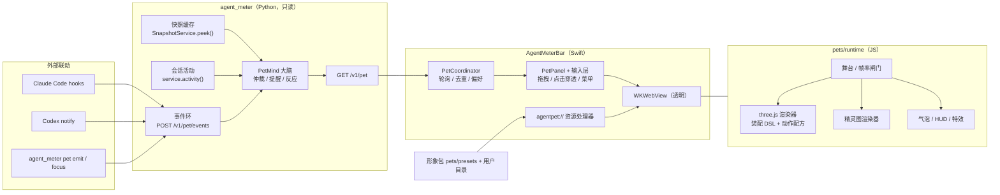

# 桌宠系统规划 · AgentMeter Pets（2026-11-09）

目标：给 AgentMeter 加一只常驻桌面的伙伴。它不是装饰：把额度、会话、重置、提醒、本机消耗、创作积分和重置预测翻译成**看得见的状态**，并提供几个真正省事的小功能。同时交付两套「做形象」的 skill（前端 + three.js、生图模型），让新形象可以被重复、可验证地制作出来。

本文是规划与契约；形象包格式的逐字段说明见 [pets/SPEC.md](../pets/SPEC.md)，实施结果见文末「实施状态」。

## 1. 目标与边界

做：

1. 透明、置顶、不抢焦点的桌面宠物窗口（SwiftUI/AppKit 宿主 + WKWebView 渲染）。
2. 一份**形象包规范**（`agentmeter-pet/1`）：同一套状态契约，同时容纳 three.js 程序化形象和生图模型的精灵图形象。
3. 一个**状态大脑**（`agent_meter/pet.py`）：把快照、会话活动、预测与外部事件仲裁成唯一的宠物状态，并通过 `GET /v1/pet` 提供。
4. 多套内置预设、两套制作 skill、校验与预览工具。
5. 功能性：额度守卫（HUD）、会话看板、Agent 钩子联动、专注计时、提醒接管、右键快捷操作。

不做：

- 不新增任何会写账户、买卡、换套餐、发模型请求的能力（沿用「100% 只读」）。
- 不把宠物状态写进快照、不进菜单栏行情条、不改变现有统计口径。
- 不在宠物里「脑补」：未知额度显示困惑，而不是耗尽；活动状态沿用既有分级，停止写入不算成功。
- 不联网下载形象；第三方形象包是本地文件，无网络权限、拿不到后端 token。

## 2. 设计原则

| 原则 | 落地 |
|---|---|
| 只读、本机 | 宠物只读 `/v1/*`；新增的写接口只写**内存里的宠物事件/偏好**，不碰账户。 |
| 诚实（未知 ≠ 0） | `energy.known=false` → `confused`；过期数据（`stale`）降级为灰态；不同账户不相加，仪表逐个列出。 |
| 与现有规则一致 | 提醒键、阈值、等级与 `Notifier.swift` 逐位一致（`tests/test_pet.py` 与 Swift 测试共用同一夹具防漂移）。 |
| 相关性优先 | 「没力气/告急/耗尽」只看**你正在用**的来源（有会话在跑、或最近 6 小时用过、或手动钉住），避免一个不用的账号让宠物天天躺平。 |
| 轻量 | 状态轮询 2 秒、活动扫描自带 5/15/30 秒闸门、全程不触发全量采集；渲染按状态降帧，遮挡/睡眠时暂停；尊重「减弱动态效果」。 |
| 可替换 | 形象只实现状态契约；缺的状态按回退链降级到 `idle`；包坏了回退到内置默认。 |
| 可测 | 大脑是纯函数 + 小记忆，Python 离线测试覆盖；形象包由校验器在 CI 里守门。 |

## 3. 总体架构



分工的理由：

- **大脑在 Python**：数据都在这里，外部钩子也只能打到这里的 HTTP；离线可测、CLI 可用（`python3 -m agent_meter pet state --snapshot …`）。
- **宿主在 Swift**：窗口、置顶、点击穿透、菜单、钥匙串外的偏好都属于 OS 集成。
- **渲染在 JS**：three.js 与精灵图共用一套舞台、气泡、特效；形象包是纯数据，可由 skill 生成。
- **JS 没有网络和 token**：后端只对宿主开放，WebView 的 CSP 禁止一切外连。

## 4. 状态契约：`PetFrame`

`GET /v1/pet`（无查询串，沿用服务器规则）返回 schema_version 1：

```jsonc
{
  "schema_version": 1, "generated_at": 1760000000.0,
  "state": "working",            // 基础状态，见 §5
  "state_since": 1759999900.0, "intensity": 0.6,   // 0..1，驱动动作幅度与特效
  "mood": "determined",          // 表情层，独立于动作
  "reaction": {"id":"celebrate","key":"refill|codex|primary|…","until":1760000008.0,"reason":"quota_refill"},
  "energy": {"known":true,"remaining":82,"tone":"ok","scope":"auto","source":"codex","label":"Codex · 5 小时","resets_at":1760009000,"stale":false},
  "meters": [{"id":"codex:primary","source":"codex","name":"Codex","window":"5 小时","remaining":82,"tone":"ok","resets_at":1760009000,"stale":false}],
  "activity": {"known":true,"running":2,"apps":[{"app":"codex","label":"Codex","count":1,"project":"NEW-agent 统计"}],
               "recent_finished":[{"app":"claude","label":"Claude Code","status":"completed","ago":42}],"generating_images":0},
  "forecast": {"known":true,"mood":"waiting","median_48h":33.0},
  "today": {"known":true,"tokens":1234567},
  "focus": {"active":false,"ends_at":null,"minutes":null},
  "reminders": [{"id":"low|codex|primary|1760009000|20","kind":"low_quota","level":"20","priority":70,"tone":"warn",
                 "source":"codex","text":"…","action":{"kind":"open_panel","tab":"accounts"}}],
  "events": [{"id":"evt-3","kind":"agent_done","source":"claude","text":"…","at":1759999990.0,"ttl":30}],
  "honesty": {"quota_known":true,"activity_known":true,"snapshot_age":31.2,"stale_sources":[]},
  "reasons": ["activity.running=2","energy=ok(82)"]
}
```

- 帧是**幂等**的：同一输入同一输出。需要「只触发一次」的东西（提醒、事件、反应）都带稳定 id；由客户端去重并持久化（宿主存 `UserDefaults`，与 Notifier 相同做法）。
- 转折（额度回血、预测落地、令牌突增）由 `PetMind` 在**新快照/新活动到达时**检测，写成带 id 的反应，不依赖 GET 次数。

## 5. 状态目录与仲裁

基础状态（循环动画）按优先级从高到低：

| 状态 | 中文 | 触发 | 回退 |
|---|---|---|---|
| `offline` | 失联 | 后端不可达（宿主本地判定）或从未拿到任何来源数据 | idle |
| `exhausted` | 电量耗尽 | 相关额度 = 0% | tired |
| `alarm` | 告急 | 相关额度 ≤ 5% | tired |
| `waiting` | 等你确认 | 钩子事件 `agent_waiting` 有效 | idle |
| `busy` | 忙翻了 | 进行中会话 ≥ 3 | working |
| `working` | 干活中 | 进行中会话 1–2（或钩子 `agent_started` 有效） | idle |
| `painting` | 创作中 | Codex 生图调用进行中 | working |
| `tired` | 没力气 | 相关额度 ≤ 阈值（默认 20%，与通知同一设置） | idle |
| `alert` | 有提醒 | 24 小时内到期的重置卡 / 积分 / 续费待处理 | waiting |
| `focus` | 专注 | 专注计时中 | working |
| `excited` | 期待 | Tibo 预测为「正在重置/兴奋」 | celebrate |
| `confused` | 拿不准 | 额度全部未知或过期（未知 ≠ 0） | idle |
| `sleeping` | 睡觉 | 无会话超过 30 分钟，或处于安静时段 | idle |
| `idle` | 待机 | 默认 | — |

短反应（叠在基础状态上，有 `until`）：`celebrate`（额度回血 / 预测落地 / Agent 完成 / 专注结束）、`eating`（会话令牌突增）、`startle`（Agent 失败）、`wave`（启动 / 价格表更新）。
交互状态（宿主本地产生，不进帧）：`poke`、`pet`（抚摸）、`drag`（被拎起）、`drop`、`refresh`（双击刷新）、`photo`。

回退链保证每个形象包只需实现最小集 **idle / working / tired / alarm / sleeping / celebrate / offline / waiting**，其余按上表回退到最近可用状态。

**相关额度**（避免一个闲置账号让宠物长期躺平）：

1. 手动钉住了某来源 → 只看它。
2. 否则看「有会话在跑」或「最近 6 小时有会话」的来源对应的额度。
3. 都没有 → 看全部，但严重度封顶为 `tired`（不触发 `alarm`/`exhausted`）。

额度桶与 `Snapshot.tightestQuota` 同口径（读 `remaining_percent`），按驾驶舱的做法排除 `mcp` 次数桶，`stale` 数据不参与严重度，只做灰显。

## 6. 功能打通矩阵

| AgentMeter 能力 | 宠物里的体现 |
|---|---|
| 账户额度（15+ 来源、多账号） | `energy` 与 HUD 计量条；每个账号独立一行，从不求和；`stale` 灰显 |
| 菜单栏行情条（Ticker） | 气泡可轮播同一批条目；点击气泡打开面板对应标签 |
| 提醒通知（Notifier） | 提醒键/等级/文案与之一致；开启「桌宠接管提醒」后用气泡代替系统横幅 |
| 七套界面风格 | 气泡与 HUD 随风格换皮；形象调色板有 `$accent1/$accent2` 主题令牌 |
| 重置卡 / 积分临期 | `alert` 状态 + 倒计时气泡；24 小时内更急 |
| 续费 / 会员到期 | 同上，沿用 3 天 / 7 天规则 |
| Tibo 全员重置预测 | `excited`/`celebrate`；`tibo` 预设有重置器道具；只在**已公告**事件时庆祝，概率不触发提醒 |
| 会话活动（回合 / 子代理 / 疑似结束） | `working`/`busy`/`painting`；完成/失败反应；严格沿用「疑似结束 ≠ 成功」 |
| 本机消耗（令牌、缓存、估算费用） | 会话令牌突增 → `eating`；今日用量作为 HUD 副标题（标注为估算/下界） |
| Codex 生图统计 | 生图调用进行中 → `painting` |
| 创作积分（即梦 / MiniMax Design） | 积分减少 → `painting` 反应；积分临期走提醒 |
| 模型目录 / 价格表同步 | 同步成功 → `wave` + 一条低优先级气泡 |
| 用量报告与分享卡 | 右键「分享用量报告…」直达报告窗口（宠物截图进分享卡未做） |
| 一键打开应用（AppLauncher） | （未做）会话标签目前只展示；点击 HUD 打开面板 |
| 应用页 / 覆盖矩阵 | 点击气泡/HUD 跳转到「应用」标签 |
| 开机启动 / 偏好 | 宠物显示、形象、大小、HUD 等都在设置菜单的「桌宠」子菜单，持久化 |
| 后端健康 | 连续失败 → `offline`（拔线道具），恢复后 `wave` |

## 7. 功能性与联动

1. **额度守卫（HUD）**：宠物脚下的小胶囊，显示最紧张的相关额度与重置倒计时；悬停展开前 3 个窗口。`gauge` 预设自带随额度变化的圆环。
2. **Agent 钩子联动**：`POST /v1/pet/events` 接收 `agent_started | agent_done | agent_waiting | agent_failed | nudge | focus_start | focus_stop | prices_synced`。`python3 -m agent_meter pet hooks claude` 打印可粘贴的 Claude Code hooks 与 Codex notify 配置（本工具**不自动改**用户的配置文件）。文本做长度与控制字符清洗，不含提示词。
3. **会话看板**：额度显示选「胶囊 + 会话标签」时，宠物脚下列出进行中的会话（应用、项目别名、数量）；点击 HUD 打开面板。逐条点击打开对应应用未做。
4. **专注计时**：右键开始 25/50 分钟，`focus` 状态 + 倒计时环；结束庆祝并提示休息；也可 `agent_meter pet focus 25`。
5. **提醒接管**：同一套提醒键，宠物气泡显示；可选关闭系统横幅避免重复。
6. **久坐提醒**：连续有会话运行超过设定时长（默认 2 小时）后温和提示休息，可关闭。
7. **眼睛跟随**：形象朝光标方向轻微转头（偏好可关）。
8. **快捷操作**：单击=戳一下 + 当前摘要；双击=强制刷新；右键=菜单（刷新、打开面板各标签、分享用量、专注、切换形象、大小、HUD、安静模式）；拖拽=移动并记住位置。

## 8. 形象包与预设

- 包 = 目录 + `pet.json`（`agentmeter-pet/1`）。`renderer: "three"` 用声明式 **Avatar DSL**（几何体 + 材质 + 槽位 + 表情）和**动作配方**；`renderer: "sprite"` 用状态条带 PNG + 帧率。详见 [pets/SPEC.md](../pets/SPEC.md)。
- 内置预设（`pets/presets/`）：

| id | 名称 | 渲染 | 特色 |
|---|---|---|---|
| `gauge` | 量量 | three | 仪表兽，身后的圆环就是额度；旗舰 |
| `blob` | 团团 | three | 果冻史莱姆，挤压拉伸，耗尽时化成一滩 |
| `tibo` | Tibo | three | 沿用 App 里 Q 版吉祥物的配色，重置器联动 |
| `bot` | 码码 | three | 小机器人，屏幕脸与滚动代码 |
| `cat` | 缓存猫 | three | 抱着鱼（缓存命中）的小猫，吃 token |
| `bit` | 比特 | sprite | 像素宠物，手绘 ASCII 帧 |
| `mochi` | 麻薯 | sprite | 已完成（2026-11-12）：H3 Image 4k 生图 12 张（用户批准张数、Hub 预估 0 积分），抠底切片打包，strict 校验通过 |

## 9. 两套形象制作 skill

| Skill | 路线 | 产物 |
|---|---|---|
| `agentmeter-pet-three` | 前端 + three.js：设计槽位与表情 → 写 `avatar.json` → 校验 → 全状态联系表预览 → 安装 | `renderer: three` 包 |
| `agentmeter-pet-imagegen` | 生图模型：角色设定 → 参考图锁定 → 每状态条带 → 抠底 / 切片 / 对齐 → 打包校验 → 预览 | `renderer: sprite` 包 |

共用 `pets/tools/petpack.py`（`new / validate / install / pack / list`）与 `pets/tools/spritekit.py`（抠底、切片、对齐、联系表），以及 `pets/runtime/sheet.html` 的全状态联系表。生图路线默认使用本仓库已有的 `minimax-design` 正式 MCP 流程（见 [MINIMAX_MCP.md](../MINIMAX_MCP.md)），生成与费用确认遵循其「先报价、再同意」规则；skill 本身不替用户确认费用。

## 10. 原生宿主要点

- `NSPanel`（borderless + nonactivating）、`level = .floating`、`canJoinAllSpaces`、不抢焦点、不进 Dock/切换器。
- 透明 `WKWebView`；资源走自定义 `agentpet://`（支持 ES Module，且不开放文件系统；路径解析后必须仍在包目录内）。
- 输入由原生覆盖层处理：悬停 / 拖拽 / 点击 / 右键 / 光标跟随，JS 只负责画；JS 上报「可交互矩形」，宿主据此在透明区域开启点击穿透（`ignoresMouseEvents`）。
- 位置按屏幕记忆并在显示器变化时夹回可见区域。
- 性能预算：空闲约 15 fps、干活 30 fps、睡眠 6 fps、遮挡/锁屏 0 fps；`NSWorkspace.accessibilityDisplayShouldReduceMotion` 开启时静态化。

## 11. 安全与隐私

- 宠物接口全部走现有的 loopback + Bearer token + Host/Origin 校验；新增 `POST /v1/pet/events`（4 KiB 上限、事件类型白名单、文本清洗）与 `PUT /v1/pet/preferences`（字段白名单）。
- 事件只存内存环（最多 50 条，TTL 到期即清），不落盘，不进快照。
- 形象包：禁止符号链接、`..`、SVG 与可执行扩展名；大小上限；含脚本的包标记为「脚本包」并在校验时告警；WebView CSP 禁止外连。

## 12. 验证计划

| 层 | 手段 | 入口 |
|---|---|---|
| 大脑 | Python 离线单测（合成快照，覆盖仲裁、相关额度、提醒键对拍、转折检测、事件清洗） | `python3 scripts/test-offline.py` |
| HTTP | 回环服务器测试（鉴权、查询串、体积、非法事件） | 同上 |
| 包校验 | 校验器测试 + 对全部内置预设守门 | 同上 |
| 素材工具 | 合成图抠底 / 切片 / 对齐测试 | 同上 |
| 运行时 | Node 内置测试（回退链、动画求值无 NaN、DSL 装配） | `node --test pets/runtime/test` |
| 视觉 | `sheet.html` 全状态联系表 + 浏览器截图；`AgentMeterBar --pet-sheet` 用真实 WebKit 无头出图 | 见 pets/README.md |
| 宿主 | Swift 单测（路径解析防穿越、包发现、偏好默认值、提醒对拍） | `swift test --package-path menubar` |

## 13. 里程碑

1. 契约与大脑（本文、`pet.py`、接口、CLI、测试）。
2. 运行时与旗舰形象（`gauge`），联系表可视化。
3. 其余预设与精灵图渲染器。
4. Swift 宿主与打包。
5. 两套 skill + 工具 + 文档 + CI。

## 实施状态（2026-11-10）

**已完成并验证**

- 规划与契约（本文）、[形象包规范](../pets/SPEC.md)、[使用说明](../pets/README.md)。
- **Python 大脑**：[agent_meter/pet.py](../agent_meter/pet.py)、[pet_cli.py](../agent_meter/pet_cli.py)；`GET /v1/pet`、`POST /v1/pet/events`、`PUT /v1/pet/preferences`；[tests/test_pet.py](../tests/test_pet.py) 68 个测试。
- **运行时与渲染**：three.js 精选构建（可复现）、Avatar DSL 构建器、动作配方库、导演（客户端大脑）、three / 精灵图 / 兜底三种渲染器、气泡、HUD、特效、舞台、联系表页、交互开发台；26 个 Node 测试。
- **六个内置形象**：`gauge` `blob` `bot` `cat` `tibo`（three）与 `bit`（sprite，像素）；联系表在浏览器和 App 自带 WebKit 里都已出图检查。
- **工具与 skill**：`petpack.py` / `avatarkit.py` / `spritekit.py` / `promptkit.py` / `serve.py`；两套 skill（[three.js](../.claude/skills/agentmeter-pet-three/SKILL.md)、[生图](../.claude/skills/agentmeter-pet-imagegen/SKILL.md)）及其模板与参考资料；[tests/test_pet_tools.py](../tests/test_pet_tools.py) 54 个测试，包括「skill 里写的每条命令和 `--flag` 都必须真实存在」。
- **Swift 宿主**：不抢焦点的透明置顶窗口、`agentpet://` 资源处理器（路径与 CSP 有单测）、原生输入层（拖拽/点击/右键/悬停）、点击穿透、光标跟随、位置记忆、设置菜单、提醒接管、价格同步联动、`--pet-sheet` / `--pet-demo`；[PetTests](../menubar/Tests/AgentMeterBarTests/PetTests.swift) 含与 Python 共用夹具的**提醒键对拍**（`Notifier.alerts` 与大脑逐键一致）。
- 打包：`build-app.sh` 把运行时与预设拷进 `Contents/Resources/Pet`；`smoke-release.py` 增加 `/v1/pet` 检查；`THIRD_PARTY_NOTICES.md` 补 three.js。

**验证与自查中发现并已修**：精灵图头顶空间不足导致跳跃被裁；`NSNumber(1)` 桥接成 `Bool` 会让 `x: 1` 的命中矩形被拒；星形参数 `points` 被误当顶点数组；联系表被浏览器模块缓存（因此有了禁缓存的 `serve.py`）；互动动画降级到更长的动画时沿用了它的时长（戳一下变成 8 秒庆祝）；快照超过 20 分钟仍被当作最新额度（现在视为未知）；光标跟随在鼠标远离时仍持续推送；「已提示」集合无上限。

**尚未验证 / 刻意没做**

- 没有跑 `build-app.sh` 与 `smoke-release.py`（需要 PyInstaller 与签名环境）；CI 的 macOS 15 / Xcode 16 工具链也没有实际跑过（本机是 Xcode 27 / Swift 6.4，按 Swift 5 语言模式编译）。
- 没有在真实账户上长时间运行：状态仲裁在合成数据下充分测试，真实数据下的「相关额度」手感需要使用后再调。
- 没有调用任何付费生图：生图 skill 的 MiniMax 调用顺序来自 `MINIMAX_MCP.md`，未经端到端执行；`bit` 的帧由脚本绘制，不是模型生成。
- ~~计划里的 `mochi`（插画风精灵图）未做~~ 已于 2026-11-12 完成：用户批准 12 张（4 参考候选 + 8 状态），H3 Image 4k，Hub 预估 0 积分；参考图选最贴设定的一张，auto 键色抠底（模型实际背景偏玫瑰红，非提示词纯品红），idle 第 2 帧右缘网格残线已清除。
- 未做：拍照分享（宠物截图进分享卡）、日报气泡、漫游（窗口自己走动）、`.agentpet` 拖拽安装（命令行 `petpack.py install` 已可用）。
- 所有改动均未提交，`VERSION` 未变。

## 追加：面板里的「桌宠」标签页（2026-11-10）

**要解决的问题**：桌宠只能悬浮在桌面上；没开桌面桌宠就完全看不到它，也没有一个地方集中看「它能做什么、现在为什么是这个状态、怎么接入」。

**做法**

- 面板第 5 个标签「桌宠」（`PanelView` 的 `Tab.pet`；不依赖快照，没数据也能打开）。内容自上而下：实时舞台（可戳、双击刷新、「判断依据」）→ 「在桌面上陪着我」开关 → 形象库 → 状态与短反应（点一下试玩，8 秒后自动回到真实状态）→ 联动（在用的额度、会话、今日 Token、重置预测、待提醒及跳转、专注计时、hooks 事件、提醒接管、复制 hooks 接入命令、立即刷新、分享报告）→ 设置（大小、额度显示、参考来源、久坐提醒、免打扰、眼睛跟随、安静模式、打开形象文件夹）。
- **一份数据，两个观众**：`PetFeed` 取代 `PetController` 里的轮询，成为唯一的 `GET /v1/pet` 轮询者，并负责把偏好推给大脑；悬浮窗与舞台都只是订阅者，没有订阅者就不轮询。试玩只改舞台自己的页面，从不写后端。
- **舞台与悬浮窗是同一个页面**：新增 `embed=1`（DOM 指针事件、头顶留给气泡的空间、不显示 HUD），悬浮窗仍用原生输入层。舞台的 web view 常驻并在标签间搬运，离开 60 秒后释放；滚轮转交给面板的滚动视图，不弹 WebKit 右键菜单。
- **缩略图由运行时现画**：`still=1` 一次性画出「待机 · 开心 · 78% 圆环」并把 PNG 留在 `window.__petStill`，原生端逐个形象读取；因此与磁盘上的形象包（含自制）和当前界面风格永远一致，不需要存、也不会过期。它刻意不用动画帧，因为不在屏幕上的窗口拿不到动画帧（第一版就是因此全部超时）。
- **诚实**：舞台不播报提醒（由桌面桌宠或系统通知负责，标签页用文字列出），避免同一条说两遍；额度未知/过期照旧显示「未知/已过期」，不当成 0%；hooks 命令只打印、不改任何文件（文本仍由 `agent_meter pet hooks` 生成，Swift 只负责给出该运行哪条命令）。

**验证**：七套风格 × 浅/深色离线渲染逐张核对；真实窗口里用进程内真实事件自检（`--panel-window --selftest`）：滚轮落在舞台上能滚动面板、点击宠物出气泡、试玩与回到真实状态、离开标签页停止订阅、回来恢复；并在 `AGENT_METER_PORT` 的独立后端上用真实本机数据跑过。新增 Swift 测试 18 个（共 52）、Python 2 个（共 499，仅存量的 1 项 SQLite 环境错误）、Node 1 个（共 26）。

**验证中发现并已修**：缩略图与离屏截图依赖动画帧而超时/空白（改为一次性绘制与主动 `capture()`）；端口被本地化成「8,769」；预览里页面尺寸读到旧值导致舞台空白（`capture()` 先重新排版）；后端启动中令牌文件尚未生成时被计成连接失败（现在不计）。

**刻意没做**：舞台里的右键菜单（桌面悬浮窗有）；用试玩同时驱动桌面桌宠；把 hooks 文本做成后端接口（避免多一个 API 面）。
